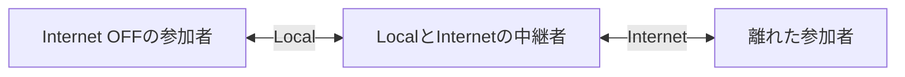

# 通話を始める・続ける・終える

このマニュアルは現在の画面と操作を説明する。Local、Internet、中継で音量やエフェクトの操作は共通。実機の音質・Bluetooth・画面ロックと実Cloudflare媒体は後続確認であり、自動テストの成功と区別する。

## 最初の準備

初期の標準表示は「ユーザー・設定」の2タブで、最初はユーザーです。グループを使うときは、設定 → 音声・接続の詳しい設定の「グループタブを表示」をオンにします。通話はタブではなく、相手やグループを選ぶとiPhoneではシート、iPad・Macでは右側に開きます。通話中に閉じた後は、タブバーの上の通話表示（Macはツールバー）から戻れます。切断すると一覧へ戻ります。通常グループの通話中は、メンバーの名前の下に「話しています」「接続中」「接続していません」と、その人の今の状態を表示します。ユーザーから相手を選ぶと個別通話、グループから選ぶとグループ通話の接続をその場で始め、通話の画面を開きます。通話中に別の相手やグループを選んでも、今の通話を開くだけで切り替えません。別の相手とつなぐときは、今の通話を切断してから選びます。新しいグループはグループタブの「新しいグループ」から名前と相手を選んで作成します。グループの名前・メンバー・削除は、通話の右上の設定のボタン（「グループの設定」）、または一覧の行の左へのスワイプから開きます（Macは右クリック）。メンバーは「グループの設定」で行をタップして開き、「グループから外す」で外せます。メンバーの招待は通話のメンバー一覧の先頭の「メンバーを招待」です。自分で作ったグループの削除は「グループの設定」の最後と、一覧の行の左へのスワイプにあります。招待から入ったグループは、設定の「グループから抜ける」を使います。相手の呼び名・削除は「相手の設定」です。通知の許可はOSの設定で変えます。行のタップは接続だけに使います。終了は通話の「通話を終了」。表示だけの切替や一覧の閲覧では終了しません。

設定の「画面表示」を「詳細」にすると、Users・Groups・Diagnostics・Settingsの4タブを使えます。詳細表示は常にGroupsを表示し、Callは両方の表示でタブにせずシート／右の列で開きます。以下の英語の操作名は両方の表示で共通する機能を示します。通信やcodecなどの詳しい設定は「音声・接続の詳しい設定」にあります。表示切替で現在の通話やマイクのミュートは変わりません。 標準表示の個人通話は相手名・通話操作・音量を表示し、メンバー一覧を出しません。通常グループは2人でもメンバー一覧を表示します。

| 操作する場所 | 操作 | 確認する結果 |
|---|---|---|
| 起動画面 | Sign in with Appleでログインする | メール・本名は要求しない。初回ログインにはInternetが必要 |
| OS | マイク・Local Networkなど、使用する機能の権限を許可する | 拒否した場合はCallのエラーとOSの設定を確認 |
| Settings → Audio I/O | Input / Outputを選ぶ。選択肢が複数ある場合だけPickerを表示 | AutoはOSの既定。接続中のBluetooth / 有線機器と希望が一致するか確認 |
| Settings → Audio Check | 通話接続がない状態でRecord 5s and Play | 5秒録音して再生。これは自端末の確認であり、相手までの通信試験ではない。標準表示は操作と結果の文だけで、録音・再生に使う機器、ミュート、meterは詳細表示で確かめる |
| Audio Check実行中 | Stop Audio Checkで中断できる | 再実行可能。Connectを始めた場合も録音確認を終了する |
| Settings → Communication | Local Network / Internetを選ぶ | 既定は両方ON。最後の1経路はOFFにできない。変更は現在の接続を終了する |

Audio Checkが押せないときはCallでDisconnectする。Groupsへ戻るだけでは通話は終わらない。設定の具体的な効果は[設定と音声効果](設定と音声効果.md)を参照する。

## 通話の呼び出し通知を使う

通知は通常のAPNsとUserNotificationsを使います。CallKit・VoIP Push・AppleのPushToTalk frameworkは使いません。最初に起動したときにOSが1回だけ許可を聞き、許可するとサインインの後にこの端末が自動で登録されます。通知のオン・オフはiPhoneの「設定」の通知（RideCom）で変えます。アプリの中に端末や相手ごとの通知の切替はありません。

個人で登録した相手は全員、通知を送ってよい相手として扱います。相手に送るための許可は、直接の招待で互いの登録が済んだときに交換します。圏外などで交換できなかった場合も相手の登録は残り、最初の1対1の接続で交換し直します。通常のグループで見えただけの相手には通知しません。

受付済みでも相手への到着・応答は未確認です。通知が届いただけでは、通話やマイクは始まりません。通知を開くと、通話中は送り主を確認せず今の通話が表示されます。未接続なら期限と許可を確認して接続します。期限切れや圏外などで送り主を確認できないときは、ユーザー一覧が開きます。通話中（接続待ち・音声の一時停止を含む）にアプリが前景なら、通知センターへ残して音とバナーを出しません。背景でも同じように静かにする対応は残っています。実際のOS表示・配送は[未確認事項](../validation/未確認事項.md#通常通知の受入)で区別します。

OSで通知をオフにした後は、アプリが次に前面へ戻ったときなどに端末登録を取り消します。通信できずに取消が失敗した場合も、前面復帰で自動で再試行します。相手を削除すると、この端末で発行したその相手の既知の許可も取り消します。他の本人端末が別に持つ許可の同期は未提供です。

通知は本体のタップ、または長押しの「接続」でアプリが開きます（ロック中は解除の後）。入らないときは「無視」か、何もしません。どちらも送り主には何も伝わりません。Apple Watchの通知の「接続」はWatch Appを開き、Watchからそのまま入る操作はまだありません。Watchで登録済みの通話先を選ぶと、iPhoneの通話処理へWatchのマイク・スピーカーを接続します。マイクは「押して話す」のパネルを押している間だけ送話します。指を離す・画面消灯・中断・切断ではマイクが閉じ、復帰だけでは開きません。切断は画面左上のボタンから確認して行います。実Watchの音声・背景起動は実機での受入が残ります。

## アクセスポイントもセルラー電波もない場所で使う

事前にAppleログインを完了し、同じグループの招待・鍵を共有しておき、Local NetworkをONにする。Wi-Fiアクセスポイントへの接続、テザリング、セルラー契約や電波は近距離通話の必須条件ではない。端末の設定ではWi-Fi機能をONにし、近くの端末間で通信できる状態にする。Wi-Fi機能を完全にOFFにしたBluetooth単独の音声通話には対応していない。近距離で通話する端末は、すべて近距離通信方式の更新後の版を使う。近距離Wi-Fiの探索・待受にも電力が必要であり、通話を停止するとその資源を解放する。

セルラーが使える場所でも音声は近距離を優先する。近距離で全員へのUDP送信を受け付けられる場合はInternet音声コピーを省く。遠隔参加者やLocalが送信できない相手がいればInternetも使う。InternetをONにしている間の参加者探索・制御通信までゼロになるわけではない。実機での距離・障害物・移動・画面ロック中の品質は[未確認事項](../validation/未確認事項.md)を参照する。

## グループを作る・参加する

以前の版で作った招待が開けない場合は、現在のアプリから新しいInviteを共有する。保存済みの相手との不一致が表示されたときは本人を確認し、古い項目の削除や呼び名の整理を行ってから新しい招待を受け取る。一覧からの削除で既存グループや通話は消えない。招待リンクは参加してほしい相手だけへ渡す。

| 場面 | 操作と挙動 |
|---|---|
| 自分で作ったグループを削除する | グループの行を左へスワイプ（Macは右クリック）して「削除」。設定画面の「グループを削除」からも同じ結果になる。確認を取消すとグループと通話を保ち、確定するとこの端末の一覧から消す。接続中なら切断する。招待から入った人は設定の「グループから抜ける」を使う。他端末への削除の同期は未実装 |
| 新しく始める | グループタブの＋（新しいグループ）を押し、名前と必要なユーザーを選んで「作成して接続」。作成と同時に接続し、通話を表示する |
| 保存済みユーザーと別グループを作る | 利用権があるときにGroups → New Groupでグループ名を入力し、「あなたのユーザー」で相手をタップして選び（印が付く）、下の「作成して接続」を押す。下に「自分を含めて{n}/8人」と人数が出る。同じ本人と確認済みの相手は、複数端末でも1人として数えます。最初から「グループ ABC123」のような名前が入り、そのまま作れます。好きな名前に変えても、メンバーの選択で上書きされません。消して空のまま作成すると、その画面の生成名を使います。続けて表示される「招待」でグループ名と相手ごとの状態を確認します。確認済みの相手へは自動配送し、相手が保存すると「受け取り済み」になります。必要なら招待を共有できます。共有せず完了しても保存済みです |
| 新しい相手をグループへ招待する | 標準表示はグループの作成、または通話やグループ設定の「メンバーを招待」から「新しい人を招待」を選びます。詳細表示は通話の「…」のAdd Saved Users、Group SettingsのAdd Members、または新規作成からInvite Someone Newを選びます。名前を入力し、作成または「招待を保存」を押します。空欄なら仮名の候補を使います。保存後の同じ画面で相手を開き、参加先を確認して「招待を共有」。共有を取り消しても名前と招待は残り、完了で閉じてもUsersの同じ人かグループ設定の招待中の行から続けられます。相手は1つの招待の登録で、あなたとグループをまとめて保存します。返信を確認するまで送った側は招待中です。受取側がグループから抜けると、そのグループへの未完了の返信は停止します。相手の登録と個人通話は残り、古い招待ではグループを戻しません。参加し直すときは新しい招待を受け取ってください |
| 保存済みユーザーを追加する | 標準表示は通話の「メンバーを招待」、詳細表示は通話のメニューのAdd Saved Usersから相手を選ぶ。利用権がある場合はグループの設定からも開けます。入力中に利用権が切れたときは、入力を保ったまま設定の「利用権」を確認する案内が出ます。行のタップは選ぶだけで、ここでは名前の編集・削除をしない。標準表示は下の「招待を保存」、詳細表示はツールバーのAdd Usersを押す。保存後の「招待」で対象グループ名と相手ごとの状態を確認します。確認済みの相手には自動配送し、相手側の保存確認で「受け取り済み」になります。許可未交換なら次の接続を待ち、旧形式の相手には「招待の共有が必要です」と表示します。必要なら共有でき、共有を取り消しても保存状態は変わりません。「完了」で閉じられます |
| グループからメンバーを外す | グループの設定でメンバーの行を左へスワイプ（Macは右クリック）し、利用権がある場合に出る「外す」を確定します。確認中に利用権が切れたときは、設定の「利用権」を確認する案内が表示され、メンバーは残ります。保存できたら設定を閉じて構いません。受信箱に残る自動配送の取消が始まり、圏外などでは次の同期で続けます。取消が先に反映された招待は、送信が遅れた場合も相手の取得結果から外れます。取得後でも、受取確定前に取消が反映されれば相手の一覧には追加されません。この端末ではその人の音声が止まり、再接続しても一覧には戻りません。残りのメンバーとの通話は続き、ユーザー一覧の登録も残ります。ほかの端末への除外の同期は未実装です |
| 自分の名前を決める | 初回はサインイン直後の「あなたの名前」に入力して「はじめる」。後から変えるときはSettings → Your Display Nameへ入力してSave Name。招待と接続中の相手へ伝わり、通話は切れない |
| グループ内の相手の名前を変える | 標準表示はCallの相手の名前、詳細表示はGroupsの対象グループの詳細から名前を編集。本人名を確認しながらこの端末の呼び名を変えられ、Use Shared Nameで戻せる。直接招待関係がなければそのgroup内だけの変更で、ユーザー一覧への登録はしない |
| ユーザーの表示名を変える | Usersの行を左へスワイプ（Macは右クリック）して「相手の設定」を開き、「この端末での名前」を編集して保存する。下に「本人の名前」も表示され、編集した名前はこの端末の一覧と保存グループへ反映する。標準表示では欄を空にして保存すると本人の名前に戻り、詳細表示ではUse Shared Nameで戻せる。直接招待した・された相手はグループを削除しても残る。他の参加者はユーザー一覧に登録されない。本人確認済みの同じ相手を別端末から直接招待した場合は、一つの項目にまとめて呼び名を維持する |
| 保存ユーザーを削除する | Usersの行を左へスワイプして「削除」（Macは右クリック）、または「相手の設定」の最後の「ユーザーを削除」。その相手との個別の通話も一緒に消え、話している最中なら切れる。相手が入っているグループはそのまま残る。削除した相手との古い招待や返信はこの端末で停止する。再登録するときは新しい招待を共有する |
| 保存済みgroupへ入る | 未接続なら標準表示・詳細表示ともGroupsで行を選ぶと接続を始める。相手の認証後に音声を開始する。別の通話中なら今の通話を開くだけ |
| 招待する | 標準表示はCallのInvite、詳細表示はGroupsの対象グループの詳細からInviteを開き、OS共有画面で同じgroupの招待URLを相手へ渡す |
| 招待を受ける | 端末で招待URLを開く。形式・期限を検査しgroupを保存して選択。別group通話中ならその通話を維持し、新groupは閲覧状態になる |
| 切断後に入り直す | 一覧で同じグループの行を選ぶと、その場で接続を始める |
| 別groupの設定を見たい | Groupsへ戻り、その行を左へスワイプ（Macは右クリック）して「グループの設定」を開く。既存通話は続く。行そのもののタップは今の通話を開く |
| 通話先を変えたい | 今の通話を切断してから、別の相手・グループの行を選ぶ。接続中に別の行を選んでも切り替わらず、確認のダイアログも出ない |
| 終了する | 通話中groupのDisconnect。タブ移動・Groupsへの戻りとは異なる |

グループの鍵が見つからない場合は、Call上部の案内に従って有効な招待を開くか、新しいグループを作る。古いグループの鍵を自動で推測して接続することはない。鍵の保存失敗や不正な招待もCall上部に表示する。

招待URLはgroupの秘密情報を含む。公開投稿せず、参加者へ共有する。group招待とInternet用の端末資格は別物である。

## 保存した相手と個別に話す

ユーザーの＋で「相手を追加」を開き、名前を入れて「保存」を押す。空のままなら薄く見えている仮名の候補になる。保存までは名前や招待を作らず、「キャンセル」で戻れる。保存後は同じ画面に確定した名前と「未登録」が表示される。共有せず「完了」で終えても、一覧に同じ相手が残る。

招待するときは、その相手の詳細の「招待を共有」からOSの共有先を選ぶ。共有画面を何もせず閉じても、コピーしても、同じ保存済み詳細に戻る。共有操作だけで相手への到着や登録を表示せず、相手の受諾を確認するまでは「未登録」のまま。期限内は同じリンクを使い、期限切れなら次の共有で新しいリンクを作る。名前と人のIDは保持する。「完了」で一覧へ戻り、未登録の同じ行から再び共有できる。名前の編集・削除はその相手の設定で行う。

受け手はリンクを開いて本人名を確認し、「登録」で相手を保存し、同じ画面に登録済みの詳細が表示される。「拒否」は保存せず閉じるだけで、相手へ拒否を知らせない。リンクが残っていれば期限内に開き直して登録できる。登録は通常通話・ミュートを変えず、返信を開始する。作者は検証済み受諾で同じ相手を登録済みに更新する。開いている詳細を勝手に閉じたり、同じ人とは別に返信待ちの行を残したりしない。返信の配達確認がまだの場合は、その人の詳細内で配送状況を扱う。共有先アプリから戻った場合も同じ詳細を保ち、同じ招待の返信試行を再開する。

登録後に返信が届かない場合は、その場の「返信を共有」から共有先を選べる。インターネットや通常通話を始める必要はなく、共有を取り消してもコピーしても同じ詳細に戻る。「完了」で終えても、相手の設定から再び共有できる。元の作者が返信リンクを開くと同じ人が登録済みになる。作者に表示される「到着確認を共有」を返し、受け手が開くと返信待ちが解消する。通常の近距離交換では到着確認を自動で返す。共有操作だけで相手に届いたとは表示しない。

保存された未配送の返信が期限切れになった場合は、相手の詳細・設定に期限切れと新しい招待の案内が出る。期限切れの返信は再送・共有できない。登録した相手やこの端末での呼び名、通話はそのまま保つ。

空欄で採用した仮名と本人の名前が異なる場合は、同じ相手の詳細・設定で、どの名前を使うか選べる。「本人の名前を使う」は本人の名前の更新に追従し、「この呼び名を使う」は今の呼び名を保つ。どちらもその場で保存し、画面は閉じない。設定は「完了」で閉じる。新しく入力を編集すると「保存」が戻る。選ばず閉じても後で続けられ、通話を始めるために選択する必要はない。手入力した呼び名や、由来が分からない旧データは無断で変えない。

登録済みになったらUsersで相手を選ぶと、その場で個別通話への接続を始める。相手も自分のUsersから同じ相手を選び、同じ場所に入る。新しく接続を始めると、相手から受け取った許可があれば通知を1回だけ添える。通知の到着や相手の参加は保証しない。別の通話中に相手を選んでも今の通話を開くだけで、別の通話を始めるには切断してから選ぶ。

個別通話のタイトルは相手名で、内部グループの作成・選択は不要。3人以上で話す場合は通常のグループを作る。個別通話の参加者追加・削除は行わない。Usersから相手を削除すると、その相手との個別通話も消え、進行中なら切断する。通常グループは保持する。

双方がInternet Connectionでアカウント確認済みなら、同じ相手の別端末でも同じ通話先を使う。新しい端末には招待を共有する。保存内容や鍵の自動同期は行わない。確認済みの端末同士は圏外でも再接続できるが、新しいアカウント宛て招待で確認を求められた場合はInternet Connectionから更新する。自分の別端末はUsersの個別通話先に表示しない。Internet接続からサインアウトしても、同じAppleアカウントへ再ログインすれば保存済みの個別通話をLocalで再利用できる。Internet接続や新しいアカウント宛て招待には、Internet Connectionで再確認する。本人の確認情報がない場合は相手を選んでも別の通話先を作らず、確認を案内する。

個別通話の招待は、この機能に対応した版同士で使用する。招待を別の人が開いた場合は参加を拒否する。両方が先に通話を作り、招待の共有を求める案内が出たら、標準表示は案内と同じ箇所の「招待を共有」を押す。詳細表示は個別通話の「…」またはUser SettingsのShare Call Inviteを使う。案内が出た側から共有し、相手の端末で開く。接続中の鍵を変更する案内が出た場合は、Disconnectしてから相手の招待を開き直す。

## 再登録後に以前のデータが残っているとき

Set Up Your Account Againが表示されたら、以前のアカウントの保存ユーザー・グループ・設定・鍵がこの端末に残っている。Remove Previous Account Dataから内容を確認し、Remove Dataで取り除く。新しいアカウント、Apple連携、購入は保持される。この整理にInternet接続は不要で、失敗したら画面から再試行できる。

完了後はReturn to Sign Inへ進み、ログインとInternet Connectionの再設定を行う。友達とは新しい招待でつながり直す。今は整理しない場合はCancelまたはSign Outを使えるが、同じ本人で再開する前に整理が必要になる。

## 通話中の操作

| 操作 | 相手や通信への影響 |
|---|---|
| InputのMute | 自分の音声送信を止める。自端末が担当する他者の中継は維持 |
| OutputのMute | 自分に聞こえる音を止める。自分のマイク送信とは独立 |
| Output Volume | 自分が聞く全員の音量を調整。OSの音量ではない |
| 参加者のOutput | その相手だけ自分に聞こえる音量を調整。相手の端末音量・他の聞き手には反映しない |
| Standardの相手の声を分離／受信する声を分離 | 自分が聞く声に適用する |
| AdvancedのIsolate This Voice／Isolate All Received Voices | それぞれ該当する相手／受信全体の再生に適用する |
| SettingsのTransmit Voice Isolation Effect | 自分から送る音声へ適用。対応環境でのみ表示 |
| 参加者Delete | 通常グループのみ。ローカルの保存メンバー表示を削除する操作。ネットワークのアクセス禁止・資格失効ではなく、再度presenceを受ければ現れ得る |
| GroupsのDelete | 保存groupとこの端末のgroup鍵を削除し、保存ユーザーは保持。active groupを削除するとその通話を切断 |

## Local / Internet / 中継の考え方

| 変化 | 期待する動作と制約 |
|---|---|
| 全員が近い | Localの到達経路を使う |
| 一部が離れる | Internetや近くの中継者を通る経路があれば通話を維持。切替時の短い音声欠落はあり得る |
| 自分のInternetがOFF | 自端末のサービス接続を止める意味。近くの人を経由した遠方との通話まで禁止する意味ではない |
| 中継者がMute / 音声機器を失う | その人の送受話は停止しても他者の中継は維持 |
| 最後の中継者が切断 / 圏外 | 分断した側同士の通話は不可能。各側の残る経路で継続し、復帰を待つ |
| 一部Internet接続が失敗 | 正常なLocal通話を巻き込んで切らず、理由を表示して再試行 |
| Local / Internetの設定を手動変更 | 自動的な経路復旧とは異なり、現在の接続を終了。Connectで再接続する |

中継する端末の電池・通信量を使う。経路表示はその端末の接続概要であり、全員への直接接続や全員が聞けた証明ではない。[状態の見方](状態の見方.md)と[通信仕様](../spec/App/通信仕様.md)を参照する。

## Bluetooth・有線機器が外れた場合

使用中の機器が失われるとAudio Pausedを表示して自分の入力・出力を停止する。意図せずスピーカーへ会話を流さないため、機器が戻っただけでは自動再開しない。出力先を確認し、認証済みの相手がいる状態でResume Audioを押す。失敗理由が残る場合は[切り分け](困ったとき.md)へ進む。接続・中継は停止中も維持し、マイク・出力muteの選択も保持する。

## Internetを初めて試す

| 担当 | 手順・完了条件 |
|---|---|
| サービス運用者 | [Workerの初期設定と試用](../spec/server/Worker.md)に沿ってSFU App、Worker、利用枠、個別端末資格を準備。秘密はWorkerに置く |
| 各利用者 | Settings → Configure Internet ConnectionでWorkerのHTTPS originと、その端末のDevice access tokenを保存。保存成功時は現在の通話を終了 |
| 各利用者 | Diagnostics → Check Internet Serviceで認証と利用枠を確認。Authorizedだけでは音声・SFU接続成功ではない |
| 全参加者 | 同じgroup招待で参加し、互いの声を確認する。Internetのみを試すならLocal NetworkをOFFにして再接続 |
| サービス運用者 | [費用試算](../development/Cloudflare費用試算.md)と実際の使用量を比較。参加者秒の予約上限は請求額の厳密な上限ではない |

端末資格はKeychainへ保存し再表示しない。失効は運用者側で行う。公開向け本人確認・abuse対策、実アカウントでの請求確認は未完了である。TURN資格はWorkerで有効化すると自動取得・更新される。実TURN・制限回線での通話確認は未実施。準備は[Worker手順](../spec/server/Worker.md)を参照する。

## 保存と招待でエラーが出たとき

グループは自分を含め8人まで。同じ本人と確認できた相手は、端末が複数あっても1人として扱う。今の端末が参加中はその接続を保ち、離脱後に別端末で本人確認ができたら表示を引き継ぐ。満員の場合は不要なメンバーを外してから別の人を追加する。groupを削除しても、他の端末へ配った招待や相手の鍵を失効させる操作にはならない。

保存データを読めない場合は元データを上書きせず、Groups上部へ案内を表示する。通話をDisconnectしてReload Saved Groupsで再読込する。破損が続く場合はReset Saved Groups…の内容を確認して初期化できる。元データの退避に成功した場合だけgroupとその鍵を消去し、rider identity・音声設定・Internet資格は保持する。新しい招待が必要になるため、迷う場合はCancelして[切り分け](困ったとき.md)を確認する。新しい版の保存形式を旧版でresetすることはできない。音量メーターや通話中の接続・認証状態は保存されず、再起動後は未接続状態から始まる。

通話中のgroupの鍵を変更する招待は受理しない。Disconnect後に招待を開き直す。同じ鍵の招待をもう一度開いても参加者一覧は初期化されない。

## ログインとサインアウト

すべての通話にAppleログインが必要。保存済みのログインがあれば圏外でも近距離通話を使える。Appleの資格取消を確認した場合は通話を終了し、再ログインを案内する。ログイン前に開いた招待は、ログイン後に処理する。

Settings → Account → Sign Outからサインアウトできる。確認して実行すると進行中の通話も終了する。保存ユーザー・グループはこの端末に残り、同じApple Accountでログインし直すと利用できる。別アカウントには表示しない。これは端末のサインアウトであり、アカウント削除・Appleとの連携解除・購入の解約ではない。

保存資格を読み出せない場合は元データを残してTry Againを表示する。資格保存に失敗した場合はログインを完了せず、再操作を案内する。

### アカウントを削除する

Settings → Account → Delete Accountで範囲を確認する。確定すると通話を終了し、この端末の本人の保存ユーザー・グループ・設定・鍵を消去する。接続済みInternetサービスの本人の全端末登録と稼働中のInternet通話も削除対象になる。他のユーザーの通話は終了しない。

Appleで再確認して認可取消まで行うか、Apple側を後で手動解除する方法を選ぶ。Internetをサインアウト済みの場合も最後の登録は削除対象として残り、その削除にはAppleでの再確認が必要になる。通信失敗、Apple認可取消待ち、Internet通話の回収待ちは完了と表示せず、Retry Deletionで続ける。アプリを再起動しても未完了の削除へ戻る。必要な処理が終わるとReturn to Sign Inが表示される。

他の端末内のオフラインデータ、他人へ共有済みのグループ情報、未接続のサービス登録や購入の解約を同時に消す操作ではない。確認画面の範囲を確認する。詳細は[アカウント削除](../spec/App/UI/Settings.md#アカウント削除)を参照。

## 最近の通話へ戻る・ショートカットから操作する

標準表示では、接続していないときにユーザー一覧の先頭の「前回の接続先」から「もう一度接続」を選べる。最後に相手の認証と音声の準備が成立した通話先を1件だけ保持し、呼び出しの試行では更新しない。削除した相手やグループは再開先に出さない。音声設定や表示を変えても保持し、アカウントの端末内データ消去で消す。

ショートカット向けにはStart a call（保存した相手・グループ）、Resume recent call（直近）、End current call（現在通話の終了）、Set microphone mute（マイクのミュートを設定）を公開する。アプリを前面へ開き、端末認証と現在のAppleログインを使用する。別の通話中に外部から開始した場合は先に現在の通話を終了する。開始の応答は接続の開始を意味し、相手への通知や相手の応答完了を意味しない。OS・Siriでの受入状況は[検証](../validation/README.md)を参照する。

ミュート操作ではON／OFFを指定する。同じ値で繰り返しても反転しない。ショートカットに値を保存していない場合は、実行前にミュートするか確認する。通話していない場合は次の通話用のマイク設定を変更し、この操作だけで通話や録音を開始しない。ミュート解除の応答は設定変更を示し、マイク権限や実際の音声接続の成立を示すものではない。

## Widgetから通話する

Selected call Widgetを追加し、Widgetの編集で保存済みユーザーまたはグループを選びます。Start callから現在のログインと設定先を確認して開始します。設定先への通話中だけミュートと切断のボタンを表示します。ミュートは1つの切替で、ミュート中は赤く塗られ「ミュート中」と表示します。もう一度押すと戻ります。切断は右端の円で、赤い記号で表します。別の通話が続いている場合は、その通話を終了してから開始してください。候補がない、または相手を削除した場合は別の通話を操作せず、Widgetの設定で保存先を選び直します。直近の相手を使う操作はiPhoneのControlとSiri／Shortcutsにあります。ホーム画面のウィジェットで通話中のマイクを切り替えるときは、RideComを開き直す必要はありません。施錠中のウィジェット操作にはiOSの認証が必要です。ライブアクティビティとDynamic Islandでは状態が見え、本体をタップすると通話画面を開けます。

## 登録済みの相手をグループへ招待する

グループの「メンバーを招待」か新しいグループの作成で相手を選び、保存します。アカウントと確認済み端末がある登録済みの相手には自動で届けます。同じ画面で「招待中」を確認でき、相手の端末で受取が確定すると「受け取り済み」になります。「完了」で閉じても招待は残ります。個人招待の登録・返信で同じ相手と確認できた追加端末にも、元のグループ招待の期限内は自動で届きます。

グループが届いたことは音やバナーを出さず、通知センターに知らせます。通知の許可がなくても相手がRideComを開けば取得できます。オフラインや新しい配送許可をまだ交換していない相手には、次の接続・前面復帰などで再試行します。必要なら「招待を共有」も使えます。旧形式の相手には共有が必要です。受取が確定すると一覧に追加します。通信断などで確認が中断したときはアプリを次に開いたときなどに続けます。招待を受け取っただけでは通話を始めず、現在の通話も切り替えません。新しい人への名前付きの招待は、保存後に相手ごとの詳細から共有してください。

グループタブを表示していない場合は、招待の操作を終えてユーザー一覧へ戻ると、一度だけ表示を案内します。「表示する」でグループ一覧へ進めます。「今はしない」を選んでも受け取ったグループは保存され、別のグループが届くまで案内しません。通話は自分で相手・グループを選んだときに始まります。

招待画面を完了した後も、グループの設定でメンバーの招待状態を確認できます。招待中と相手の受取確定後の「受け取り済み」を区別します。詳細表示では同じ配送記録の値を表示します。新しい相手の招待中の行からは、同じ人の詳細を開いて共有を続けられます。
