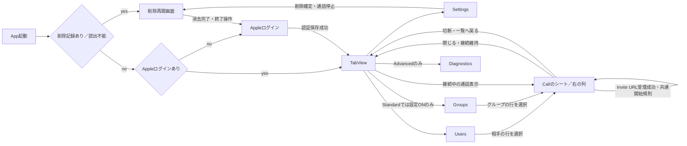
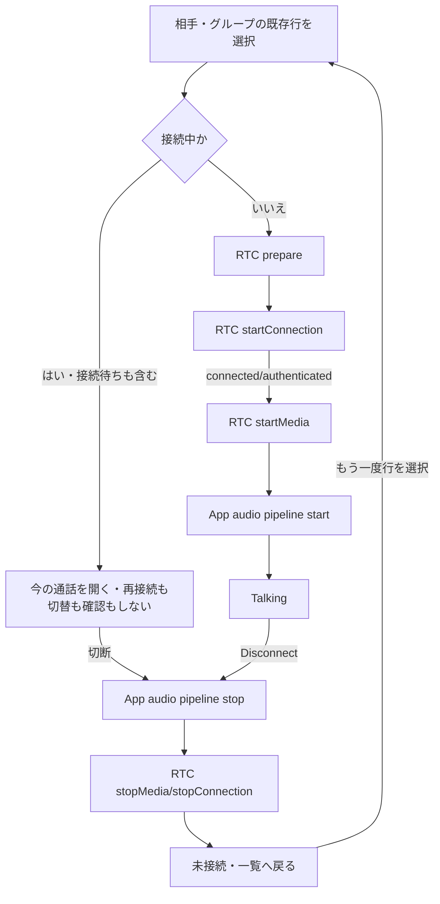
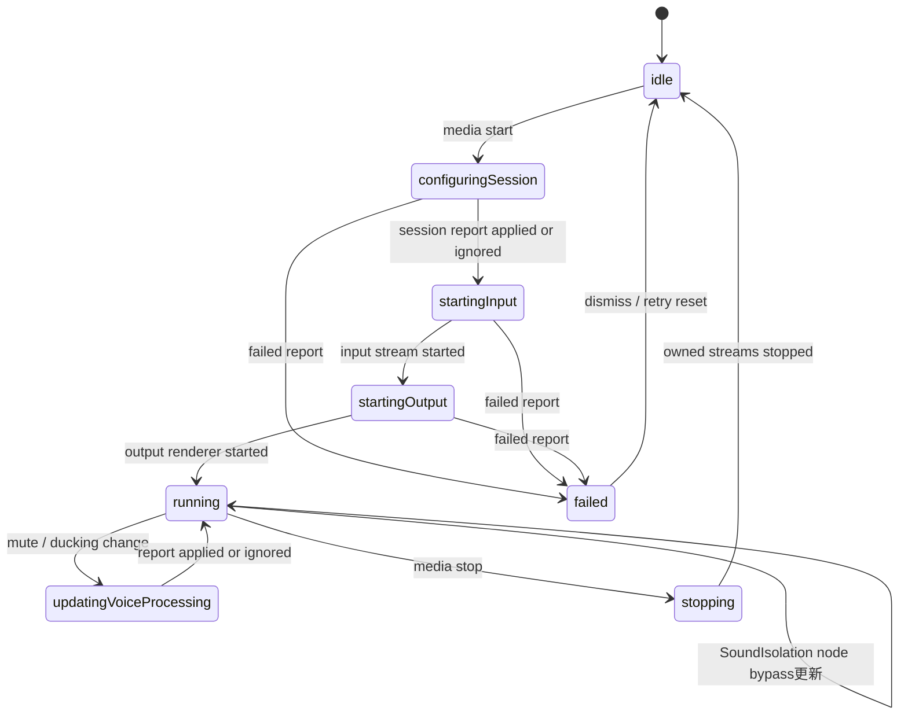
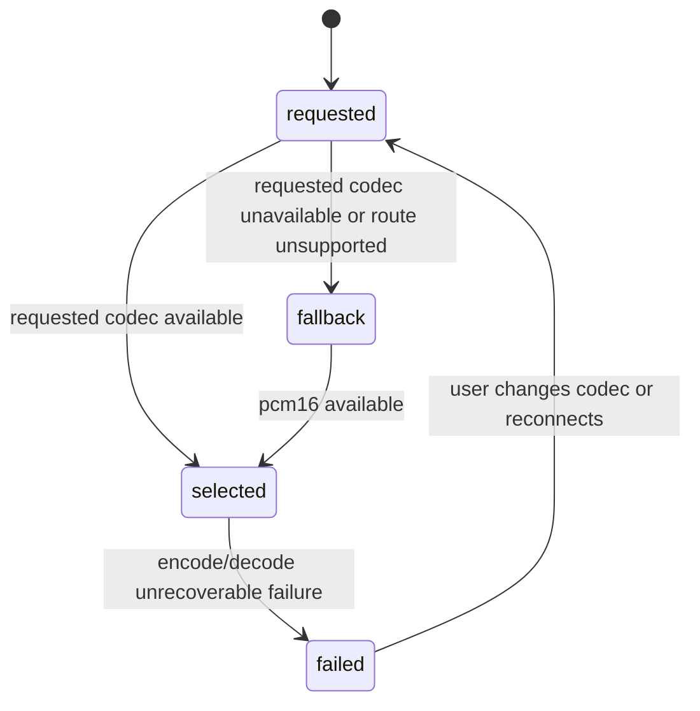
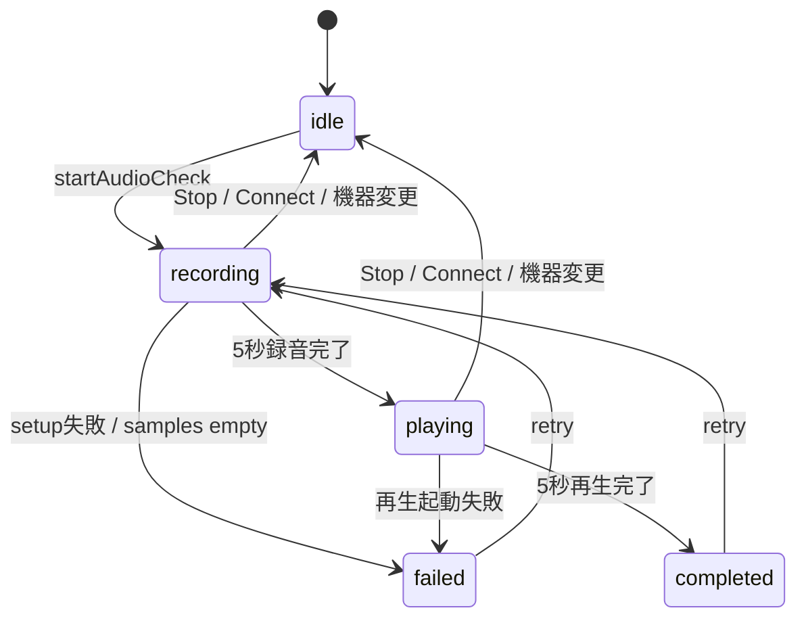
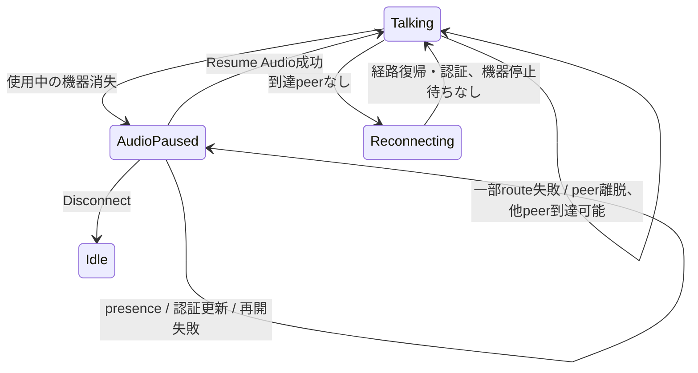

# RideCom 画面・状態遷移

## 目的

本書は、現行のRideCom App の画面遷移と主要状態遷移を定義する。

RTC、SessionManager、Codec、Mixer の内部状態は各 package 仕様を正とし、本書では App が UI 表示へ要約する状態だけを扱う。

## StandardとAdvancedの選択

初期のStandardはUsers / Settingsで、Groupsは`showsGroupsTab`がONのときだけ表示する（既定OFF）。AdvancedはUsers / Groups / Diagnostics / Settingsを常に表示し、最初は両モードともUsers。通話はタブではなく、選んだ接続先を`inspector`で開き、切断で閉じて一覧へ戻る。相手・groupの既存行選択は`openDestination`で、待機中ならその場で接続を始めてCallへ移る。現在の通話先なら再接続せずにCallへ戻り、別の通話中なら今の通話を開くだけで置き換えない（確認は出さない。別の場所へは切断してから選ぶ）。新group作成の確定と招待URL受理は既存の共通開始規則を使う。Settingsの表示切替では通話状態を変えず、切替後に存在しないタブ（標準表示での診断、非表示のGroups）だけUsersへ移す。

認証・削除復旧のroot分岐、一覧選択と通話の表示・開始は両モードで共通とする。compact幅のiPhoneでは`sheet`、regular幅のiPad・Macでは`inspector`を使い、Callはタブに置かない。

## 画面遷移

## Call 操作遷移

| 状態 | UI 表示 | package 対応 |
|---|---|---|
| Prepared | 未接続。既存行の選択で接続開始。開始失敗時は理由と再試行を表示し、別の接続中には置き換えない | RTC request を組み立て可能 |
| Connecting | 接続準備中 | `CallSession.startConnection` 実行中 |
| Connected / Control Only | control plane 成立、media 未開始 | RTC connection 成立、media 未開始 |
| Starting Media | 音声開始中 | RTC `startMedia` と App audio pipeline start |
| Talking | 通話可能 | RTC media と App audio pipeline running |
| Reconnecting | 復旧中 | RouteManagerの到達経路再試行。残る経路は維持 |
| Failed | 再試行可能な失敗 | RTC / SessionManager / Codec の failed report |

## Audio pipeline 状態

| 状態 | App の扱い |
|---|---|
| `configuringSession` | `AudioSessionManager.configure(_:)` と `setActive(true)` の report を保持する |
| `startingInput` | `AudioInputStreamCapture.start()` の report を保持する |
| `updatingVoiceProcessing` | `AudioInputStreamCapture.updateVoiceProcessing(_:)` を呼び、入力 stream は止めない |
| `startingOutput` | `AudioOutputStreamRenderer.start()` の report を保持する |
| `failed` | Call の音声エラーと Diagnostics に表示し、ログへ記録する |

## Codec 状態

| 状態 | UI 表示 |
|---|---|
| requested | Settings の選択値 |
| selected | Diagnostics の Codec 行 |
| fallback | requested と selected を分け、理由を表示 |
| failed | codec error として Diagnostics とログに残す |

## AudioCheckPhase

## 補助状態

| 状態 | 遷移概要 |
|---|---|
| `selectedGroup` | `nil` なら Groups 画面、非 `nil` なら Call 画面 |
| `activeGroupID` | RTC 接続中または接続準備中の group ID |
| `audioCheckOwnsAudioPipeline` | 通話未開始時に Audio Check が一時的に audio pipeline を所有し、完了/失敗時に解放 |
| `isOtherAudioDuckingActive` | Duck Other Audio 設定 ON かつ可聴な受信音声が最終出力へ渡っている間だけ `true` |
| `selectedCodec` | `preferredTransmitCodec`、`CodecRuntimeReport`、route capability から決まる実 codec |

## 実装トレーサビリティ

| 遷移対象 | 参照先 |
|---|---|
| 画面遷移 | `docs/spec/App/UI/共通画面遷移.md` |
| 通話/通信状態 | `docs/spec/App/通信仕様.md`、`docs/spec/packages/RTC.md` |
| 音声状態 | `docs/spec/App/音声処理仕様.md`、`docs/spec/packages/Audio/SessionManager.md` |
| codec 状態 | `docs/spec/App/Configuration/Bindings/Audio/Codec.md` |

## 復旧時に固定した遷移

| 起点 | 操作 / イベント | 到達状態 |
|---|---|---|
| A通話中 | Bを選択 | B閲覧、A通話継続 |
| B閲覧、A通話中 | Connect | A停止・旧通知無効化、B接続開始 |
| Audio Check recording / playing | 通話media開始 | Checkをidleへ戻し所有資源を停止後、通話開始 |
| media開始途中 | input / output / Mixer失敗 | 音声資源解放、error表示、再試行可能 |
| 切断後 | 旧timer / 旧通知 | 現在の状態へ反映しない |

Diagnosticsのgraphとeffect chainは実Mixerだけを表示する。未開始なら空、未接続effectは稼働中と表示しない。

## 機器と混在経路の遷移

AudioPausedでもRTC接続と他者の中継は続く。再開時も入力muteと出力muteの意図を保持する。Audio Check中の機器消失はCheckをidleへ戻し、古い完了callbackを破棄する。
