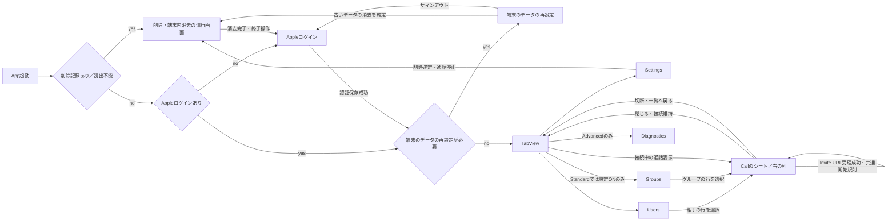
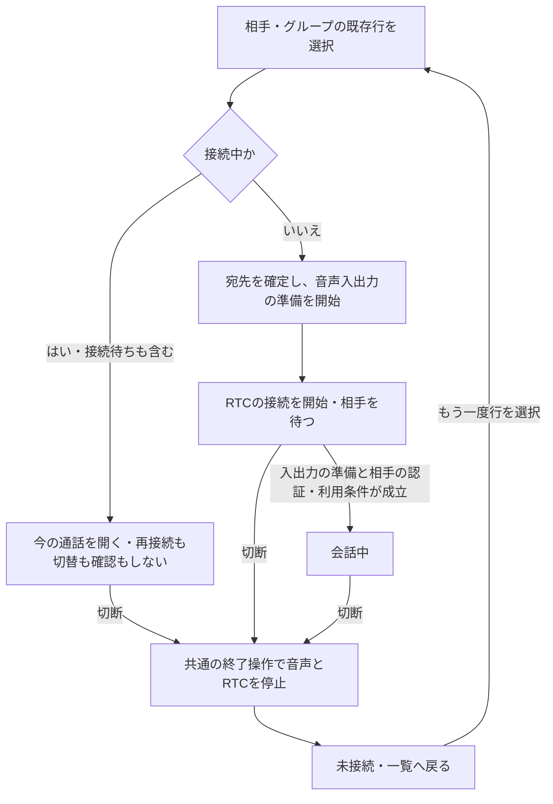
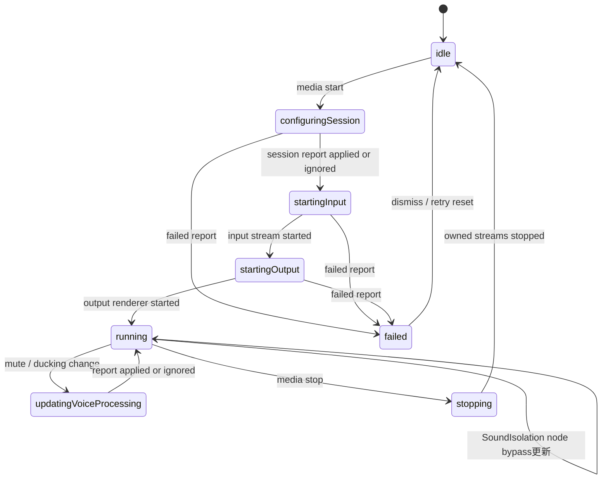
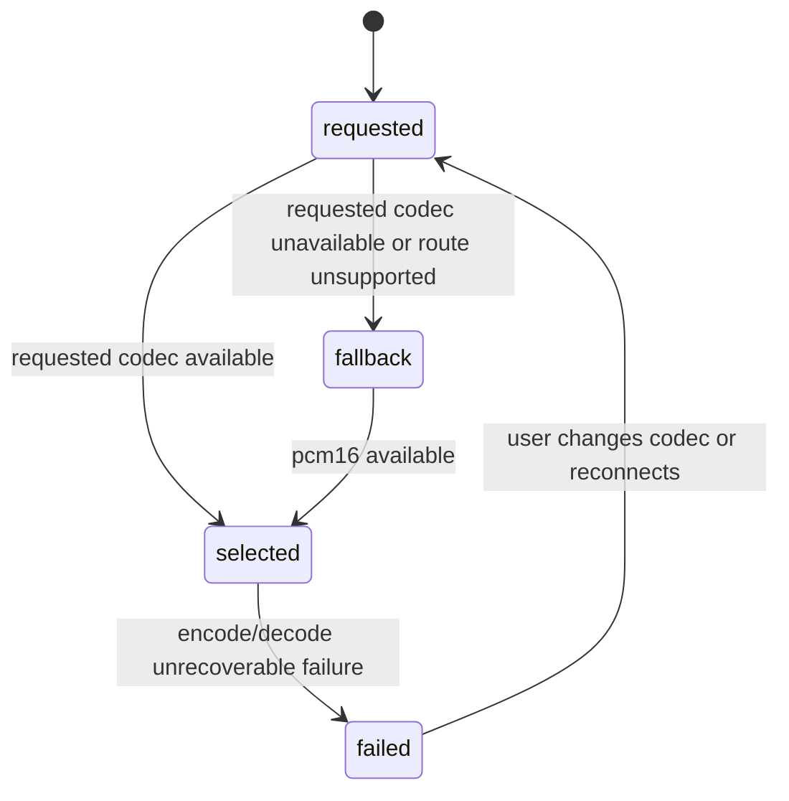
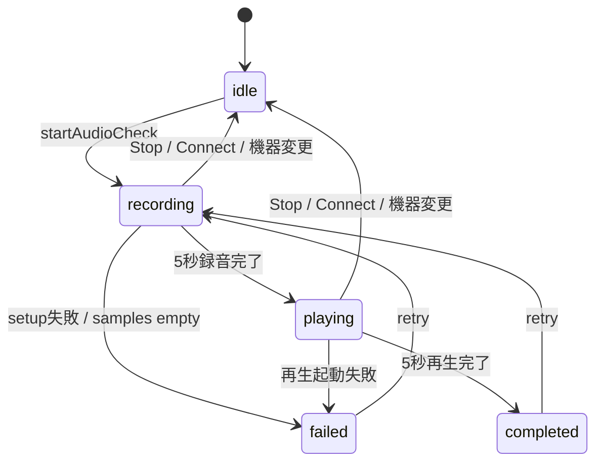

# RideCom 画面・状態遷移

## 目的

本書は、現行のRideCom App の画面遷移と主要状態遷移を定義する。

RTC、SessionManager、Codec、Mixer の内部状態は各 package 仕様を正とし、本書では App が UI 表示へ要約する状態だけを扱う。

## StandardとAdvancedの選択

初期のStandardはUsers / Settingsで、Groupsは`showsGroupsTab`がONのときだけ表示する（既定OFF）。AdvancedはUsers / Groups / Diagnostics / Settingsを常に表示し、最初は両モードともUsers。通話は接続先を選んで開き、切断すると一覧へ戻る。相手・groupの既存行選択は`openDestination`で、待機中ならその場で接続を始めてCallへ移る。現在の通話先なら再接続せずにCallへ戻り、別の通話中なら今の通話を開くだけで置き換えない（確認は出さない。別の場所へは切断してから選ぶ）。新group作成の確定と招待URL受理は既存の共通開始規則を使う。Settingsの表示切替では通話状態を変えず、切替後に存在しないタブ（標準表示での診断、非表示のGroups）だけUsersへ移す。

認証・削除復旧のroot分岐、一覧選択と通話の表示・開始は両モードで共通とする。compact幅のiPhoneでは`sheet`、regular幅のiPad・Macでは`inspector`を使い、Callはタブに置かない。

通話画面を閉じる操作と終話は、どちらも直前に選んだタブへ戻る。閉じる操作では接続を保つ。戻り先のGroupsを非表示にした場合はUsersへ戻る。別の宛先を表示したあとで通話アクセサリを押すと、一覧から今の通話を開くときと同じ `showLiveCall()` で進行中の通話先を選び直す。再接続は行わない。同じ宛先を表示中なら、現在の選択と案内を保って開く。

## 画面遷移

## Call 操作遷移

| Standardと通話アクセサリなどが使う状態（`StandardCallStatus`） | 表示と条件 |
|---|---|
| `chooseDestination` / `ready` | 通話先が未選択、または表示先に進行中の通話がなければ「未接続」。未選択だけの画面はStandardに置かない |
| `connecting` | 通話の要求があり、音声の停止・失敗に該当せず、成立条件が揃う前は「接続中」。通信経路や制御接続が成立しても、相手が通話に参加するまでは待機 |
| `inCall` | 音声入出力の準備が済み、認証済みで有効な参加者がいて、適用される利用条件が成立したときは「会話中」 |
| `audioPaused` | 通話は続いていて、機器消失や音声中断などで音声を止めたときは「音声停止中」。音声の再開条件は[機器と混在経路の遷移](#機器と混在経路の遷移)を参照 |
| `audioUnavailable` | 音声の準備が失敗し、理由がある場合は「音声エラー」。機器・録音許可などの理由を確認できる |

経路の制御接続・媒体の準備・経路の再試行は[RTCの状態](../../packages/RTC.md)と[接続状態の表示境界](../通信仕様.md#接続状態の表示境界)を参照する。表の状態は`IntercomViewModel.callStatus(for:)`が求める。AdvancedのCall見出しは`callPresenceLabel`と`routeLabel`で、経路・接続や音声の稼働を詳しく示す。[Callの表示仕様](Call.md#混在通話機器切断の表示)。

## Audio pipeline 状態

| 状態 | App の扱い |
|---|---|
| `configuringSession` | `AudioSessionManager.configure(_:)` と `setActive(true)` の report を保持する |
| `startingInput` | `AudioInputStreamCapture.start()` の report を保持する |
| `updatingVoiceProcessing` | `AudioInputStreamCapture.updateVoiceProcessing(_:)` を呼び、入力 stream は止めない |
| `startingOutput` | `AudioOutputStreamRenderer.start()` の report を保持する |
| `failed` | Call の音声エラーと Diagnostics に表示し、ログへ記録する |

## Codec 状態

| 状態 | UI 表示 |
|---|---|
| requested | Settings の選択値 |
| selected | Diagnostics の Codec 行 |
| fallback | requested と selected を分け、理由を表示 |
| failed | codec error として Diagnostics とログに残す |

## AudioCheckPhase

## 補助状態

| 状態 | 遷移概要 |
|---|---|
| `selectedGroup` | 表示する通話先。画面を開くのは `selectedTab == .call` で通話先があるとき。画面を閉じても通話先や接続は保持する |
| `activeGroupID` | RTC 接続中または接続準備中の group ID |
| `audioCheckOwnsAudioPipeline` | 通話未開始時に Audio Check が一時的に audio pipeline を所有し、完了/失敗時に解放 |
| `isOtherAudioDuckingActive` | Duck Other Audio 設定 ON かつ可聴な受信音声が最終出力へ渡っている間だけ `true` |
| `selectedCodec` | `preferredTransmitCodec`、`CodecRuntimeReport`、route capability から決まる実 codec |

## 実装トレーサビリティ

| 遷移対象 | 参照先 |
|---|---|
| 画面遷移 | `docs/spec/App/UI/共通画面遷移.md` |
| 通話/通信状態 | `docs/spec/App/通信仕様.md`、`docs/spec/packages/RTC.md` |
| 音声状態 | `docs/spec/App/音声処理仕様.md`、`docs/spec/packages/Audio/SessionManager.md` |
| codec 状態 | `docs/spec/App/Configuration/Bindings/Audio/Codec.md` |

## 復旧時に固定した遷移

| 起点 | 操作 / イベント | 到達状態 |
|---|---|---|
| A通話中 | 一覧でBを選択 | 進行中のAを開く。接続と選択をBに切り替えない |
| A通話中 | Bの招待を受理 | Bを表示してもAの通話を続ける |
| B閲覧、A通話中 | AdvancedでConnect | Bへの開始を拒否し、Aの通話を保つ。Standardはこの条件では接続ボタンを出さない |
| Audio Check recording / playing | 通話media開始 | Checkをidleへ戻し所有資源を停止後、通話開始 |
| media開始途中 | input / output / Mixer失敗 | 音声資源解放、error表示、再試行可能 |
| 切断後 | 旧timer / 旧通知 | 現在の状態へ反映しない |

Diagnosticsのgraphとeffect chainは実Mixerだけを表示する。未開始なら空、未接続effectは稼働中と表示しない。

## 機器と混在経路の遷移

| 起点 | 通話と表示 |
|---|---|
| 機器の消失や音声中断（通話中・相手待ち） | 音声を停止し、接続と可能な中継を続ける。認証が更新されても音声停止のままとする |
| 音声を再開 | 現在の通話が続き、この端末から再開できれば、相手の参加前でも再試行できる。成功すると成立条件に応じて「接続中」または「会話中」に戻り、失敗すると「音声停止中」を保つ。入出力のミュートと終了期限を維持する |
| 到達経路の一部または全部を失う | 他の経路で届く相手との通話を続ける。経路が復帰した相手は認証と音声条件を満たせば再参加する。音声を明示再開待ちにしている間は、経路だけが復帰しても音声を再開しない |
| 切断 | 音声の再開待ちを解除し、一覧へ戻る |

[音声機器の変化](../音声処理仕様.md#音声機器の変化)が音声の準備・解放の条件を定める。Audio Check中の機器消失はCheckをidleへ戻し、古い完了callbackを破棄する。

[参加招待、個人登録の招待と返信の遷移](共通画面遷移.md#共通ルール)を参照する。
