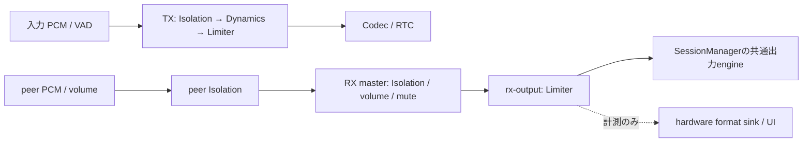

# RideCom App 音声処理仕様

受信decode入口は未知codecと不正RTC formatを拒否し、PCMや別formatへ暗黙変換しない。送信のcodec選択時に行う対応codecへのfallbackとは区別する。

125msの標準品質条件は、送信側SoundIsolationを既定有効、受信側の参加者別・全体SoundIsolationを既定無効とする。受信側は必要時のオプションとして維持する。複数段のnative分離を有効にした場合の加算遅延は標準構成と分けて計測・表示し、標準構成の125ms合格で代替しない。

## 安定した音声動作の理由と変更範囲

### 送信の声の分離を切り替えても同じ効き方に戻る

初回ONと再ONで同じ弱い音を残せるのは、送信エフェクトの生成時に原音と処理音の比率を固定し、OFFでは音の通り道を切り替えるため。以前はOFF時にmixを100%へ書き換え、再ONで表示が50%に戻っても実際の抑制が強くなった。同じPCMを実Audio Unitへ入れた397 Hzの比較で、この書き換えを外すと初回ONと再ONの残留振幅が揃った。差が再発したら、まず送信側の切替だけをこの接続方法へ戻せる。相手別・全体の受信ミキサーは独立して動く。この比較で説明できるのは送信分離の効き方まで。[現行の混合比と配線](Configuration/Bindings/Audio/Effectors/SoundIsolation.md#通話の音声保持)・[変更前後の波形と通話で残った差](../../validation/history/音声同一性と途切れの再現.md#送信側の声の分離をoffからonに戻すと効き方が変わる2026-11-20)

### 語頭を残し、発話が始まるたびに送信が遅れるのを防ぐ

送信の発話判定には今の収録フレームも寄与する。例えばStandardの10msの判定に対して5ms収録なら、過去から保持するのは残り5ms。10ms収録なら現在のフレームで足りる。無音中と発話中に同じ先読みを使い、確定したフレームを収録順に一度ずつ渡すと、語頭を残しながら発話開始時の一括配送も避けられる。組み直したあとで送信入口に語頭の欠けや余分な待ちが出たら、`AudioTransmissionController` の保持時間と解放順をこの規則と比較する。受信の再生待ちを調整する前に送信段だけで差を切り分けられる。[現在の保持規則](#入力時間と受信資源の寿命)・[先読みを二重に待っていたときとの比較](../../validation/history/リアルタイム音声の遅延と連続性.md#確認済みの実行)

### 自分の送信形式を変えても相手の声は続く

自分が次に送るpacketの形式を変えても、すでに相手から受け取って再生を予約したPCMはそのまま使える。`AppAudioPipeline.updateEncoding` は新しい形式を確かめて送信側へ渡し、適用が成功した時点で設定を更新する。受信engine・node・再生時計は動き続ける。送信形式の変更で相手の声まで途切れたら、設定変更が共通graphの再構築まで呼んでいないかを見て、更新先を送信側へ戻す。物理機器や共有I/Oモードが変わって時計自体が再開する場合は別の経路で扱う。[設定変更と受信資源の寿命](#入力時間と受信資源の寿命)・[共有I/O再開時の扱い](#出力クロックの共有)・[受信engineとnodeの継続を照合する例](../../../RideIntercomTests/RealtimeConversationTests.swift)

#### 送信形式変更の判定

対象は開発者が[送信形式の変更を切り分ける場面](../../requirements/README.md#用途別のストーリーマップ)。入力は希望codec・送信PCM形式・bitrateの組。`F` は渡された形式が[AudioCoreの妥当性条件](../packages/Audio/AudioCore.md#pcm-invariants)を満たすこと、`A` は送信側の `updateEncoding` が正常に戻ったことを表す。

| 条件 | 呼出元に返す結果 | Appが保持する設定 | 受信側への操作 |
|---|---|---|---|
| `NOT F` | invalidFormat。送信側への適用は呼ばない | 直前の設定 | なし |
| `F AND NOT A` | 送信側のエラーを返す | 直前の設定 | なし |
| `F AND A` | 正常終了 | 新しい設定を確定 | なし |

## 音声デバイスの差し替え

通常端末とWatch音声は、同じSessionManager capture／rendererのlifecycleを使う。Watchを選ぶと[AudioDevice](../packages/Audio/AudioDevice.md)のbackendへ差し替え、終了時は元のnative backendへ戻す。音声フローの中にWatch専用の送受信処理や別mix graphを設けない。

既存engineを時計として共有することと、phone hardwareへ再生することを分ける。遠隔backendの`rendersToHardware=false`に従って最終physical出力だけを閉じ、合成済みmono音声を共通rendererへ渡す。phoneの保存mute値は保持するが、Watch選択中の実効入力muteには適用しない。Watchの押下ごとの状態同期はせず、phone側のVADは従来通り使う。[Watchの操作条件](Watch操作.md)を参照する。

## 目的

本書は、現行のRideCom App が音声系 package をどう組み合わせるかだけを定義する。

音声処理の詳細は `docs/spec/packages` を正とし、本書では App 本体に残る責務だけを扱う。

## 責務境界

| 領域 | App 本体の責務 | 詳細仕様 |
|---|---|---|
| Audio Session | media 開始/終了に合わせて session を構成し、入出力デバイス選択を渡す | `docs/spec/packages/Audio/SessionManager.md` |
| 入力処理 | マイクのOS許可を確認し、ミュートと他音声ダックのユーザー設定を保持する | `docs/spec/packages/Audio/SessionManager.md` |
| VAD / gate | App 設定から VAD 感度 preset を選び、送信可否や発話表示へ使う | `docs/spec/packages/Audio/Effectors/VADGate.md` |
| codec | App の codec UI 設定を Codec / RTC の codec policy へ渡せる形に変換する | `docs/spec/packages/Audio/Codec.md`、`docs/spec/packages/RTC.md` |
| mixer / output | master 音量、出力ミュート、参加者別音量を反映する | `docs/spec/packages/Audio/AudioMixer.md` |
| effect | App が使う effect の有効/無効を決める | `docs/spec/packages/Audio/Effectors/*.md` |
| transport | 符号化済み音声の配送、packet audio、WebRTC接続lifecycle は RTC に委譲する | `docs/spec/packages/RTC.md` |

## 基本方針

| 項目 | 方針 |
|---|---|
| 接続と音声 | 明示した通話の音声準備と、認証・利用条件によるnetwork mediaの許可を分ける。接続操作で入出力を準備し、許可前は入力pipelineとRTCで送信を閉じる |
| OS 差分 | iOS / macOS の Audio Session 差分は App で直接扱わず、SessionManager に渡す |
| 高頻度処理 | frame、packet、jitter、codec の詳細値は App 仕様に重複定義しない |
| 設定 | 設定値は本書に重複定義せず、`docs/spec/App/Configuration` に集約する |
| 診断 | App は package の runtime report / event を要約し、ユーザーが状態を理解できる値だけを表示する |
| ログ | App は package 操作結果を `docs/policies/ログ記録規約.md` に従って構造化ログへ変換する。高頻度 frame は通常ログに出さない |

## Package runtime 入力

App は音声 package の設定や状態を App 独自の表示 model で作り直さない。Diagnostics と RTC 送信用の現在値は package が返す snapshot / report / runtime state を `RTCRuntimePackageReport` に詰める。

| package | App が保持する package runtime 入力 | 用途 |
|---|---|---|
| AudioMixer | `AudioMixerSnapshot` | TX bus、RX peer bus、RX master bus、route、output bus、effect chain、graph 描画 |
| Codec | `CodecRuntimeReport` | requested codec、selected codec、fallback、codec option summary |
| VADGate | `VADGateRuntimeSnapshot` | speech / silence、noise floor、threshold、gate gain |
| SoundIsolation | `VoiceIsolationRuntimeSnapshot` | 接続した実ノードのactive / bypassed。未生成時はruntime reportを送らない |
| DynamicsProcessor | `DynamicsProcessorRuntimeSnapshot` | 接続した送信ノードの設定と状態 |
| PeakLimiter | `PeakLimiterRuntimeSnapshot` | TX と RX master の limiter stage 表示 |
| SessionManager | `AudioSessionConfigurationReport`、`AudioSessionOperationReport`、`AudioStreamOperationReport` | session resolved 設定、input/output stream、voice processing の適用結果 |

| 更新契機 | 仕様 |
|---|---|
| 接続 / media lifecycle | connect、media start、media stop、disconnect で最新 report を生成する |
| 設定変更 | codec、bitrate、VAD、mute、ducking、output mute、master volume、peer volume、SoundIsolation 有効状態の変更で即時生成する |
| stream / session report | SessionManager の operation report を受け取った時点で即時生成する |
| 音声 tick | 診断画面の表示中は最短0.5秒、非表示は5秒間隔で生成する。画面を開いた時点は即時生成する |
| RTC 連携 | 生成した report 配列を `CallSession.updateRuntimePackageReports(_:)` へ渡し、RTC の runtime status に同梱する |

## 設定値

音声関連の App 設定、既定値、永続化、package へ渡す値は `docs/spec/App/Configuration/設定値一覧.md` を正とする。

## 音声 lifecycle

ハードウェアへ直接描画する経路では、出力観測だけを20ms単位へ集約する。UIのメーターと診断用通知の回数を減らし、実再生は観測通知を待たない。PCM通知を再生に用いるfallback経路では集約待機を追加しない。

受信ミキサーは設定上の処理rateを上限に、実出力のsample rateへ揃える。44.1kHzの出力では、復号PCMからAudioMixerへの変換後にOSの別rate変換を重ねない。96kHzの外部出力で受信effect全体の処理量を倍に増やすことはしない。送信のmixer/codec formatは独立して維持する。

入力のDSP・UI観測は通話またはAudio Checkの準備完了後に開始する。入力deviceを開いてからgraphの構築が終わるまでのframeは通知キューへ蓄積しない。取消済みのdeliveryを再開せず、次の接続は新しいdeliveryを作る。通話中のUI観測はDSP完了後に20Hzで最新値へ集約し、raw PCMを表示のために蓄積しない。観測の集約を音声破棄として数えない。Audio Checkの録音は5秒分のsample予算で全PCMを順序配送し、末尾frameを予算に合わせて切り詰める。通話用の32frame上限・100ms期限によって有限録音を破棄しない。有限再生の出力観測は開始・排出の余裕を含む最大6秒で保持し、dropを検査する。実送受信のcapture/render/sender欠落検査は変更しない。

| タイミング | App の動作 |
|---|---|
| 明示した接続操作 | SessionManagerを構成・活性化し、入力とmixer / outputを準備する。相手の探索・認証やInternetの応答を待ってから録音を開始しない |
| 相手待ち・認証／利用条件の未成立 | 音声準備を維持し、network mediaを開始しない。入力pipelineを送信禁止にし、mute設定の変更でも開かない。保存済みの利用者のmute値は変更しない |
| peer認証・利用条件の成立 | 入出力の準備完了後にRTC mediaを開始し、利用者のmute値を適用する。相手追加のためにnative captureを再起動しない |
| 最後の相手の離脱・復旧可能な経路断 | network mediaと送信を閉じ、native入出力と接続意思・元の終了期限を維持する。再認証後に同じ入出力で送受信を再開する |
| 明示終了・期限到達・サインアウト・復旧不能な切断 | network media、入力、出力、mixerを停止し、Audio Sessionを非活性化する。旧callbackで再開しない |
| 入力設定変更 | Duck Other Audio、ローカルマイクミュートは `AudioInputStreamCapture.updateVoiceProcessing(_:)` で即時反映する |
| session設定変更 | 音声モード、Speaker、エコーキャンセル、入出力deviceの選択は、希望値の変更 → 保存 → SessionManagerの`configure` → 選択deviceが実際に変わった場合だけmediaを再起動 → ログ、の共通経路（`applyAudioSessionSettings`）で適用する。設定ごとの差は変更する希望値とログ項目だけとし、`configure`が失敗した場合は再起動とログを行わずエラーを表示する |
| effect設定変更 | Voice Isolation Effect は SoundIsolation effect chain の有効/無効として扱い、SessionManager の voice processing へは渡さない |
| codec / RTC format 設定変更 | codec、sample rate、AAC/Opus bitrateを完全な設定として`AppAudioPipeline.updateEncoding`へ一度に渡し、送信ownerの単一の遷移処理へ適用してからRTC policyを更新する。codec固有の正規化はCodecのoption・対応値に従う。無効なformatはnative converter作成前に拒否し、受理済み設定を保持する。正規化後に同じ値なら再適用・保存・RTC通知を行わない。利用不可のcodecはfallback結果をDiagnosticsとログへ出す |
| 出力設定変更 | volume / mute は Mixer bus へ即時反映する。出力 device 変更だけは SessionManager / output renderer の report を確認する |

## Mixer 構成

App は AudioMixer 上で、送信用のマイク入力系統と受信用の参加者入力系統を分けて扱う。

### マイク入力側

マイク側は SessionManager で Audio Session、Duck Other Audio、入力ミュートを構成したうえで、マイク入力を送信用処理へ入れる。Voice Isolation Effect は SessionManager の input voice processing ではなく、SoundIsolation effect chain で扱う。

| 順序 | 処理 |
|---|---|
| 1 | SessionManager で Audio Session、入力デバイス、入力 stream format を構成する |
| 2 | `AudioInputStreamCapture` で他音声ダック、入力ミュートを初期適用してマイク入力を取得する |
| 3 | AudioTransmissionController が VADGate で発話・prerollを判断し、発話PCMと時計を維持する無音PCMをAudioFrameProcessorへ入れる。接続維持はRTCが所有する |
| 4 | TX busでformat変換・PCMの時間順処理とSoundIsolation → DynamicsProcessor → PeakLimiterを適用する |
| 5 | AudioMixer の TX sink を `rtcAudioFormatPreset` の target format で受け取り、Codec で encode して `RTCAudioPacket` として RTC へ渡す |

収録workerからVAD・送信DSP・codecへ同期的に渡し、符号化済みpacketは独立した単一の送信workerへ渡す。音声のためにMainActorへ戻らない。受信もRTCの独立した有界購読でdecode・native再生予約を行い、UIの制御通知処理を待たない。

発話判定は送信側の声の分離より前に行う。静かな定常雑音が続き、学習済みのしきい値で無発話へ戻れない場合は、VADGateがノイズフロアを見直す。既定のStandard感度では一定の小さな入力が1秒続くことを条件にする。無発話に戻った後は、既存のDSP・codecが末尾を処理してから音声の生成を休止し、新しい発話では既存の先読みで再開する。接続維持はRTCが続ける。[VADGateの判定仕様](../packages/Audio/Effectors/VADGate.md#判定仕様)。

入力PCMの時刻が途切れたり形式が変わった場合も、次のframeを判定する前にVADと未確定prerollを破棄する。入力停止中の発話表示は既存の通話tickで失効させ、mute値・通話・切断期限は変更しない。DSPと未送出PCMの不連続処理はAudioMixerが所有する。

停止・ミュート変更でVADの未確定frameとcodecの部分packetを破棄する。ミュート中もnative effectの末尾を排出するまで無音を送信DSPへ渡すが、符号化・送信はしない。完全無音が続けばpackageの休止機能でnative描画も停止する。再開後へ古い発話やeffectの停止中の履歴を持ち越さない。

送受信graphは別々の直列所有とし、設定変更は同じ所有者で適用する。受信graphのstopでも世代を進め、再構築中は受信を拒否する。旧graphのlock待ちをしていたpacketは、再構築後も旧世代として破棄する。TX・各peer・RX masterのIsolation設定と診断snapshotは共通関数で更新するが、lock所有・準備・settling時間の計算は各経路の特性に応じて維持する。通常の音声配送に待機timerを追加しない。native graphの接続変更とcodec/formatの設定変更は、fade・有限の無音保護を使う。SoundIsolationは未接続のnative資源を先に準備し、送受信lockを保持する接続変更区間を短くする。codec変更は旧形式のfadeをCodecが報告する残留区間まで通常captureで送り、新形式へ移る。途中の置換可能な設定だけを最新値へ集約し、timer待機・音声batchingを追加しない。packet callbackは送信graphのlockを解放してから呼び、受信graphや通信との相互待ちを作らない。

音量計・話者・診断は観測通知で更新する。受信の観測待ちは最新64件までとし、観測の遅れを音声の再生待ちに置き換えない。停止時に収録のbindingを無効化し、取り消されたRTC購読はgraphのlock取得後にも取消を確認する。前世代のcallbackを次の通話へ適用しない。

### 送信用 effect chain

送信用 effect chain は固定分岐ではなく、AudioMixer package の `AudioMixerSnapshot` に含まれる `tx-bus` の `MixerBusSnapshot.effectChain` を正とする。App の `transmitEffectChainSnapshot` は package snapshot から UI stage metadata へ写す薄い adapter であり、Diagnostics はこの snapshot を描画するだけで、effect の既定値や stage 配列を持たない。

| 処理 | 現在の適用箇所 | 検証状態 |
|---|---|---|
| VADGate | Mixerの前段。発話判定とprerollを制御。通信のpresence・再接続はRTCが所有 | package / App単体テスト |
| input mute | SessionManagerの入力設定とAppの送信gate | App単体テスト |
| SoundIsolation | TX / RX peer / RX masterは生成時に処理音50%・原音50%を設定する。ON／OFFを切り替えてもmixを保持する。OFFは信号経路から外して不要なlatency補償を防ぐ | offline graph / 設定反映と切替時の波形テスト |
| DynamicsProcessor / PeakLimiter | TXにDynamicsProcessorとPeakLimiter、受信出力直前にPeakLimiterを接続 | 実Audio Unitとoffline PCMテスト |

旧DiagnosticsはAVAudioMixerNodeを仮のeffectとして並べた別グラフを生成していた。現在はその生成処理を廃止し、実際の `AppAudioPipeline.snapshot` だけを使用する。実Audio Unitを接続したgraphを表示し、生成前・停止後はruntime stageを表示しない。

## 他音声ダック

`Duck Other Audio` のユーザー設定、実際の有効条件、SessionManager へ渡す値は `docs/spec/App/Configuration/設定値一覧.md` と `docs/spec/App/Configuration/Bindings/Audio/SessionManager.md` を正とする。

OS API の適用方法、入力ノード、ducking level の詳細は `docs/spec/packages/Audio/SessionManager.md` を正とする。

## Codec UI 設定

送信 codec のユーザー設定、bitrate、fallback の扱いは `docs/spec/App/Configuration/設定値一覧.md` と `docs/spec/App/Configuration/Bindings/Audio/Codec.md` を正とする。

| 状態 | App の扱い |
|---|---|
| 要求 codec が利用可能 | `CodecRuntimeReport.selectedCodec` を `CodecEncodingConfiguration.codec` と `RTCAudioPolicy.preferredCodecs` の先頭へ反映し、`RTCAudioPolicy.preferredSendFormat` は `rtcAudioFormatPreset` と一致させる |
| 要求 codec が現在環境で利用不可 | `CodecRuntimeReport` の fallback 結果に従い、`pcm16` fallback が可能なら通話を継続し、Diagnostics に fallback 理由を出す |
| decode 失敗 | 該当 frame を破棄し、受信 drop として扱う |
| Local / Internet / 中継 | 同じCodec設定とMixerを使用。SDKのnative音声trackは使わない |

## Audio Check

Audio Check は App 本体の診断機能として残す。

マイク自体の入力状態は入力バーで確認できるが、それだけでは送信者はエフェクト適用後に相手へ送る音を判断できない。Audio Checkは、通話と同じ設定・エフェクトで実際の送信処理を通した音を本人が聞き、設定を確かめるための機能とする。5秒分の録音内容を先頭から末尾まで再生して確認する。

| 項目 | 仕様 |
|---|---|
| 目的 | 入力バーによるマイクの状態確認に加え、エフェクト適用後の送信音声と選択した出力先をユーザーが単独で確認できるようにする |
| 実行条件 | 通話・接続待ち・通話音声の開始処理がない時、端末本体の設定から開始する。Watch入力は専用sessionから別に開始する |
| 録音 | 入力メーターを表示し、5秒分の入力を通話と同じ送信エフェクト・VAD・codecへ渡す。実際の送信packetを端末内で復号して保存し、RTCやグループ接続は開始しない |
| 他音声への影響 | 端末本体のAudio Checkでは他アプリ音声のduckingを適用せず、録音のためにVoiceProcessingIOへ切り替えない。通話と同じ保存済みの「送信する声を分離」の設定と、VAD・codecの設定を使う。通話用のDuck Other Audioの選択は保持し、通常通話ではその選択を適用する |
| 入力期限 | 録音準備後、最初の有効な入力frameを有限時間待つ。到着後はその時点から5秒の録音と1秒の猶予を一度だけ設け、後続frameでは延長しない。空・不正frameは入力として数えず、正常な無音frameは有効とする。期限内に5秒分を取得できなければ失敗し、取消後に旧期限が新しい録音を停止しない |
| 再生 | 選択した送信codecの復号formatを保持し、AudioMixerで実出力formatへ変換して5秒間再生する。送信処理の遅延を補正し、VADで送らない区間も同じ時間位置の無音として保持する。サンプルを別formatとして再ラベルせず、録音内容へ受信側の音声分離を重ねない |
| 失敗 | 権限拒否、5秒分の入力不足、session構成失敗、送信処理・復号の失敗を表示する。処理失敗を無音の成功にしない。明示ミュートは入力の時計を維持して送信処理側で適用し、正常な5秒の無音として扱う |
| 終了 | 一時的に使った audio pipeline を解放し、通話状態へ影響させない |

有限録音の終了時は入力受付を閉じ、送信エフェクトとcodecに残った末尾を回収してから再生する。端末本体の再生終了では、5秒の再生時間に加えて残りbuffer・native出力遅延・出力観測の排出を最大1秒の範囲で待ち、末尾を切らずに停止する。必要な排出時間が上限を超える場合は再生失敗とする。停止・再開始で前回の処理履歴を持ち越さない。入力バーの反応や完了表示だけを送信音声の確認成功として扱わず、検証の成立範囲は[録音確認の検証記録](../../validation/history/Watch音声のApp接続とデバイス分離.md#iphone設定の5秒録音と有限配送)で区別する。

### Watch入力の録音確認

DebugのWatch `Recording Check`は、同じWatch音声controllerからnative入力を開始し、既存AudioDevice経由のlive音声をiPhoneのAudio Checkへ渡す。録音・送信エフェクト・VAD・codecはiPhoneで処理し、録音した音をWatchへ戻して再生する。Watchに録音ファイルや音声処理graphを追加しない。Watchのsessionを有効化した後、共有engineを開始する前にSessionManagerの`AudioDuplexIO.prepare`で両I/Oを準備する。

iPhoneが録音済み状態を通知するとWatch側のマイクを閉じて再生を要求する。要求は同じ録音sessionに限定し、重複再生や終了後の遅い要求では再開しない。終了・取消・失敗時は一時経路を解放し、iPhoneの元の入出力backendとミュート設定を保持する。通常のiPhone録音チェックはiPhone入出力で開始し、Watch経路使用中との混在を避ける。この実装接続と、5秒の全量往復再生の受入は区別し、[未確認事項](../../validation/未確認事項.md#simulatorのnative入力開始)に残る境界を記録する。

## マイク許可と音声準備

端末本体の通話・Audio Checkは、Appが`AVAudioApplication.requestRecordPermission()`で許可を確認してからsessionのactivationとnative入出力を始める。OS権限要求はAppの責務で、SessionManagerへ移さない。許可待ち・activation待ちの両方で、同じ操作・通話・アカウントが有効か確認する。初回のOS許可は準備段階に含め、許可済みの通常利用で前面を維持する条件にしない。Watchから受け取る入力のためにiPhone本体のマイク許可を要求しない。

| 状態・操作 | 期待結果 |
|---|---|
| 未決定 | OSの許可ダイアログを出し、同じ通話または録音の準備を待つ。許可を得る前はactivation・capture・render・media送信を開始しない |
| OS要求への許可応答 | 同じ操作のまま準備を続ける。再タップ・画面の開き直しを求めず、従来の認証と利用権で媒体送信を判定する |
| 拒否 | マイク許可が必要で設定を変更する理由を表示する。通話は音声不可として終了でき、Audio Checkは失敗となる。入出力と媒体を開始しない |
| 許可待ちで取消・終了・サインアウト・通話切替 | 旧応答は現在の操作を変えず、マイクを開かない。新しい通話の音声を止めない |
| 許可待ちに通話期限へ到達 | 遅い許可後も期限を延長せず終了し、入力を開始しない |

## 表示する音声状態

| 表示 | 意味 |
|---|---|
| マイク権限状態 | 未決定、拒否、許可を区別する |
| ローカル発話状態 | VAD / gate の結果から表示する |
| 入力レベル | マイク入力の現在レベルを表示する |
| 出力レベル | 共有エンジンでは最終出力の最新レベルと直近フレームのピークを示す。別の再生先ではフレームを予約する処理のレベルを示す |
| 参加者別レベル | 受信した peer ごとの音声レベルを表示する |
| Audio Check 状態 | idle、preparing、recording、playing、completed、failed を表示する |

## 異常時

| 事象 | App の扱い |
|---|---|
| マイク権限未決定 | OSの許可要求を表示し、許可後は同じ操作を続行する |
| マイク権限拒否 | 設定変更が必要な状態として表示する |
| 入力/出力デバイス適用失敗 | 通信失敗とは分けて、音声デバイスの問題として表示する |
| 音声 pipeline 開始失敗 | 接続状態とは分けて、media 開始失敗として表示する |
| codec / packet / route の失敗 | App で詳細を再定義せず、RTC / Codec から受け取った error を要約表示する |

## ログ

| 事象 | Event | Level | metadata |
|---|---|---|---|
| media 開始成功 | `audio.media.started` | `.info` | `operationID`, `route`, `codec` |
| media 開始失敗 | `audio.session.failed` | `.error` | `operationID`, `errorType`, `isRecoverable` |
| 入出力 device / route 変更 | `audio.session.route_changed` | `.notice` | `operationID`, `reason` |
| voice processing 更新 ignored | `audio.input.voice_processing_ignored` | `.debug` | `operationID`, `reason` |
| voice processing 更新失敗 | `audio.input.voice_processing_failed` | `.warning` | `operationID`, `errorType`, `isRecoverable` |
| output schedule 失敗 | `audio.output.schedule_failed` | `.warning` | `operationID`, `errorType`, `isRecoverable` |
| codec fallback | `audio.codec.fallback` | `.notice` | `requestedCodec`, `selectedCodec`, `reason` |
| decode 失敗 | `audio.codec.decode_failed` | `.error` | `codec`, `errorType`, `isRecoverable` |

音声 sample、encoded payload、frame ごとの通常処理はログへ出さない。ログ仕様の正本は `docs/policies/ログ記録規約.md` と `docs/spec/App/ログ仕様.md` とする。

## 移管済みとして本書に書かないもの

| 領域 | 参照先 |
|---|---|
| VAD の attack / release / noise floor | `docs/spec/packages/Audio/Effectors/VADGate.md` |
| Audio Session category / mode / option | `docs/spec/packages/Audio/SessionManager.md` |
| voice processing / advanced ducking API | `docs/spec/packages/Audio/SessionManager.md` |
| codec payload / availability / fallback | `docs/spec/packages/Audio/Codec.md` |
| mixer bus / effect chain / output format | `docs/spec/packages/Audio/AudioMixer.md` |
| packet audio / jitter / relay | `docs/spec/packages/RTC.md` |

## 起動・停止とcallback所有

音声設定の適用は同期の`configure`へ渡し、設定変更だけでsessionを再活性化しない。通常通話とAudio Checkの開始は、`requestActive(true)`を同期登録して返されたTaskの完了を待つ。開始待ちを媒体の成功・失敗と表示せず、同じ開始を重複作成しない。完了時には音声・接続・Audio Checkの既存世代、ログイン、参加相手、現在の利用権と通話期限を再確認してからcapture/render/mediaを開始する。`superseded`は開始成功として扱わず、非対応OSの`unsupportedOnCurrentPlatform`は従来どおり共通フローを継続する。

本番factoryはprocess lifetimeの単一session managerを、アカウント切替で作り直すViewModelにも渡す。共有native sessionへの旧終了・新開始の順序を維持する。テスト注入とViewModel initializerの既定は個別managerを保つ。Audio Checkは準備中・録音中・再生中を区別し、録音時間は活性化とstream起動の成功後から計測する。

| 操作 | 処理 |
|---|---|
| 入力・出力・Mixer途中起動失敗 | 開始済み入力、出力、Mixer、mediaを共通停止処理で解放し、同じgroupで再試行できる。待機中の通話期限を監視するtickerは維持する |
| 通常停止 / 起動失敗 | 音声世代と開始待ちTaskを無効化し、入力・出力・Mixer・mediaを停止して、同じsession managerへ非活性化要求を同期登録する。直後の新しい開始とのnative操作順はpackageが管理する |
| Audio Check終了・中断 | 準備中も取消可能。所有する入力・出力・Mixerを停止し、非活性化要求を同期登録する。録音フレームを解放する |
| Audio Checkから通話 | timerと世代を無効化してAudio Checkを終了後、同じmanagerへ通話の活性化要求を登録する。旧完了から録音・再生・新通話の停止を行わない |
| 古い入力 / Mixer callback | 音声世代またはグラフ世代が異なる場合は破棄する |
| 切断peer | 該当PCM sourceの未再生データを停止で破棄し、他peerのsourceは維持する |
| 出力時刻 | output callbackの受信時刻を壁時計で記録する。AVAudioTimeのhostTimeを壁時計と混同しない |

検証の範囲と結果は[自動検証範囲](../../validation/自動検証範囲.md)を参照する。

## エフェクトの実配線

| 状態・操作 | 契約 |
|---|---|
| TX / RX peer / RX master Isolation | 対応環境では実nodeを保持。設定変更時は実接続を切り替え、処理遅延の間だけフェード付き無音にする。全Mixer・mediaの再起動は行わない |
| Isolation非対応 | 実nodeは挿入しない。support reportで非対応を区別し、操作を非表示にする |
| Dynamics / Limiter生成・設定失敗 | 起動を失敗として扱い、既存の共通停止処理で部分graphを解放する。保護なしで成功扱いしない |
| RX master音量 | rx-masterのfaderへ適用し、その後のrx-output busのLimiterで最終ピークを抑制 |
| Audio Check | 選択したTX Isolation・Dynamics・Limiterとcodecを通した送信音声を復号して再生する。RXの任意Isolationは重ねず、選択した出力先の音量と最終Limiterを適用する |
| 診断 | 接続したeffectのruntime snapshotとMixer metadataを使用する。要求設定と実行状態を分ける |
| 実機音質 | 自動検証は実Audio UnitのPCM処理・配線・制御・解放を対象とする。風切音・会話品質・聴感評価は実機確認へ残す |

## Local / Internet 共通の音声所有者

| 対象 | 所有と処理 |
|---|---|
| capture / render | 全production routeでSessionManager。WebRTC SDKのマイクは開始しない |
| Mixer / Codec | Local / SFU DataChannelで共通。選択codec、VAD、TX/peer/master effectと音量を適用 |
| 中継端末 | 符号化済みpayloadをRTCが転送。中継者のmute、音量、effectを他人の音声に適用しない |
| mute / stopMedia | 自分の送受話だけ停止。接続がある間は他者の中継を維持 |
| 経路追加・喪失 | 音声所有者を変更せず、同じMixerと入出力を維持 |
| 診断 | 実際に処理するpacket / PCM / effect snapshotを表示。未提供のRTT/lossを正常値に置換しない |

## 音声機器の変化

| イベント | 挙動 |
|---|---|
| 使用中の機器消失、oldDeviceUnavailable、利用可能routeなし | 開始待ちも無効化し、自分の入力・出力・Mixerを停止。接続・中継と通話期限のtickerは維持し、Audio Pausedと理由をCallへ表示。スピーカーへの意図しない再生を避ける |
| OSの音声中断開始・media services reset | 開始待ち・稼働中の媒体とAudio Checkを共通停止する。接続待ちの通話も再開待ちにし、後からのpeer認証で送話を始めない。機器切断と区別した中断の案内を表示する |
| OSの音声中断終了 | snapshotを反映するだけ。`shouldResume=true`でも活性化・録音・送話を自動再開せず、利用者のResume AudioまたはAudio Check再実行を待つ |
| 認証・presence更新 | 機器消失・音声中断後は自動で送受話を再開しない |
| Resume Audio | 同じ通話を要求中なら相手待ち・認証前でも共通の非同期開始を再試行し、native入出力を準備する。認証・利用条件が揃うまで送信は閉じる。現在の通話で開始成功した後に停止表示を解除する。失敗時は資源を解放して再試行可能。待機中の期限終了や別通話への切替後に旧完了で停止表示を変更せず、muteの意図を維持する |
| iOSの使用中エンジンの構成変更 | 開始済みの端末本体の通話で、音声sessionがactive、入出力先が同じ、エンジンが停止している場合は、既存の入出力・Mixerの再構成を一度試す。内部の通知queueを抜けてから行う。同じ通話・認証・ミュート・終了期限を使う。機器の消失やOSの中断で停止した通話は明示再開を待つ。 |
| 実際のdefault入出力変更 | 起動時は入力と出力の選択を`.systemDefault`とし、snapshotのcurrent deviceは実状態として保持する。録音チェックの古い通知の判定、通話の再構成、iOSのエンジン復旧では、入力・出力それぞれの現在のIDが一致するかで実機器を比較する。選択が自動のままでも実機器が変われば、使用中の入出力とMixerを再構成する |
| 再構成失敗 | Audio Pausedと理由・再開操作を表示する。再開でマイクの許可が得られなかった場合は、同じ通話・認証・終了期限を保って音声を停止し、設定でマイクを許可する案内を出す。許可後の明示再開で同じ通話の入出力を準備する。初回接続で許可を拒否した場合はAudio Unavailableを表示する |
| Audio Check中の機器変更 | 準備・録音・再生と旧完了Taskを中断し、再実行を案内 |
| configuration report | snapshotだけ反映。設定中に再帰的な再起動をしない |
| Disconnect | 再開待ち表示と経路状態を初期化 |

実機の受け入れは[検証](../../validation/未確認事項.md)で管理する。

## 経路共通の操作とcallback配送

| 項目 | 実装契約 |
|---|---|
| UI | Internetでも個別音量、マスター音量、入力・出力、VAD、Codec、effect、meterを同じ画面で操作する。非対応effectだけOSのsupport reportに従う |
| 旧所有権分岐 | AppのusesRouteManagedAudio / audioOwnershipChanged / supportsPacketAudioControlsを廃止。経路による音声graphの分岐を持たない |
| PCM callback | AudioRenderCaptureがrender threadでPCMを事前確保ringへコピーし、非render threadへ渡す。入力とPCMを必要とする出力先への配送はAudioFrameDelivery。通話中の入力表示は最新1件、別の出力先へのPCMは32件・100ms、録音テストは有限の再生時間を上限にする。TX sinkは同期処理。PCMの上限超過はdrop counterへ計上 |
| 共有エンジンの出力表示 | 出力workerが最新RMS、直近100フレームのピーク、有声出力時刻、未反映の出力件数を保持する。既存の通話tickで値を反映し、メーターのためのPCM配送を省く。別の出力先・録音テスト・明示的な計測でPCMが必要な場合はフレームを配送する |
| RTC送信への受け渡し | 制御操作は直列。音声は進行中1件と合計100ms以下・最大64件の待ちを保持し、待ち100ms超過は送らない。送信可能なら即時配送し、packet長が5/10/20msでも同じ時間予算を守る。stop/mute/接続世代変更で待ちを破棄 |
| RTC受信からViewModel | actor内で直接渡す。無制限のmain queueへ再投入しない |
| 停止 | callback consumerをcancelし、generationを更新。停止済みgraphの入力・送信・出力を拒否 |
| 中継と個別音量 | 中継packetはMixerに戻さずRTCでopaque転送。聞き手のpeer volume/effectはその聞き手の再生だけに適用 |

100msは各アプリケーション境界の待ち期限で、OS/SFU/機器を含む端末間遅延の上限ではない。ネットワーク配送の件数・期限・再送契約は[RTC仕様](../packages/RTC.md)を正とする。

ロック中の受話検証では、出力フレームを受け取るworkerとAppへの反映をそれぞれ観測する。出力グラフごとの時系列記録と他音声ダック切替の計測は[検証用ビルドの明示起動時](../../development/自動検証.md#ios実機の準備とロック中の検証を分ける)に限る。

## 通話の再生予約

| 境界 | Appから指定する設定 |
|---|---|
| 通話TX | 同期AudioFrameProcessorで処理し、送信用の再生queueを持たない。10ms packetへまとめ、native codecの必要frame数以外の待機を追加しない |
| RX peer source | 2msを下限、最大待ち120msとして相手ごとの時計を対応付ける。RTCからAppがpacketを受け取った単調時刻を、グラフのlock取得と復号より前に記録し、AudioMixerの `arrivedAt` に渡す。これ以降の処理待ちを到着の揺れに加えず、実際に描画位置を過ぎた場合は再予約する。安定後の無音中に余分な待ちを縮め、時刻不連続は当該sourceだけ再基準化する |
| 通話hardware output | SessionManagerの`renderingEngine`上で受信Mixerを直接出力へ接続する。PCMの再予約・二つ目の再生queue・UI actorの待機を挟まない。sinkは20ms以下で計測だけを通知する。engineを提供しないbackendのPCM出力だけは`intercomCall`の200ms上限を使う |
| Audio Check output | 通話と同じ出力engineへ直接接続する。engineを提供しないbackendのPCM出力は`AudioOutputStreamConfiguration.intercom`の100ms上限を使う。用途の変更は停止後の開始時に適用 |
| Audio Check source | nil。5秒分の録音予約を保持し、engineの通常速度でhardware outputへ流す |
| 診断 | Mixer sourceとSessionManager snapshotの予約時間・リセット回数を使用。未提供backendはnilのまま扱う |

## 入力時間と受信資源の寿命

VADのattack/releaseはcapture frameのsample数÷channel数÷sample rateで計算し、hardware bufferを一律20msとは扱わない。発話・無音とも同じattack先読みを保ち、capture順に一度だけ渡す。発話開始で保留列を一括解放しない。

受信busは接続中のpeerだけを組み立て、離脱時はAudioMixer.removeBusでsource/fader/effectを解放する。未接続の保存メンバーや過去の音量設定だけではbusを生成しない。peerのruntime statusも離脱時に破棄する。発話中表示とduckingの受信時刻にはローカル到着時刻を使い、遠隔capturedAtで保持時間を延長しない。outputのframe countは共通engineのrender通知で増やす。engineを提供しないbackendではPCMのschedule成功後に増やす。実デバイスで聞こえたことの証明ではない。

VADの先読みは、attack時間から分析済みの現在frameの長さを引いた区間を覆う最小の全frame列とし、保存frame数の上限も併用する。StandardとLow Noiseのattackは10ms、Noisyは20msであり、例えば5ms収録ではそれぞれ5 / 5 / 15msを保持する。現在frameだけでattack時間を満たす場合は追加の保留を行わない。発話中も無音中も同じ先読みを維持する。発話確定時は保留中の語頭をvoiceへ分類し、その後にgateが閉じても確定済みの語尾を無音化しない。未確定の静音だけを同じ時計・長さの無音としてDSPへ渡す。各frameは一度だけ渡し、設定変更時は未確定列を破棄する。これにより発話開始・終了で送信待機とバーストを交互に発生させず、収録済みのattack時間を二重に待たない。

Codec選択と各Codecのbit rate変更は、次のpacketの符号化設定とRTC policyへ反映する。RTC PCM formatの変更も送信sinkの出力formatとencoderだけを更新する。受信Mixer、effect、再生時計、既に受信した予約を作り直さない。hardware route自体が変わる場合の再構成と区別する。

## 会話の時間と設定切替

| 境界 | 方針 |
|---|---|
| capture | native sinkのquantumで渡し、tapの約100ms集約を待たない |
| VAD | attack分だけ保留。閉状態の古いframeは同じ時計・長さの無音としてDSPへ渡す。語頭と語尾を保ち、発話中も一定の先読みで一度ずつ解放 |
| TX / codec | 同期Audio Unit処理、継続stream専有encoder。codecごとのnative frame以外の固定待機を追加しない |
| RX | 相手専有decoderと独立clock。順序通りのpacketはRTC timerを待たず配送 |
| 設定切替 | codec/formatは送信側のみ変更。stream不連続は2msずつのfade out/in。effect切替はnative接続変更前に最終出力のfadeを要求する。native処理のsettlingを無音にし、実際に戻った音声からfade-inする。送信graph変更で直列ownerが短時間占有される場合も同じ出力保護を適用する |
| 遅延の限界 | SoundIsolation等のnative algorithmic latencyと機器のIO周期はゼロにできない。TX・peer・masterに重ねて有効にすると加算される。125msはネットワーク・機器を含む全設定での保証ではない |

正確な設定値は[AudioMixer binding](Configuration/Bindings/Audio/AudioMixer.md)、実測条件と結果は[検証](../../validation/README.md)を参照する。

## 出力クロックの共有

`AudioOutputStreamRenderer.renderingEngine`がある場合、既定の入力captureとAppAudioPipelineの受信Mixerはそのengineを共有する。入力と出力を別々のhardware I/Oで起動しない。受信のsource → peer bus → master gain → final limiter → device outputは一つのrender graphで処理する。`onOutputFrame`は音量表示・ducking・診断だけに使い、再生し直さない。Audio Checkも同じ経路を使う。通常通話とAudio Checkの開始時は、受信graphをclock停止状態で構成し、native入力の設定・開始と出力の準備後に同じgraphのclockを開始する。入力開始後のgraph再構築で共有engineを止め直さない。再構成前にengineを停止し、終了時はMixer所有のbusを全て解放する。codec・bitrate・音量の更新は再構成を伴わない。

受信graphの再構築は、一度取得したgraph lock内で通常の停止・開始と同じ処理を使う。停止で世代を進めて旧受信を無効化し、再構築中は受信できない世代にする。準備だけを求める呼出しでは受信を予約でき、再生開始は後から明示する。Appはgraphの開始・停止と動作中のsource追加に応じて開始要求を渡す。個々の予約でnative playerを開始・再試行する判断は[AudioMixerのPCM source](../packages/Audio/AudioMixer.md#収録時刻に基づく受信再生)が持つ。

共有I/Oのモード変更は入力再開後に受信sourceの再生時計を初期化し、受信全体の声の分離の切替は処理を通る全sourceの予約を無効にする。これらの変更中に到着したpacketと、変更前の世代でgraph lockを待っていたpacketは破棄する。相手別の声の分離だけを切り替えるときは、同じgraph lockで接続変更と予約を直列化し、受信世代を変えずに処理を続ける。接続が変わる相手の再生時計はAudioMixerが初期化し、同時に話す別の相手の予約を維持する。音量のみの変更は接続変更と出力の保護区間を作らない。

送信音声分離の変更は独立したTX processorだけを再構成する。受信graphの保護区間・再生時計・lockを共有せず、他人の声を止めない。受信音声分離変更だけがRX側の短い保護区間を使う。

## codecとcapture周期の差による再生余裕

受信ownerはStreamingCodecDecoderの`packetizationJitterDuration`を、そのままMixerPCMSourceの共通scheduleへ渡す。受信PCMとAudio Checkの録音再生は、同じgraph lock内の予約処理を使う。RTC受信は復号・予約・該当パケットの診断取得まで同じ保護区間で実行し、診断callbackはlockを解放してから渡す。AppにAAC/Opusの識別分岐や固定待ち時間を追加しない。20ms入力と30ms native AAC frameのような非整合の場合だけ、codecが計算した必要分を初期再生余裕へ足す。標準の整合する周期は0のままであり、低遅延経路は待たせない。音声timestamp・sampling rate・bitrateの契約は変えない。

パケットごとの受信診断を要求したときは、同じ保護区間でAudioMixerの予約開始位置とnative描画時計も受け取る。予約がないパケットでは予約情報はnil。音声E2Eはこの値を復号・Mixer出力・native出力の波形に結び付ける。通常通話の再生予約と診断画面の集計は既存の経路を使う。

## AAC低帯域候補のApp選択

既存のAAC native対応値と交差するmono 48kHz・32kbps、mono 24kHz・16kbpsだけを、音質低下を許容する手動候補として追加する。標準送信codec・既定値・品質基準・packageのcodec実装は変えない。既存品質範囲と明示した低帯域候補を区別し、不正・非対応値の補正で低品質へ自動移行させない。保存・周波数変更・表示の詳細は[設定値一覧](Configuration/設定値一覧.md#aacの低帯域手動候補)を参照する。独立codec往復での設定反映・時間軸の連続と、実通信量・聞き取り・電池の受入は別であり、新候補を品質推奨や推奨下限にはしない。

## バーストモードとストリームモードの現行差分

2026-11-17のコード照合。表示名は`AudioSessionProfile`、設定適用は`SessionManager.AudioSessionConfiguration.intercom`が定義する。

| 表示 | 内部profileと要求するAudio Session mode | 現行の意味 |
|---|---|---|
| Burst mode | `.standard` → `.default` | Audio Sessionの通常modeを使う。スピーカー・入力エコーキャンセルは別の設定として組み合わせる |
| Burst modeの派生 | `.speakerDefault`／`.echoCancelledInput` → `.default` | スピーカー既定出力や入力エコーキャンセル希望を付加する。Modeの選択欄ではBurstにまとめる |
| Stream mode | `.voiceChat` → `.voiceChat` | Audio SessionのvoiceChat modeを要求する。実際のOS側の適用・非対応はSessionManagerのreportで区別する |

両方ともAppAudioTransmitterの同じ送信経路を使い、encoderは`suppressesSilence: true`で作成する。Modeの名前によって、音声packetをまとめて送る方式と無音を含む常時連続送信方式を切り替える処理はない。Codecの`StreamingCodecEncoder`という型名もUIのStream mode専用という意味ではない。したがって現行差はAudio Sessionの要求設定であり、遅延・連続性・電池・通信量の優劣を名前だけで保証しない。実効設定と実音声の評価は別途必要。

初回、設定欠落、未知の保存値では`IntercomViewModel.defaultAudioSessionProfile = .echoCancelledInput`を使う。リセットでは同じprofileと入出力先の自動選択をまとめて適用する。Advancedの選択肢ではこの既定値を `Burst mode (Default)` と表示する。有効な保存済みprofileを読み直すと、Streamを明示設定していた場合も再現する。AdvancedからStandardに移動しても同じ設定を使う。[設定保持](UI/Settings.md#表示モードを切り替えたときの設定保持)。

## 相手待ちでの明示した音声再開

相手待ちの音声一時停止でも、既存のResume Audio操作は相手を待たずに準備を開始する。期限・本人・Watch音声経路の条件は通常開始と同じで、期限切れは接続を終了してマイクを開かない。再開によってmuteの意図や元の終了期限を変えない。認証済み相手がいない停止状態を接続済みとは表示しない。

音声中断終了後に自動では再開しない現行の制限は、[双方背景での復旧要求](../../requirements/製品要求.md#双方背景と無音状態を組み合わせた受入)への未達条件として継続して追跡する。明示した再開操作の修正をもって、前面維持・復帰・再操作を通常の通話成立／自動復旧の条件へ採用しない。
