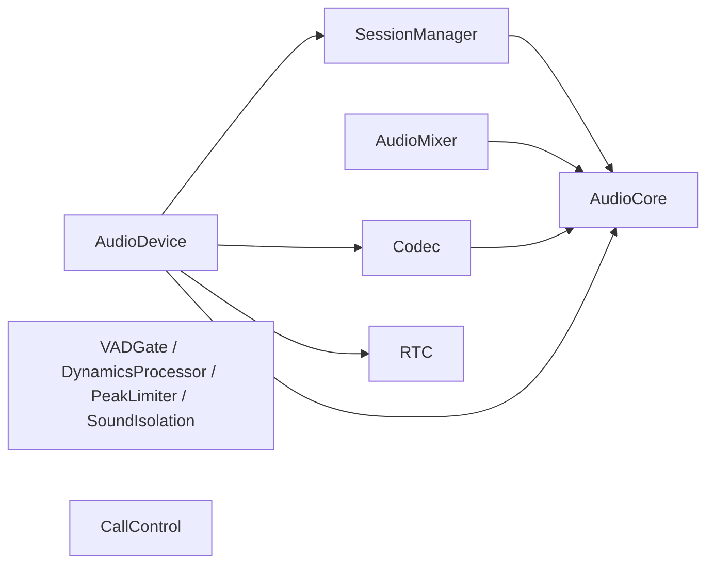

# Package 統合仕様

RideCom の package 群は、App の都合ではなく、音声、通信、OS差分、format差分をそれぞれの境界で吸収するための独立したライブラリとして設計する。

この文書は「全packageを同時に移植しなければならない」という仕様ではない。各packageは単独で移植できる。ここでは、複数packageを同じAppで使う場合の接続ルール、責務境界、エラー出力の扱いだけを定義する。

App は必要な package だけを組み合わせる。package 内の責務を App に移さない。App を作り直しても、各packageの外部仕様が変わらないことを優先する。

## 独立性の原則

| 原則 | 仕様 |
|---|---|
| 単独移植 | 各packageは、そのpackageの `Package.swift` が宣言する依存だけで別Appへ移植できる |
| 統合任意 | この文書の end-to-end flow は RideCom での組み合わせ例であり、全Appへの必須構成ではない |
| 上位composition | package同士を直接循環依存させず、Appまたは上位層が接続する |
| 共通語彙 | Audio系package間でPCMを渡す場合だけ `AudioCore` を共有語彙として使う |
| 通信独立 | `RTC` は Audio package に依存せず、他Appでは通信package単体として使える |

## 移植単位

| 移植したい機能 | 移植するpackage | 追加で必要なpackage | 不要なpackage |
|---|---|---|---|
| PCM型、signal meter、report型だけ使う | `AudioCore` | なし | `SessionManager`, `AudioMixer`, `Codec`, `RTC` |
| OS audio session / hardware I/Oだけ使う | `SessionManager` | `AudioCore` | `AudioMixer`, `Codec`, `RTC` |
| PCM graph / mix / effect chainだけ使う | `AudioMixer` | `AudioCore`（Effectorsは使用側で追加） | `SessionManager`, `Codec`, `RTC` |
| codec encode / decodeだけ使う | `Codec` | `AudioCore` | `SessionManager`, `AudioMixer`, `RTC` |
| VAD / Dynamics / Limiter / SoundIsolationだけ使う | 対象Effector | なし | `AudioMixer`, `SessionManager`, `Codec`, `RTC` |
| 暗号化された端末ペアを音声入出力に使う | [AudioDevice](Audio/AudioDevice.md) | `AudioCore`, `SessionManager`, `Codec`, `RTC` | `AudioMixer`, Effectors, `CallControl` |
| route / packet / encryption / handoverだけ使う | `RTC` | なし | Audio packages |
| 現在の通話世代を端末の操作入口へ渡す | [CallControl](CallControl.md) | なし | RTC、Audio、画面・OSの操作SDK |

## ローカルpackageの依存関係

矢印の先が依存先である。WebRTC SDKはRTC package内の `RTCNativeWebRTC` が使う。外部SDKと試験用の依存は各 `Package.swift` で確認する。

RideComのAppは必要なpackageを接続し、使用するEffectorのAVAudioNodeをMixerへ渡す。端末を組にして音声を入出力するときはSessionManagerへAudioDeviceをつなぐ。AppとWidgetはCallControlの参照を共有し、操作の可否はAppが現在の通話と照合して決める。

## Package 境界

| package | 依存 | 持つ責務 | 持たない責務 |
|---|---|---|---|
| `AudioCore` | なし | PCM共通語彙、validation、signal measurement、report型 | resample、channel mix、volume、hardware、codec、transport |
| `SessionManager` | `AudioCore` | Audio Session、device、route、機器の入出力、再生機器へのPCM形式変換、OS voice processing | 処理用バスの正規化、mix、effect、codec、RTC |
| `AudioMixer` | `AudioCore` | PCM source/sink、bus graph、source ingress正規化、sink egress正規化、effect chain、volume、mix | hardware、codec、packet、暗号化 |
| `Codec` | `AudioCore` | `PCMFrame <-> EncodedCodecFrame`、codec availability、bit rate option、fallback report | PCM正規化、mix、packet、暗号化、jitter |
| Effectors | なし | 単機能effect、effect runtime snapshot | graph構築、hardware、codec、transport |
| [AudioDevice](Audio/AudioDevice.md) | `AudioCore`, `SessionManager`, `Codec`, `RTC` | 暗号化された端末ペアをSessionManagerの入出力backendとして提供 | 出力時計の生成、端末内の再生、VAD、mix、通話の参加者管理 |
| `RTC` | なし | route、handover、packet envelope、encryption、jitter、metadata、runtime status | Audio package依存、DSP、codec encode/decode |
| [CallControl](CallControl.md) | なし（Foundationを使用） | 操作の対象とするログイン・通話の世代とグループを表す参照、文字列とJSONへの変換 | 世代の発行、操作の可否、認証、音声・通信 |

## End-to-End Flow

[RideComの信号の流れ](../アーキテクチャ.md#音声通信の所有境界)を参照する。[実機器へ直接描画する通話](../App/音声処理仕様.md#出力クロックの共有)は受信Mixerを出力へつなぎ、音量や診断に出力の観測を使う。PCMを受け取るbackendには、同じ通話の出力規則に従って音声を渡す。

送信では機器のPCMをMixerで処理用の形式へ揃え、送信用sinkから符号化先の形式で取り出す。Codecの出力をAppが `RTCAudioPacket` に入れてRTCへ渡す。受信では `ReceivedAudioPacket` から取り出した音声を復号し、復号時のPCM形式でMixerのsourceへ渡す。バスとsinkの形式は[Mixerへ渡す設定](../App/Configuration/Bindings/Audio/AudioMixer.md#mixer-設定)に従う。

単一のPCMを再生する場合は [SessionManagerの再生予約](Audio/SessionManager.md#stream-format-contract)を利用できる。機器への形式変換はrendererが行う。呼び出し側は必要なpackageを[移植単位](#移植単位)から選ぶ。

## I/O とエラー出力の原則

| 原則 | 仕様 |
|---|---|
| エラーも外部出力 | throw、operation report、runtime event、snapshot failure、drop metrics はすべて package の外部出力として扱う |
| 継続可能な差分 | OS非対応、device不在、format mismatch、packet drop は可能な限り report / event / metrics に正規化する |
| Appで推測しない | App は package 内部状態を推測せず、snapshot、runtime report、event、metrics を表示や判断に使う |
| 音を変える場所を限定 | バス間の形式変換、volume、effect、mixは `AudioMixer` に置く。再生予約時の機器への形式変換は `SessionManager` が扱う |
| 通信は音を変えない | `RTC` は codec metadata と payload を運ぶだけで、PCMやpayloadをDSPしない |
| hardware formatを偽装しない | `SessionManager` は actual hardware format をそのまま外へ出す |

## 変更判断表

| 変更したいこと | 変更するpackage | 変更してはいけないpackage |
|---|---|---|
| PCM型、frame validation、meter | `AudioCore` | `SessionManager`, `Codec`, `RTC` |
| マイク入力、出力renderer、OS route | `SessionManager` | `AudioMixer`, `RTC` |
| バスや符号化前のsample rate / channel count の変換 | `AudioMixer` | `AudioCore`, `Codec`, `RTC` |
| 機器へのPCM再生時のsample rate / channel count の変換 | `SessionManager` | `Codec`, `RTC` |
| peer volume、bus volume、master limiter | `AudioMixer` / Effectors | `RTC`, `Codec`, `SessionManager` |
| codec追加、bit rate fallback | `Codec` | `RTC`, `AudioMixer` |
| packet暗号化、重複排除、handover | `RTC` | `AudioMixer`, `Codec`, `SessionManager` |
| WebRTC SDK差分 | `RTCNativeWebRTC` | App, Audio packages |

## App Composition

| Appが扱うもの | Appが扱わないもの |
|---|---|
| packageの生成と接続 | package内部のOS分岐 |
| start/stop lifecycle | package内部のformat変換実装 |
| mute設定やpeer volume設定の入力 | RTC内でのDSP |
| package reports のDiagnostics表示 | hardware formatの偽装 |
| user settings からpackage設定への変換 | codec payload の中身解釈 |

`MediaPipeline` package は作らない。composition は App が行うが、glue code で package責務を肩代わりしない。

## 差し替えと拡張の入口

| 変更したいもの | 既存の入口 | 追加すべきでない構造 |
|---|---|---|
| 通信方式 | RTCのRTCCallRoute / CallSessionFactory / capabilities | App内の別ルーター、方式別ViewModel |
| native WebRTC | NativeWebRTCEngine、WebRTCSignalingClient | SFU DataChannelとWorker WSの二重制御経路 |
| 音声codec | Codecのencoder/decoder選択とavailability report | App内のcodec実装、暗黙のsample rate変換 |
| 効果 | AudioMixerのbus/source/sinkとEffector node | 通信packageへDSPを埋め込むこと |
| 入出力backend | SessionManagerのbackend契約 | テスト用の本番launch分岐 |
| 公開用identity | Worker入口でtokenをownerへ解決する境界 | group招待と端末資格の共用、AppへのSFU secret配布 |
| 検証 | package単体 / native SDP / Worker / Swift-Workerペア / App / UI | 全層をfakeにして外部契約が未検証のまま成功と呼ぶこと |

ここでのプラグイン性は、ビルド時に既存protocol/factoryへ差し替える意味。動的コード読み込みや外部プラグイン市場は実装しない。Internetも共通Mixerのeffect/音量を使用する。Codecの追加は現状Codec package内の実装・availability表を拡張する方式で、外部codec登録protocolはない。通信統計とTURNの不足は別に管理し、Appで推定・代替しない。

## 状態と寿命の所有

| 対象 | 状態の所有者 | 生成・変更・解放 | 経路変更時 |
|---|---|---|---|
| 音声エンジン・bus/source/sink・effect順序 | AudioMixer | compositionがgraphを指定、Mixerが接続・format変換・合成・停止を担う | 同じgraphを維持 |
| DSP内部状態・パラメータ | 各Effector / AVAudioUnit | busごとに独立instance。bypass/parameter更新で同一nodeを変更 | リセットしない |
| peer音量 | Mixer source fader | origin peer IDに対する設定をcompositionから渡す | route/gateway IDではなく同じ話者に追従 |
| TX / RX master音量とmute | Mixer bus fader / input gate | ユーザー設定で更新 | 同じ設定を維持 |
| codec識別・format変換境界 | Codec / Mixer | Codecはencode/decode、Mixerはsample rate/channel変換 | RTCはpayloadを解釈・再符号化しない |
| 認証・重複・経路・中継・ネットワーク待ち | RTC | session/peer lifecycleに従い初期化。転送特性は音声と制御で分ける | 残った経路を維持 |
| 選択設定・graphの組み合わせ・callback寿命 | App composition | package生成・接続・停止。DSP計算や経路選択は持たない | 音声所有者を切り替えない |

EffectorはMixerそのものや通信routeとは別である。Mixerは注入されたAVAudioNodeを順序どおり実行し、各Effectorの種類を知る必要がない。同じnode instanceを複数peerのbusへ共有しない。Appは標準effectの組み合わせを一箇所で決め、DiagnosticsにはMixerの実snapshotを渡す。外部plugin探索・追加のregistry・中間packageは設けない。

## 差し替え実装の受け入れ契約

| 差し替え先 | 必須の振る舞い | 接続前に確認する試験 |
|---|---|---|
| RTC route factory | group envelopeをapplication dataとして転送。reliable制御とunreliable音声を分け、認証済みhop ID・members・接続状態を通知。Mixer/captureを所有しない | 既存のLocal/Internet/relay混在グラフ、切断・再認証・遅延通知・重複拒否 |
| Effector node | 対象bus formatで処理し、busごとに独立node。parameter/bypass変更を同じinstanceへ適用。設定とruntime状態を報告 | 実AVAudioUnitのPCM変化、連続frame、複数話者、bypassと停止 |
| SessionManager backend | 希望formatを入力しactual hardware formatを返す。途中起動失敗・stop反復・古いcallbackを扱う。音量/mixを実装しない | 無実機backendのlifecycleと実offline出力、OS実機試験を分離 |
| Codec実装 | Codec packageでencode/decode、availability/fallback、formatとsample数を検証する。App/RTCへcodecの中身を持ち込まない | 同一PCMの往復、利用不可時fallback、各RTC format境界 |

既存の差し替え入口を使い、通信方式ごとに音声pipelineを複製しない。Codecは組み込み選択APIであり、任意の外部codecが登録だけで使える実装ではない。新codecにはpackage内の実装・試験が必要である。
