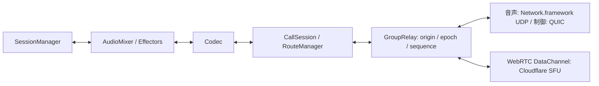
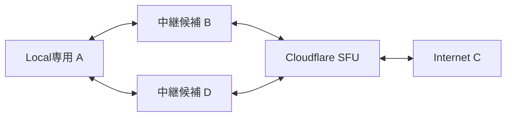

# RTC パッケージ仕様

## 待機中の処理と診断

RouteManagerは固定20ms pollingを行わず、未解決の並べ替え期限、2秒のpresence、再試行期限、有効な周期診断の最も早い期限だけで起床する。正常順のpacketは到着時にすぐ次の処理へ渡し、timer起床を待たない。複数経路の最初の認証済み到着を使う方針と、音声の再送なし通信は維持する。

自動runtime statusが無効なら周期的に起床せず、native統計を収集・配信しない。必要時の明示的な`networkDiagnostics()`は利用できる。停止ではtimerも破棄する。

高頻度の`updateRuntimePackageReports`は最新snapshotだけを保持し、周期status（既定5秒）または接続・操作のstatusに同梱する。更新ごとのnative統計取得・JSON生成・通信はしない。周期をnilにした明示更新方式では更新時に配信する。mute・設定・接続操作は集約せず即時通知する。

## 役務と所有関係

| 項目 | 契約 |
|---|---|
| 通信 | 接続・認証・複数経路の維持・中継・重複破棄・受信待ち・診断を所有 |
| 音声 | `RTCAudioPacket` のcodec、format、sampleCount、bitRate、payloadを保持。RTC内でDSP・再符号化をしない |
| 音声I/O | `SessionManager` が所有。Local/InternetともApp compositionがAudioMixer・Codec・RTCへ接続 |
| パッケージ境界 | RTCはAudioパッケージに依存しない。hardware 48kHz、RTC 16/24/48kHzなどの変換はAudioMixer/Codec側 |
| products | `RTC`、`RTCNativeWebRTC`。後者のみ同梱WebRTC binaryへ依存 |
| カメラ | 公式SDKに撮影・映像APIが含まれていても、アプリはカメラの権限を要求せず、撮影や映像トラックを開始しない。通話の音声はDataChannelで転送する |
| SDK privacy manifest | 同梱ZIPの全sliceで標準リソース位置を検査。macOSは`Resources`から`Versions/A/Resources/PrivacyInfo.xcprivacy`へ到達し、上流manifestのbytesを保持する。組み立て時のみ既知の二重`Versions/A`配置を正規化し、検証・importは不正配置を拒否する |
| OS / Swift | iOS/iPadOS/macOS/watchOS 27.0以上、Swift 6 |
| plugin | `RTCCallRoute`、`CallSessionFactory`。中継の共通契約は認証済みpeerとapplication dataの転送 |

## 混在通話と経路

| 状況 | 振る舞い |
|---|---|
| `.singleRoute` | preferred routeだけを開始。ほかの経路を無断で有効化しない |
| automatic設定 | preferredを開始し、fallbackDelay後に許可済みの残りの経路も開始する。一部Local接続が成功してもInternet開始を抑止しない |
| 既存のautomatic 2値 | ともにグループ接続維持として扱う。1経路へ切り替えて他の接続を切る旧動作は廃止 |
| Local専用A、両経路B、Internet専用C | A↔B↔Cで元の話者を保持して中継。AはCloudflare資格を持たなくてよい |
| 中継候補が複数 | Local近隣でInternet媒体がreadyと通知された候補の最小PeerIDを選ぶ。話者の端末がInternetへ直接送信している音声は中継しない |
| 経路の準備と参加者更新 | 経路が利用可能になったときや利用可能な経路の状態が変わったとき、在席を通知する。同じ状態の再通知による在席送信を省く。参加者の更新通知による在席送信は、同じIDの再認証も含めて維持する |
| 全員近くにいる | Localへ先に即時送信し、Internetの既知の全参加者がその送信で媒体が届いたことを確認済みの集合に含まれればInternet音声コピーを省く。Localは現在のUDP flowでの即時受付と、有効期限内の認証済み媒体受領確認を必要とする。制御接続やOSのreadyだけでは省略しない。空のInternet参加者集合、初回・期限切れ・UDP未準備・上限超過ではInternetコピーを維持する。現在の音声のACK待ち・再送は行わない |
| 遠隔参加者がいる | Internet音声も届ける。SFUは全購読者へfan-outするため、この場合は近隣にもInternetコピーが届き得る。先着した認証済みenvelopeだけ再生する。Internetの制御・参加者探索は維持する |
| 複雑なLocal接続グラフ | Localは重複破棄付き転送。近隣ごとに候補が異なる間は重複転送があり得るが、再生は1回。最大8hop |
| 中継離脱・接続障害 | 残る経路を停止しない。membership/presence更新で中継候補を再評価し、失敗した経路だけ2〜30秒間隔で再試行 |
| 接続経路がなくなる | 接続を作れるまで音声は届かない。無音や探索中を接続成功とみなさない。presence失効は8秒 |
| `stopMedia`、中継端末自身のmute | 自分の収録・再生要求を停止。他人の中継は継続。`stopConnection`が明示的な離脱 |
| `updateAudioPolicy` | 通話中のcodec / format方針を更新する。transport・認証済みpeer・relay epoch・replay windowを維持し、音声設定だけの変更で再接続しない |
| `stopConnection` / group変更 | leave通知、世代無効化、購読・タイマー・受信バッファ・認証状態を終了 |
| active/media route | UI用の代表経路。実際に使う経路が1本だけであることを表さない。availableRoutesとmembersのrouteも確認する |

## 認証・重複・バッファ

| 境界 | 制約 |
|---|---|
| Local接続 | BonjourのTXTで同じgroupHashを探索し、QUICのmutual TLSで制御路を開く。双方の証明書を束縛したgroup共有鍵のhandshakeに失敗した相手は認証しない。この場合は通信失敗の `connectionFailed` と区別して `CallSessionError.handshakeRejected(route)` を通知する。拒否理由・secret・peerの申告値は含めない |
| peer識別 | handshakeの送信者は `CallStartRequest.localPeer.id`。広告名は通話世代ごとに生成する。表示名の変更でInternet側と別人にならない |
| Internet接続 | Workerの端末資格・同一room購読認可。SFU App Secretはサーバーのみ |
| 中継envelope | `rtc.group-relay.v2`。session、origin、epoch、sequence、path、body、Internet ready状態。招待由来のgroup keyでAES-GCM暗号化。Foundation binary PropertyListのCodingKeysを短縮し、packetごとのmetadata量を減らす。独自parserや信頼ありの辞書同期は導入しない。v1参加者との混在は不可 |
| 信頼境界 | 接続元hopが認証済みpeerで、path末尾と一致すること。group credentialを持つ参加者間の信頼モデル。個人署名による悪意あるグループ参加者のなりすまし防止ではない |
| 自分へ戻った音声 | path内に自分が含まれるものを破棄 |
| 近距離の音声中継 | 直接つながった相手が全員その音声のpathに含まれるとき、Localへ送り返さない。未経由の相手がいるLocalと、中継が必要なInternetへは既存の経路判定に従って送る |
| duplicate / replay | originと接続epochごとの1024 sequence window。古いepochは直近8世代を拒否。音声はpresenceで参加済みかつ有効な話者だけ受理。認証済み音声も活動期限を更新し、制御streamの再接続を音声の停止条件にしない |
| 再参加 | 新epochで当該peerの受信待ちを破棄し、memberの再認証をAppへ通知。他のpeerは維持 |
| presence | 2秒周期のreliable制御。presenceと認証済み音声のどちらも8秒届かない場合に失効。leave以前の遅延presenceで離脱を取り消さない |
| 上限 | リモート7人、path最大8、envelope 32KiB、音声payload 8KiB。受信待ちの上限は[音声の転送と待ち行列](#音声の転送と待ち行列)に従う |
| 再生時刻 | 最終受信端末が[音声の転送と待ち行列](#音声の転送と待ち行列)に従って受信順を決める。期限の計算に端末間時計の同期を求めない |
| codec / format | policyで許可されたcodec、8〜48kHz、1〜2ch。対応範囲内のformat差は保持し、PCM変換しない |
| route capabilities | Local / Internetとも符号化済みPCM16・Opus・AAC-ELD・旧AAC-ELD v2を転送可能。初期codec設定に固定しない。OSの実encode/decode能力と受理codecのpolicyは別に判定する |
| パケットsequence | 中継epoch内のsequenceで再生順を管理。収録再起動によるApp側counterのリセットと分離 |

## 参加単位の音声許可

`RTCAudioPolicy.peerPolicy`は、自端末への音声の伝送と、自端末からの音声送信開始を共通のCallSession境界で制御する。既定の`groupMembers`は有効なgroup参加者の音声を届ける。`admittedMemberships`は、現在の`membersChanged`に含まれるPeerIDと`CallMemberState.membershipID`の組を明示的に許可する。空集合なら自端末へ送らず、自端末からも音声を送らない。

| 境界 | 動作 |
|---|---|
| membershipID | 受信端末のRTCが参加ごとに発行する不透明なUUID。相手の本人証明や秘密資格ではなく、古い許可を新しい参加へ持ち越さないための参照。native routeの観測ではnil、RouteManagerの有効なgroup参加者では必ず値を持つ |
| 再参加・再接続 | 相手のepoch変更、leave後の再参加、8秒の活動期限後のpresence、受信側sessionのprepareで新しい値になる。期限後のpresenceが次の定期snapshot更新より先に届いても以前の許可を復活させない |
| 複数経路 | 有効な同一参加のLocal/Internet間の経路変化、codec/format設定更新では値を維持する |
| 受信 | 許可していない参加者の音声を受信待ちへ入れず破棄する。許可取り消し時にその参加者の受信待ちを消去し、転送時にも現在の許可を確認する。後で許可しても過去の音声を再生しない |
| 送信 | 明示許可方式では、現在も有効な参加と一致する許可が1つ以上ある場合だけ自端末の音声を送信する。自端末のミュート・media開始条件も引き続き適用する |
| 制御と中継 | 本人確認などのapplication data、presence、他端末の暗号化音声の中継はこの許可で止めない。自分が再生しない端末を経由する混在通話も維持する |

許可する本人・アカウント・用途の判断は呼び出し側が行い、RTCへその時点の参加参照を渡す。RTCはAppleログイン・連絡先・購入条件を扱わない。古い参照による遅延更新は現在の参加に一致せず、許可にならない。

この設定は自端末の媒体処理の制御であり、送信先別の暗号化ではない。group鍵を持つ端末には中継音声が届き得るため、特定のgroup参加者が暗号文を復号できないことや、音声の個人署名による本人認証を保証しない。取り消し以前にCallSessionのイベントに渡した音声を回収する契約でもない。 参加許可を外しても、ほかの許可済み参加が残る場合は同じグループ鍵で送信を続ける。鍵が共通の間は、許可を外された端末へ音声が届く可能性を残す。[3端末相当での検証](../../validation/history/通常グループの代表端末検証.md#メンバー除外後の音声とグループ鍵の境界2026-11-19)。

## Cloudflareの媒体契約

| 項目 | 実装 |
|---|---|
| transport | ネイティブWebRTCのDTLS/SCTP DataChannel。標準RTP audio track方式から、話者を保持できる符号化済みパケット転送へ変更 |
| audio channel | `group-audio-v1`、unordered、maxRetransmits=0。送信待ちが残ると新しい音声を捨て、蓄積しない |
| control channel | `group-control-v1`、ordered/reliable。送信待ち上限64KiB |
| 接続 | 完全SDP offer → Worker `/join` → SFU datachannels/establish → answer。ICE接続後 `/publish` で2種類のchannelを確保 |
| 受け取ったSDP | native接続に適用できるoffer／answerは、媒体行が1つ以上あり、そのすべてが `m=application` のもの。ほかの媒体行を含むか媒体行がなければ、SDKへ渡す前に拒否する。拒否時はnative接続の交渉状態を保つ。SDPの残りの形式はSDKが検証する |
| 購読 | roomのpeer IDから `/pull`。SFU allocation IDは端末ごとに異なり、Workerの返却値でnegotiated channelを作る |
| 表示名 | joinへ送信しない。Workerのpeer一覧はID・session IDのみで、transportの`PeerDescriptor`はIDを代替名にする。人向けの名前はgroup鍵で暗号化したpresenceから復元する |
| presence / 操作 | 同じgroup envelopeで中継。WorkerのWebSocketはroom情報・従来の小さい制御メッセージのみ。音声は通さない |
| 離脱・期限切れ | known channelをcloseし、GET sessionの残存channelも確認。部分成功・応答不明の割当ては回収記録を保持 |
| upstream不明 | timeoutしたallocationの完了を空のGET結果だけで断定しない。session消失確認まで再確認 |
| native audio device | 本経路ではWebRTCへマイクを接続しない。DSP・codec・ミュート・相手別音量は共通音声pipeline |
| TURN | WorkerからSDP作成前に短期資格を取得し、更新通知を既存native connectionのsetConfigurationへ適用。設定はWorker仕様を参照 |

Cloudflareは[custom media payloads](https://developers.cloudflare.com/realtime/sfu/features/datachannels/#custom-media-payloads)を認める一方、復号・再生時刻・欠落回復をアプリに委ねる。本実装は既存Codecと受信待ちを利用し、SDKのRTP jitter/codec/DTXが動いているとは記載しない。受け入れ条件は[検証](../../validation/未確認事項.md)を参照する。

## 音声の転送と待ち行列

| 境界 | 方針 | 所有者 |
|---|---|---|
| Local / Internet送信 | 音声は全経路で再送なしUDP、presenceを含む制御はreliable。音声に再送・順序保証待ち・reliableコピーを使わない | GroupRelayが分類、各routeが転送 |
| Internet DataChannel | 音声は`ordered=false`、`maxRetransmits=0`。送信バッファが空のときだけ送信し、詰まっていたらその音声を破棄 | RTCNativeWebRTCとWorkerのpublish/pullで同じ指定 |
| 接続通知と音声のイベント待ち | 各購読者につき一時データ最大64件・100ms。古い音声・telemetryを捨て、接続・認証・離脱・reliable制御は256件まで順序を保持 | EventSource（Local受信、native engine、route、CallSessionの各境界） |
| 再生待ち | 話者ごとに、最初に渡すパケットを順序の起点とする。連続するパケットは待たずに渡す。欠落したときだけ15ms並べ替えを待ち、次の期限に合わせてタイマーで取り出しを試みる。受信から100msで期限切れとし、最大256件を超える分は古い受信待ちから破棄する。追加と取り出しの両方で、すでに再生したsequence以下のパケットを破棄する | PacketAudioReceiveBuffer。RouteManagerが次回のタイマーを管理 |
| 再接続 | peer離脱でそのpeerの再生sequenceを破棄、session停止で全待ち状態を破棄 | RTC |

DataChannelの順序保証と再送回数は、TCP/UDPを選ぶUIではなくデータを渡す条件である。既定のreliable/orderedを音声に流用しない。`maxRetransmits=0`は初回送信後の再送を止める設定で、OS・SFUを含む絶対遅延の保証ではない。`maxPacketLifeTime`との同時指定は行わない。上記100msは各境界での待ち時間上限であり、端末間の総遅延ではない。期限に使う端末内時計は同期不要である。

イベント待ちでの破棄数はeventDropsとして境界別に公開する。受信bufferでの破棄は既存counterへ反映する。制御イベントは音声と一緒に追い出さないが、永続保存・相手の処理完了保証は持たない。

根拠: [W3C DataChannelInit](https://www.w3.org/TR/webrtc/#dom-rtcdatachannelinit)、[Cloudflare message delivery](https://developers.cloudflare.com/realtime/sfu/features/datachannels/#configure-message-delivery)。

## 近距離の探索とQUIC制御

iOS・iPadOS・macOSのLocal経路はBonjourで近くの参加者を探し、QUICの信頼できるstreamで認証・presence・操作を届ける。音声は別のUDP listenerへ送る。通話する両端末のアプリがこの方式に対応している必要がある。設定・診断に使う経路識別子は `RouteKind.multipeer`。watchOSの音声デバイス接続は別の経路を使う。

| 部品 | 契約 |
|---|---|
| `SelfSignedCertificate` | P-256の鍵で署名した最小のX.509証明書（v3、common nameだけ、ECDSA with SHA-256、有効期間は作成の1時間前から2日後まで）を作る。外部の依存を使わない |
| `LocalControlIdentity` | 鍵と証明書から`SecIdentity`を作る。Apple OSに鍵と証明書から直接identityを作る公開APIがないため、PKCS#12の入れ物（鍵はPBES2で暗号化、SHA-1のMAC）をメモリ上で組み立てて`SecPKCS12Import`で取り込む。Keychainへ書かず、後始末も要らない（macOSは`kSecImportToMemoryOnly`）。入れ物のパスワードは形式を満たすためだけの使い捨てで、何も保護しない。証明書のSHA-256を`fingerprint`として公開する |
| `LocalControlTLS` | QUIC（ALPN `ride-control`、TLS 1.3）のparametersを作る。双方が自分のidentityを提示し（mutual TLS）、相手の証明書は内容を問わず受け入れる。相手が誰かは証明書では決めず、`LocalControlLink`のhandshakeで決める。peer-to-peer Wi-Fiを含め、セルラーは使わない |
| `LocalControlFraming` | 信頼できるstream上のmessageの境界。4 byteのbig-endianの長さの後にmessageを置く。上限は現行のLocal制御と同じ64 KiBで、超える長さを告げた相手の続きは読まない |
| `LocalControlHandshake` | 相手が誰かを決めるmessage。group共有鍵のHMAC-SHA256で、groupHash・送信者ID・nonce・送信側の証明書のfingerprint・受信側の証明書のfingerprintを、各項目に長さを付けて覆う。間に入って中継する者は自分の証明書を両側へ提示するしかなく、両側から見たfingerprintが食い違うので検証に失敗する。逆向きへの使い回しと、自分のmessageの送り返しも拒否する。nonceは現行と同じくUDP媒体のlistenerの世代を示す |
| `LocalControlLink` | 相手1人との制御の接続1本（QUICのstream）。readyになったら、その接続でTLSが見た相手の証明書（接続のmetadataから読む）のfingerprintを束縛したhandshakeを送る。相手のhandshakeを同じ接続の証明書で検証できるまで、相手が送ったものを何も渡さない。検証に失敗した場合、10秒以内に認証できない場合、上限を超える長さ、通信の失敗、`close()`で閉じ、`closed`を1回だけ通知する。認証後のmessageは送った順に届く |
| `LocalControlTransport` | 届く範囲の全員との制御の接続を持つ。開始のたびに新しいidentityとservice名（端末名・人の名前ではない乱数の識別子）を作り、QUICのlistenerをBonjour service `_ride-control._udp`として広告する。TXTの`g`に現行と同じgroupHashを載せる。同じgroupHashのserviceを探索し、service名の小さい側だけが接続を張る（双方が同時に張らないための規則）。認証できた相手を`members`として通知し、相手のUDP媒体用のnonceを`authenticated`で渡す。同じ相手が新しい接続で戻ったら新しい接続に置き換える。相手は7人まで。張った接続が認証前に閉じた、または切れた場合は、広告が見えている間2秒後に張り直す。最後の相手を失うと`disconnected`を通知する。停止で、listener・探索・接続・identityをすべて破棄する。全処理を1本の直列queueで行い、MainActorを使わない |

確かめたこと: 証明書をOSが解析でき、自分自身をanchorにした検証が有効期間内だけ成功する。identityの秘密鍵で署名した値を証明書の公開鍵で検証できる。同じ端末上のmacOSとiPhone Simulatorで、2つのidentityを使って実際にQUICで接続した。同じgroup鍵を持つ2者が互いを認証した。上限の大きさを含むmessageが双方向に順序どおり届いた。片方が閉じると双方が1回ずつ`closed`になった。group鍵を持たない相手は、TLSが成立しても何も渡されずに閉じられる。実際のBonjourの探索を使い、同じプロセス内の3者が互いを見つけて認証し、messageが順序どおり届く。別のgroupの端末と、同じgroupHashを名乗るが鍵の違う端末は、認証されず何も受け取らない。離れた相手は失われ、開始し直すと再び見つかる（macOS）。この2つの試験を各200回繰り返して、失敗もプロセスの異常終了もなかった（同じ形の繰り返しで、Multipeerは約420回のうち3回異常終了した）。framingはstreamをどこで区切っても境界を保つ。handshakeは、中継者の証明書、別のgroup、別の鍵、項目の改変、項目の境界のずらしを拒否する。

実装で分かった制約: 鍵を暗号化しない入れ物では、`SecPKCS12Import`は証明書だけを返しidentityを作らない。QUICの`NWListener`は接続を`newConnectionGroupHandler`のgroupで受け取り、streamはそのgroupから受け取る（`newConnectionHandler`だけを設定すると、readyになるがデータを受け取らない接続が返る）。Keychainを経由する方法は、package単独のテストのプロセスでは権限がなく使えない。

## ネットワーク診断の契約

| 情報 | 所有者・意味 | 未取得・限界 |
|---|---|---|
| RTCNetworkDiagnostics | CallSessionがnetworkDiagnosticsChangedでローカル通知。遠隔runtime statusにもRTC / networkのpackage reportとして追加 | 生成時刻付き。別セッションへ持ち越さない |
| eventDrops | EventSourceの購読者mailboxごとにoverflowとexpiredを加算。route / engine / transport境界を区別 | ネットワークpacket lossではない。同じイベントの購読者別の破棄は別件 |
| roundTripTime | nativeの選択済みICE candidate pairのcurrentRoundTripTime、秒 | SFUまでのtransport RTT。相手端末までの往復・音声遅延ではない。未取得はnil |
| bufferedBytes | native connectionが所有するDataChannelのbufferedAmount合計 | アプリの送信待ちbyte数。接続がない場合はnil |
| packetLoss | DataChannel用の損失率はnil | RTPのpacketsLostをSCTP音声に流用しない。取得不能理由を明示し、0で正常表示しない |
| peers | group envelopeを認証・重複検査した最後のpathと到着route、観測時刻 | 最後に届いた経路。全候補経路の探索結果ではない。8秒経過・hop消失・route消失・stopで表示対象から除く |
| outboundAudioDispatch | 自端末が生成した音声packetを最後に各経路へ渡した記録。経路の順序、経路ごとの `transportAcceptance`、近距離でInternetを省いたか、観測時刻を持つ | Localは送信条件を満たしてUDPへ渡したか、InternetはDataChannelの送信受付結果。未計測の経路は結果に含めない。相手到着は受信側の観測を要する。制御や中継の送信では更新せず、通話準備・切断で消去する |
| Local | transportとrouteのmailbox破棄を通知 | UDP音声の送受信datagram数・送信処理中bytes・最近の媒体受領確認があるendpoint数を通知。間引いた受領確認からpacketごとのRTTやネットワーク損失を推定しない |

経路の新実装が統計backendを持たない場合も、共通診断APIから明示的な取得不能を返す。新たなplugin層は追加せず既存route / native engine境界を使う。packet形式・音声送信方式は変更しない。

## TURN資格のlifecycle

| 操作 | 契約 |
|---|---|
| 接続準備 | Workerのroom配下ice/participantへ接続試行のleaseIDを送る。資格取得後にiceServersイベント、connectedイベントの順で通知 |
| native適用 | SDP生成前にICE設定。更新は同じpeer connectionへsetConfigurationを適用しDataChannelを作り直さない |
| TURNの媒体経路 | UDPのTURN候補を使用する。TCPやTLSのTURN候補は使わない。UDPで媒体経路を作れない場合は、Internet経路の失敗として扱う |
| lease更新 | Workerのrenew応答にiceServersがある場合だけ更新。Cloudflare長期秘密は受け取らない |
| 中断 | SFU session成立前は試行leaseID付きDELETE、成立後はsession DELETE。古い試行の遅延cleanupは新資格を削除できない |
| エラー | 資格の取得・適用失敗はInternet routeの失敗として既存report/eventに反映。他の有効なLocal経路を止めない |

[Cloudflare公式の資格生成・失効・更新](https://developers.cloudflare.com/realtime/turn/generate-credentials/)に基づく。資格の期間・利用枠・失効再試行は[Worker](../server/Worker.md)が所有する。

## 経路と音声の境界

| 層 | 契約 |
|---|---|
| RTCCallRoute | 接続、認証済みmembership、application data、ネットワーク診断を転送。送信結果はbackendの受付と、Internetの不要な音声コピーを省くための検証済みLocal宛先を持つ。音声開始・ミュート・再生のAPIは持たない |
| CallSession / RouteManager | 共通の音声開始・停止・ミュート・暗号化中継・受信待ちを所有 |
| SFU signaling | 完全なSDP offer / answerとmembership snapshotを使用。trickle候補の個別転送や空のsendAnswer APIは持たない |
| NativeWebRTCEngine.prepareTransport | 接続試行の診断を初期化。マイク・スピーカーを取得しない |
| Local wire | handshake・presence・操作はQUICのreliable stream。GroupRelay音声は認証済み暗号化envelopeをNetwork.framework UDPへ直接渡す。UDPが未準備なら破棄し、制御streamへfallbackしない |

旧per-route音声API・暗号化・二重受信待ちは削除した。招待URLと現行group-relay wireは変更しない。旧per-route音声wireとの互換は提供せず、参加端末のアプリは同じ通信形式を使う。

## 入力と復旧の境界

制御mailboxは購読者ごとに最大256件。超過時はその購読者の未処理queueを破棄しfailedイベントを一度通知し、消費されるまでは後続を破棄する。通知消費後は同じ購読で再接続イベントを受信できる。破棄数はeventDrops.overflowに記録する。全制御の永続転送を保証しない。

再試行・presence・診断の間隔はmonotonic clockで測り、prepare/stopで基準を初期化する。重複startは同じ試行でtimerを増殖させない。fallback delayは有限の0–60秒へ正規化し、非有限値は3秒へ戻す。重複route kindは先の登録を採用する。

複数端末のLocal／Internetが異なる時刻に失敗・復帰しても、経路ごとに再試行し、残存する経路の会話を継続する。Localが別ネットワークへ戻って近距離の相手を発見できないことだけで、Internet上の通話を切らない。仮想4端末の[複合復旧試験](../../validation/history/複数端末の経路断と自動復旧.md)と実無線の受入は区別する。

通話全体の状態（`CallConnectionState`）は、相手がいれば`connected`／`mediaReady`、全有効routeが手動復帰待ちなら`failed`とする。どのrouteもつながっていず、再試行を待つrouteがあり、かつ初回の試行中（`connecting`で再試行の予約がない）のrouteが1つもないときだけ`reconnecting`にする。それ以外は`connecting`。1人で待つ間にLocalが探索を続けていれば、Internetの接続失敗と再試行があっても`connecting`のままにする（相手を待つ正常な状態を、接続を失った状態として出さない）。

診断と経路変更イベントの `routeSnapshot.isHandoverInProgress` は、通話全体が `reconnecting` のときに限り真になる。Localの初回探索が続く間は、Internetを再試行していても通話全体は `connecting` で、フラグは偽になる。経路の状態が変わったときと、参加者の変化で通話全体が再接続に入ったり抜けたりしたときは、状態を確定してから経路のスナップショットを通知する。

近距離経路では、制御の認証とUDP音声に共通のpeer ID（UTF-8で1〜80 byte）を使う。Local制御の受信は64 KiB以下、WebSocket signaling messageも64 KiB以下。Local送信失敗はイベントで通知し、生ID・payload・OS error全文を直接ログへ出さない。nativeのmediaReady判定はchannel IDだけでなく現行channelオブジェクトの同一性を確認する。

## 近距離の接続試行が競合する場合

両端が同時にadvertise / browseした場合は、広告したservice名の辞書順で小さい側だけがQUIC接続を開始する。

## 通話経路の再試行

| 場面 | 動作 |
|---|---|
| 失敗後の再試行開始 | 次の試行が成功または失敗を通知するまで同じretry timerで再prepareしない。接続試行中に新しい試行を重ねない |
| 再試行の予約後に届く失敗・切断通知 | 近距離・Internetとも、次の試行が始まるまで予約済みの期限とbackoffを維持する |
| 再試行開始後の失敗通知 | 直前の待ち時間を基に次の試行を予約する。接続成功時はretry状態を破棄する |

接続開始側の決定とretry中のsession維持を単体テストで確認し、実際の両端接続・音声は独立したAudio E2E targetで検証する。

## SFU購読更新の一時切断

`pull`は指定peerの購読状態を照合する冪等な要求である。HTTP keep-alive接続の`networkConnectionLost`だけは100 ms、200 ms後に再試行し、初回を含め3回・元の要求の総期限25秒以内に制限する。進行中のmediaは維持し、世代変更やTaskのcancelは再試行待機を中断する。認証拒否、他のHTTPエラー、新規session作成はこの再試行の対象にしない。停止時のDELETEは、呼出元Taskがcancelされていても従来どおり一度実行する。

購読でWorkerが403と `peer_snapshot_changed` を返した場合は、指定した全員を現在の部屋で確認できない。既存のSFUセッションを保ち、シグナリングのWebSocketを開き直して現在の参加者一覧を受け取る。古い一覧を再送せず、新しい一覧で購読を求める。この扱いは購読の応答に限り、他の403や端末資格の拒否には適用しない。購読の照合と解放は[Worker](../server/Worker.md#購読の入替)が行う。

### ユーザー操作を必要とする接続拒否

| 境界 | 契約 |
|---|---|
| Worker応答 | HTTP 409と32KiB以内のJSONの`code: account_in_use`が一致したときだけ、同じアカウントの既存通話を終了して再操作する案内へ変換する。サーバーの任意のerror本文は表示しない。不明code・不正JSON・別statusは既存のHTTP失敗として扱う |
| Signaling | `WebRTCSignalingEvent.blocked`で手動復帰を通知。通常の`failed`と区別し、この接続試行が所有するICE/sessionだけを回収する |
| Route | `RouteEvent.connectionBlocked`を通知して当該媒体を停止する。RouteManagerはbackendの終了を待たず、通知を受けた時点でその経路を `failed` とし、利用可能な経路から外す。共通の `CallSessionError.connectionBlocked` でAppに理由と手動復帰の必要性を渡す。その経路には送信せず、遅れて届く接続成立・参加者・受信データを使わない。次のprepareまで自動再試行を止める。特定serviceの文字列をAppやRouteManagerで判定しない |
| 他経路 | 利用できるLocal経路は維持する。全有効routeが手動復帰待ちなら全体をfailedとし、reconnectingを繰り返さない。presence・診断・受信整理の定期タイマーも停止し、次の明示prepare/startで再開する |
| 明示的な再操作 | 新しいprepareで抑止を解除する。既存通話の強制切断・他端末の追い出しは行わない。通信断した端末の予約回収はWorkerのleaseに従う |

## 通話を開始しない近距離データ交換

`RTCLocalDataChannel`はiOS・iPadOS・macOSで、同じ個別の共有資格を持つ近距離の端末へ、認証済みQUICで順序付きのデータを送る。既存の`LocalControlTransport`と証明書に束縛した共有鍵のhandshakeを使う。探索と認証に使う資格は`ride-local-data-v1`で分離して導出するため、同じ元の資格を使う通話の制御peerとは接続しない。`CallSession`、GroupRelay、UDP音声listener、Internet登録は起動しない。

| 操作 | 契約 |
|---|---|
| `start`／`stop` | 開始で広告と探索を始める。停止で広告・探索・接続を閉じる。再開時は新しい広告と認証になる |
| `members`／`message` | 認証済みの相手集合と、送信元のpeerを伴うpayloadを同じ直列queueで通知する。handshakeで確かめるのは共有資格の所持。署名・本人・宛先・利用権の照合は利用側が担う |
| `send` | 現在接続中の認証済みの相手へ送る。1件65,536 byteまで。不在の相手への保管、着信確認、受取後の保存、再試行は利用側のプロトコルで扱う |
| `failed` | listener、探索、または起動の失敗を通知する。利用側は試行を終了するか再開するかを決める |

### 登録済み端末を宛先にした探索

相手ごとに共有資格が異なる用途では `RTCLocalDataChannel(localID:knownPeers:offeredPeers:onEvent:)` を使う。既知の端末IDと個別の資格、現在届ける相手の集合を渡す。共有グループ用と同じデータ専用の鍵導出とQUICのフレーミングを使用する。既知の相手の広告を1つのブラウザーで探し、照合できた広告にだけ接続する。宛先があるときだけリスナーを1つ起動し、既知かつ宛先に選んだ端末を最大7台まで同じ広告に載せる。自身と不正なIDを候補から除き、上限超過には `failed` を通知する。接続は認証済み最大7本、認証前のリンクは最大14本とする。

広告は既存の近距離制御サービスを使い、起動ごとのUUIDをサービス名にする。TXTの `f` は新しいTLS証明書のSHA-256（32バイト）をbase64で表す。`p` は各宛先のHMAC-SHA256の先頭16バイトを連結したbase64値で、順序に意味はない。HMACはデータ専用の共有鍵で `rideintercom.local-addressed-advertisement.v1`、NUL、サービス名、NUL、証明書のSHA-256をこの順で認証する。端末IDと固定の組識別子を広告へ出さず、名前や証明書を差し替えた広告は既知の端末の広告と一致しない。

片方向の広告では受け取る側が接続を始め、双方が互いを宛先に含めるときはサービス名の小さい側が始める。接続開始側は相手のTLS証明書が広告と一致した場合に自身の認証データを送る。受け付け側は、広告で選んだ宛先IDとその個別鍵で先に相手を照合してから応答する。接続開始側も、広告に対応する既知の端末IDと鍵を照合する。両者とも同じTLS接続の証明書に認証を束縛する。宛先方式は `send(_:to:)` で指定した現在の認証済み端末へだけ届け、`send(_:)` による一斉送信を受け付けない。開始・停止、失敗イベント、最大データ長は共有グループ用と同じ契約を使う。

製品Appが持つ招待の保存・受取・確認とiOSの背景実行時間は[Appの通信仕様](../App/通信仕様.md#近距離配送の保存と確認)と[近距離の転送仕様](../App/通信仕様.md#近距離配送の保存と確認)で扱う。

## 音声の連続性とLocal転送

GroupRelayの認証・replay protection用sequenceと音声専用sequenceを分ける。presenceや制御を挟んでも音声に偽の欠番を作らない。受信bufferは相手別に並べ替え、同じsequenceの複数経路コピーを再生しない。

途中参加や受信再開では最初のsequenceが0とは限らない。受信履歴がない相手の先頭packetは、その番号を基準にすぐに渡す。履歴から実際の欠番を確認した場合だけ並べ替え猶予を使い、欠番が埋まったらタイマーを待たずに届ける。

音声はLocalのNetwork.framework UDP、Internetのunordered・maxRetransmits=0 DataChannelで届ける。InternetのICEはTCP候補を無効にし、STUN/TURNのUDP URLだけを許可する。TURN/TCP・TURN/TLSへのfallbackは行わない。TCP相当の順序保証待ち・再送・信頼性ありコピーは使用しない。接続・認証・ミュート等の制御メッセージのreliable転送とは分ける。Localを優先し、Localの媒体到達確認がない相手や遠隔参加者がいる場合はInternetへも同じ認証済み音声をすぐに渡す。重複は先着だけを再生する。

### Local datagramの所有と再接続

QUICのhandshakeで認証したpeerのIDと媒体用nonceから`_ride-audio._udp` Bonjour service名を求め、Network.frameworkで個別に解決してUDP listenerへ送る。nonceはlistener世代ごとに更新し、再起動したpeerの古いportがBonjour cacheに残っても新世代の名前を直接解決する。同じ制御session内の重複handshakeは再解決を起動しない。再接続後の認証成功は古い失敗backoffを解除して再解決し、通常の音声packetでは解除しない。媒体試験で指定したhost/portは、同じlistener世代で再認証しても使い続ける。nonceが変わった場合は、新世代のBonjour service名を解決する。UDP側の全件browserは持たず、未認証peerへの接続を作らない。8名の媒体枠から離脱peerを置換する際は、そのpeerのendpoint・送信flow・再試行状態も解放する。音声にはGroupRelayの暗号化・認証・epoch・重複排除を引き続き適用する。UDPの先頭にある直近hop識別子だけでは認証しない。

UDPの待受・service解決・送信は共通のparametersを使い、`includePeerToPeer = true`、セルラー禁止、特定interfaceへの固定なしとする。アクセスポイント・Internetがない場所ではApple peer-to-peer Wi-Fiを使う。Wi-Fi機能をOFFにしたBluetooth単独の音声通話には対応しない。通話中は途中参加を受け付けるため制御serviceだけを全件探索し、通話停止時に探索・接続を解放する。

UDPの待受またはQUICの待受・探索が失敗した場合は、そのLocalセッションを閉じてから経路の失敗を通知する。すでに配信待ちだった古いQUIC状態は復旧待ちを解除しない。RouteManagerは同じ通話の中で新しいLocalセッションを用意し、新しいUDP受信口で再び認証し、媒体を確認する。相手とのQUICリンクだけが閉じてUDP受信口が有効な条件では、従来どおり認証済みの媒体経路を保つ。

`RTCCallRoute.sendApplicationData`は、その送信で代替媒体コピーを省略できる直接peerの集合を返す。Localの音声では認証済みかつ現在のUDP flowがnative ready・送信中bytes上限内で、そのflowの最近の媒体受領確認が有効なpeerだけを返す。現在のframeの受領ACKや無線上の到着・遅延・損失の保証ではない。個別の媒体到達確認を取得できないSFUと制御送信は空集合を返す。RouteManagerがこの共通契約でLocal優先を決め、Appへnative transport判定を持ち出さない。

### Local媒体の受領確認

| 対象 | 契約 |
|---|---|
| 通常の媒体 | 従来と同じpeer ID長・直近hop ID・暗号化GroupRelay envelope。受領確認待ちを置かず直ちに送る |
| 受領確認 | 実際に受信したdatagram全体のSHA256を、67byteのUDP応答（`0,1,2`、digest32byte、HMAC-SHA256の32byte）で返す。小さなprobeだけの到達を音声到達と扱わない |
| 認証 | group secretから、domain `rideintercom.local-media-receipt.v1`とNUL、長さ付きgroup hash・送信者ID・受信者ID・双方の認証済みlistener nonceを束縛した鍵を導出する。役割・group・listener世代の違う応答を拒否 |
| 応答頻度・増幅防止 | 認証済みpeerのnonceを持ち、受信datagramが67byte以上の場合だけ、受信flowごとに最大0.5秒に1応答。音声が来ない間の周期probe・timer・ダミー音声は持たない |
| 有効期限 | 現在のflowで実送信したdigestに対する応答だけを受け入れ、送信元の単調時計で元の送信時から1.5秒未満を有効とする。到着時刻や同じ応答の再受信で延長しない |
| 保存上限 | flowごとに直近128個のdigestと送信時刻・受領済み印だけを保持。GroupRelayの暗号化envelopeは一意で再送しない。音声payloadをACK用に保持しない |
| 未確認・期限切れ | 新しいLocal音声は引き続き即時送信するが、利用可能なInternetコピーを省略しない。正常な受領確認後の新しい送信からLocal優先に戻る |
| native状態変更 | 所有queueへの状態通知より先にnative状態が変わる場合も、送信・到達確認・置換昇格時にreadyを確認する。待機中のnative接続へ音声を蓄積しない |
| 診断 | 最近の受領確認があるendpoint数を報告する。間引いた応答からpacketごとのRTT・損失率を推定しない |

通常の音声wireは維持し、旧peerは予約先頭値0の受領確認を無視する。受領確認を返せないpeerへのLocal転送も継続するが、そのpeerのInternetコピーは省略しない。

UDP送受信はQUIC制御のqueueを経由しない。音声は認証済みの媒体peerだけに許可し、停止で媒体許可を取り消す。

送信endpointが準備できないときはその音声を保持しない。送信処理中のbytesには上限を設け、接続失敗後に古いpacketを再送しない。受信flowは16個までとし、UDPに切断handshakeがないことを考慮して最も古いflowを解放する。endpoint変更・stopで所有資源を閉じ、前世代のcallbackを拒否する。

UDPは確立済みflowの無線経路を自動移行しないため、`betterPathUpdateHandler`で同じBonjour serviceへの置換flowを作る。旧flowに有効な媒体受領確認があれば、置換候補のnative readyだけでは切り替えない。最大0.5秒に1回、新しく発生した音声のコピーだけを候補へ送り、候補での受領確認後に旧flowを閉じる。候補のwireは予約値`0,1,1`とランダムUUID16byte、通常媒体で、旧flowの応答を候補の証明へ流用できない。受信後の同じ音声はGroupRelayで重複排除する。旧flowが未確認なら従来どおり候補のreadyで置換し、Internetコピーを維持する。`viabilityUpdateHandler`で到達不能になったflowは即時送信できる集合から外し、代替を解決する。置換flowはpeerごとに1本まで。前世代・旧flowの遅延callbackで新flowを取り消さない。接続・送信失敗時は共通の`ConnectionRetry`へpolicy（初期2秒・上限30秒）と単調時計を渡してbackoffを計算し、後続の新しい送信または認証・経路変更イベントで再試行する。周期pollingや捨てた音声の再送は行わない。RouteManagerも同じ間隔計算を使うが、routeの開始とtimeoutはroute側が所有する。接続試行中はdeadlineを無限大にして再起動の連打を防ぎ、成功で履歴を消す。HTTPの資格取得・signalingのrequest再試行はサーバー応答に依存する別契約として維持する。

制御接続の切断時にはQUIC接続の認証を取り消して再handshakeを要求するが、同じ通話で認証済みのUDP媒体資格は保持する。期限切れ・離脱済み話者の音声はGroupRelayで拒否し、音声が途絶えた資格を音声packetだけで復活させない。通話stop時に両方を破棄する。

圏外での成立条件とMultipeerの信頼なし転送を調べた根拠は[近距離オフライン通信の検証](../../validation/history/近距離オフライン通信.md)を参照する。

検証結果と残る音声E2Eの問題は[RTC音声を再送せずにすぐ次の処理へ渡す仕組み](../../validation/history/RTC音声の再送禁止と即時配送.md)に記録する。

## 媒体不達の検証境界

`RTCTestSupport`は`Tests/RTCTestSupport`に置くpackage内の試験専用targetで、Localとnative WebRTCのテストが同じowned UDP proxyを使う。製品の`RTC`／`RTCNativeWebRTC` productは依存しない。proxyは所有するloopback socketの媒体だけを破棄でき、hostのWi-Fi・セルラー・他アプリの経路を変更しない。

`NativeRouteContinuityTests`は実`LocalCallRoute`のQUIC制御とUDP、および実`WebRTCInternetRoute`／`WebRTCNativeEngine`を通す。サーバー側の接続交渉・opaqueなfan-outは試験内の2参加者fixtureへ置き換え、両端からfixtureまでの媒体は実UDP／DTLS／SCTPで届ける。片方向／両方向、最初から／通話途中の媒体不達を同じ契約で検査する。再実行の入口と、Appの音声出力・実Cloudflareとは別の証拠であることは[自動検証](../../development/自動検証.md#近距離媒体だけの遮断と代替経路)を参照する。

## 1組の音声機器との暗号化媒体

`RTCAudioDeviceLink`は、通話を所有する端末と音声の入出力を担う遠隔機器の1組に限る媒体APIである。`CallSession`、GroupRelay参加者、group credential、RTCNativeWebRTCを作らない。転送は音声機器専用の単一UDP双方向flowを用い、groupの`LocalDatagramTransport`は変更しない。音声用のTCP、音声再送、常設制御接続、周期polling、復旧台帳を追加しない。

| API・境界 | 契約 |
|---|---|
| 初期化 | 新しいUUIDの`sessionID`、32 byteの一時乱数鍵、`.controller`または`.device`を指定する。鍵は呼出側の認証済みcompanion経路だけで交換し、group鍵・account資格を転用しない |
| endpoint | 実際に登録されたBonjour name／type／domainだけをCodableで公開する。PeerID・groupHash・秘密を公開しない。`onEndpointChange`で登録・除去を通知し、全件browserは作らない |
| start・connect | startは受信listenerを広告し、重複はlistener・sequenceを初期化しない。connectは当該sessionの反対側の固定UDP serviceだけを受け付け、自己listener未開始でも開始できる。両端が広告・接続する既存利用も維持し、両接続が競合した場合は認証済みdevice発flowを優先する。endpoint交換は呼出側の責務。有効flowがあるとき候補の認証完了前に旧flowを破棄しない |
| 暗号化 | GroupRelayと同じAES.GCMを使う。sessionと方向でHKDF鍵を分離し、専用namespaceを追加認証する。session・方向・単調sequence・音声packetおよびhello／ackを暗号化／認証する。方向反射・別鍵・旧session・改竄を拒否する。controlのwire形式追加により同じ対応版同士が必要で、旧実装とのhandshake互換は保証しない |
| replayと順序 | 完全な認証・packet検証と対象flowへの受入に成功してから受信sequenceを進める。既に渡した音声より古いsequence・重複を即時破棄し、並べ替え待ちbufferや先頭待ちを追加しない |
| 共通packet上限 | 空payloadを許さず8192 byte以下。sample rateは有限の8–48kHz、channelは1–2、capturedAtは有限。sampleCountは未指定または1–96,000 frame×channel、bitRateは未指定または0–1,536,000。codec parserは複製しない。空payload／明示0 sampleの制御・DTX表現はなく、無音時はpacketを送らない |
| send | 即時UDP送信を受け付けたときだけtrue。転送・受信・再生成功を意味しない。送信資源が未準備の場合、inFlight上限に達した場合、不正packetの場合は破棄する。APIがqueue待ちで100ms以上遅れた音声も送らない |
| 受信 | 認証済packetを転送queue上のcallbackへ直接渡し、package内で音声待ちqueueを追加しない。callbackは短く処理し、後段で待機する場合は既存の有限・鮮度付き受信経路を使う |
| isSendReady | native UDP flow上で認証済みhello／ackが成立した状態を表す。継続的な相手の生存、双方向音声や再生を証明しない。`onSendAvailabilityChange`は状態変化を通知する |
| lastReceivedAt・statistics | 完全に認証・検証して採用した最後の音声受信を端末内systemUptimeで返す。未受信／停止後はnil。hello／ackを音声callback・最終音声時刻・媒体datagram数に含めない。受信なしを相手消失と断定しない。送信受理は転送やnetwork lossの証明ではない |
| 経路切替 | 有限回・期限付きのhello／ackによりflowを確立し、未認証候補は既存flowを追放しない。接続試行は5秒、helloは最大10回／0.4秒間隔、native障害後の再dialは最大5回とする。送話gateが閉じていてもhandshakeと受話は可能。nativeの置換・有限inFlightにより、同一sessionの通常path更新では鍵・sequenceを維持する。制御経路の再bootstrapへ依存せず、捨てた音声は再送しない。切替前pathからの未受信packetすべてを識別拒否する保証は設けない |
| 停止と所有 | stopは暗号状態を先に破棄してnative資源を閉じ、古いcallbackを拒否する。同instanceの再startはエラー。終話・account／音声機器切替では新しいsession／鍵を作る。転送queue上からのsend・stopはreentrantに実行し、同queueへの同期待ちを重ねない |

RTC targetのwatchOS deployment targetも27.0。近距離グループ通話のQUIC制御はiOS・iPadOS・macOSで使う。これはWatchでgroup通話やWebRTC binaryを利用する宣言ではない。Watchの低層通信と音声sessionの実機条件は[未確認事項](../../validation/未確認事項.md)に従い、SDK compileや端末内UDP試験を実Watchの無線・背景成立と扱わない。
