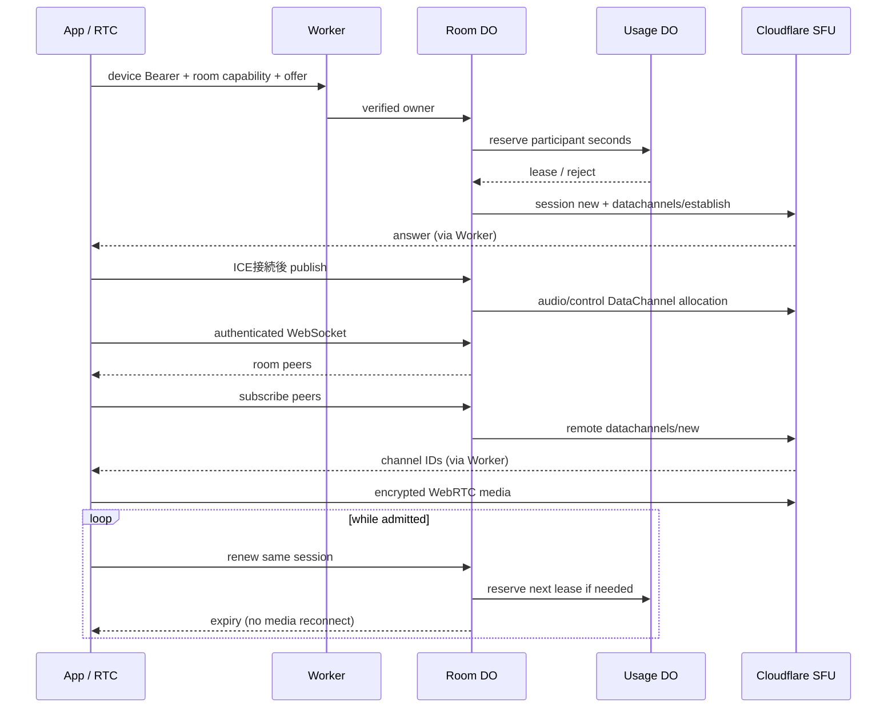

# Cloudflare Worker / SFU 仕様

## 所有する責務

少人数の招待制試用から公開へ進める際に、通話経路を作り直さず利用枠を制御する。Realtime SFUの音声を使用し、Cloudflare App SecretをAppへ配布しない。運用手順は[Cloudflare試用手順](../../development/Cloudflare試用手順.md)、確認状況は[検証](../../validation/README.md)を参照する。

| 責務 | 実装 |
|---|---|
| Worker入口 | Apple確認済みユーザーの端末Bearer、または試用registryの資格を検証。秘密の部屋capabilityでルーティング |
| AppleAuthAttempt / UserAccount (SQLite DO) | 使い捨てnonceとApple署名の検証、ユーザーと端末の区別、端末資格の発行・照合・失効 |
| AppAttestKeyIndex (SQLite DO) | 検証済みApp Attest公開鍵について、有効な登録先を端末1台に限定 |
| SignalingRoom (SQLite DO) | 部屋最大8人。SFU establish / publish / subscribe / closeを所有者だけに許可。WSは参加者一覧・App dataに限定 |
| UsageGuard (SQLite DO) | 全部屋共通の同時数、月の参加者秒、端末ごとの開始回数、認証ユーザーごとの1接続枠を同じ同期KV更新で予約 |
| Realtime SFU | 音声媒体。端末ごとに1つのPeerConnection。Cloudflareが他の参加者の音声を配信 |
| RTC package | full SDP交換、lease自動更新、WS再接続、符号化済み音声のDataChannel中継 |
| App | Worker origin・個別端末資格をKeychainに保存。招待group credentialとともにRTCへ渡す |

通知宛先・用途別capability・短期呼出しは[通知API](通知.md)を参照する。通知停止・設定不足は既存の認証・通話APIと独立する。

## HTTP / WebSocket 契約

`R = /api/rooms/{groupHash}`。groupHashは64桁hexの秘密capabilityで、招待secretからRTCが導出する。guessableなgroup IDだけで部屋に入れない。通話APIは端末Bearer必須。`/health`と下記のApple登録開始・交換はBearer不要。ClientにSFU App ID/Secretを返さない。

### Apple認証と端末資格

[Appleの検証手順](https://developer.apple.com/documentation/signinwithapple/verifying-a-user)に従い、固定のApple公開鍵からJOSEでRS256署名・issuer・audience・有効期限を検証し、serverが発行したnonceと照合する。Appの端末内ログインだけをserverの本人確認とは扱わない。

| API / 条件 | 契約 |
|---|---|
| POST `/api/auth/apple/challenge` | UUIDの`deviceID`を受け、5分有効の`challengeID`・`nonce`・`expiresAt`を返す。native Apple requestのnonceへそのまま渡す |
| POST `/api/auth/apple/session` | `challengeID`と最大16KiBの`identityToken`を照合し、`userID`・`deviceID`・`expiresAt`・`accessToken`を返す。nonceは並行再送でも1回だけ消費する。1つのchallengeの検証試行は5回までで、外部鍵取得前に回数を永続化する。上限後は新しいchallengeが必要 |
| GET `/api/auth/session` | 端末Bearerを照合し、ユーザーID・端末ID・期限だけ返す |
| DELETE `/api/auth/session` | そのBearerの端末資格だけを失効。他の端末は維持。通話サービス停止中も操作できる |
| 同一人物 | Apple subjectのハッシュでユーザーDOを解決する。DO内で256bit乱数の公開`userID`を保存し、同じAppleユーザーの複数端末・再ログイン・全端末の資格期限切れでも維持する。アカウント削除だけで破棄し、再登録時は新しいIDへ対応する。表示名やメールによる統合はしない |
| 識別子の分離 | `ri1`資格内のDO locatorは認証先を解決する内部IDであり、公開`userID`と一致させない。相手への本人確認・通知許可にlocatorやBearerを配布しない。AppはHTTPS登録応答のユーザーIDと資格を別々に検証する |
| 資格の保持 | 端末資格は30日有効、同一device IDの再認証で置換。serverには秘密のSHA-256と期限を保持し、秘密自体・Apple token・メール・Apple生IDを保存しない。DO名にもApple生IDを使用しない |
| 登録数 | ユーザーごとの有効な登録資格は最大8端末。上限でも登録済み端末の再認証は可能。WebRTC同時接続数とは別の上限。超過時は409 / `device_limit_reached`を返す |
| 登録入口の制限 | challenge・sessionのPOSTを合算し、edgeの`CF-Connecting-IP`ごとに30回/60秒、全送信元で300回/60秒をRate Limiting bindingで判定。body読取・DO作成・Apple検証より前に拒否する。超過は429 / `enrollment_rate_limited`と`Retry-After: 60`。端末IDや`X-Forwarded-For`で枠を分割しない |
| 制限の保持範囲 | bindingのkeyはUTC日付と送信元IPのSHA-256。生IP・hashをDOやAppへ保存・ログ出力しない。hashも匿名性の保証とは扱わない。ProductionとPreviewで異なるrate limit namespaceを使う |
| 制限の障害 | binding不在・例外、送信元不在・長さ不正は登録を503で拒否。既存端末資格の照合・失効、通話API、Local通話はこの登録制限の対象外 |
| 期限 | challengeと端末資格を期限時のalarmで整理し、照合時も期限を判定。server再起動後も期限は延びない |
| 所有者 | 通話sessionのownerはuser IDとdevice IDの組合せ。同一ユーザーでも他端末のsessionを操作できない |
| エラー | 不正bodyは400、検証失敗・期限切れ・再送は401、登録数上限は409、登録頻度上限は429、Apple鍵取得等の障害は503。tokenやApple応答内容はログ・エラーへ出さない |
| 有効化 | `APPLE_AUTH_ENABLED=true` と `APPLE_CLIENT_ID` が揃う環境で新規登録を受け付ける。実Bundle IDを `APPLE_CLIENT_ID` に指定する。新規登録が無効な環境でも、発行済み資格の照合と自己失効は使える |

AppのSettingsからnonce取得・native Apple認証・資格保存と、サインアウト時の自己資格失効を接続した。端末側の失効再試行と保存失敗時の扱いは[App通信仕様](../App/通信仕様.md#appleログインと端末内データ)を参照する。

[CloudflareのRate Limiting API](https://developers.cloudflare.com/workers/runtime-apis/bindings/rate-limit/)はlocation単位で非同期に集計する近似制限であり、分散攻撃の厳密な全世界上限・請求額上限ではない。共有回線では登録枠を共有する。公開時のedge対策・請求監視・緊急停止は別途整備する。

このserver実装は公開運用の完了ではない。Apple認可取消とAppからの削除は後述の契約を実装済みであり、実サービス受入・削除対象サービスの範囲・サーバー通知は後続工程とする。登録成功応答を失った場合は新しいnonceで再認証する。端末が自身の資格を失効させた後は新規APIとlease更新を拒否し、成立済みのmedia・WebSocketは現在のlease回収まで残り得る。アカウント削除では次節の即時回収を開始する。

### ユーザーと端末の署名付き証明

`POST /api/auth/identity`はApple端末Bearerを検証し、`memberID`とP-256の端末公開鍵`deviceKey`を受ける。公開鍵は65byteの非圧縮表現をpaddingなしbase64urlで送り、曲線上の有効な点を確認する。仮の招待枠IDは認めない。bodyのuserID・deviceIDは採用せず、確認済みの資格から取得する。登録入口と同じ頻度制限を適用し、署名後にも資格を確認して失効・削除と競合した応答を拒否する。

| 項目 | 契約 |
|---|---|
| 応答 | `certificate`と`issuerKey`。certificateはJOSE ES256のcompact JWT、headerは`alg: ES256`・`typ: rideintercom-device+jwt`。issuerKeyは署名用公開鍵の非圧縮表現をbase64url化したもの |
| claims | `iss`は要求先のHTTPS origin、`aud`は`rideintercom-peer`、`sub`は公開userID。`deviceID`・`memberID`・`deviceKey`・`sessionBinding`・秒単位の`iat`・`exp`を含む。Apple ID・メール・Bearer・内部DO locatorを含めない |
| 有効期間 | 発行から最大30日、かつ元の端末資格の期限以内。サーバーへ証明のコピーや端末公開鍵の追加登録を保持しない |
| 発行鍵 | `DEVICE_IDENTITY_SIGNING_KEY`へES256/P-256のprivate JWKをsecretとして設定する。未設定・破損時は503。Appへは公開部分だけ返す。環境ごとに管理し、ソース・ログへ秘密を入れない |
| 信頼の取得 | App自身の設定済みサービスへのHTTPS認証要求の応答から公開鍵を取得する。相手が送る証明・招待内の鍵をそのまま信頼の起点にしない。サービスoriginが異なるIDを統合しない |
| 限界 | 証明は発行時のユーザーと端末鍵の対応であり、直接招待・通知許可ではない。直接招待では一意な招待と受取内容への端末署名で秘密鍵の所持を確認する。接続中の本人名は、新しい確認値への端末署名と保存した相手の端末鍵を照合する。音声接続全体や通知の認可がこの証明だけで完成したと読み替えない。オフラインで削除・失効を即時照会できるという意味ではない |

`sessionBinding` は `ri1` の末尾の秘密をUTF-8としてSHA-256にかけ、小文字hexにしたサーバー保存値を、もう一度UTF-8としてSHA-256にかけた小文字hex。証明発行時に、既存の公開アカウント索引へ証明の発行者を端末資格の期限まで登録する。通知の配信設定とは独立している。索引は受信者の登録・通知許可の発行と共有し、アカウント削除で回収する。[背景用のグループ招待](通知.md#背景用の一件分のグループ招待を受け付ける)は、証明内の値と現行端末資格の値を照合する。同じ端末IDで再ログインしても古い証明を新しいセッションに使えない。既存の招待・受領で使用する端末鍵と公開IDは同じ形式で扱う。

署名鍵の変更時にはAppで証明と信頼する公開鍵を再取得する。期限切れ・未知の署名鍵の証明で新たに同一人物として統合しない。Local通話の開始をこのAPI呼出しへ従属させず、公開identityが未取得でも既存のAppleログイン・グループ認証の経路は維持する。公開通知を追加する際は、受取側の用途別許可・取消とオンライン資格の失効確認を別途接続する。

#### 招待を預けるサービスの暗号化公開鍵

対象サービスに `INVITATION_RELAY_KEY_SEED` が設定されている場合、既存の端末証明の署名対象に `invitationRelayKey: {kid,x,expiresAt}` を加える。設定するのは環境専用のランダムな32byteをpaddingなしbase64urlで表現したsecret。未設定や形式不正では項目を省略し、既存の端末証明を発行する。応答のキー構成と認証手順は変えない。

公開鍵はRFC 7748のX25519の32byte公開座標をpaddingなしbase64urlとした `x`。発行時刻をUnix秒として30日ごとの区間番号 `period = floor(iat / 2592000)` を求める。HKDF-SHA-256で32byteのX25519秘密鍵を導出する。入力は元の32byte、saltはUTF-8の `rideintercom.invitation-relay-key.v1` を使う。infoは空白を加えない `JSON.stringify([iss,period])` のUTF-8とする。鍵識別子は `v1-{period}`、公開鍵の期限はUnix秒の `(period + 2) * 2592000`。新しい証明は次の区間で別の公開鍵を受け取る。旧区間の公開鍵にも次の区間の末まで期限があるので、発行済み証明の有効期間を覆う。

本番とPreviewには別々のsecretを使い、同じsecretであってもoriginが異なれば鍵が異なる。区間ごとの鍵の生成や交換に定期の手作業は発生しない。Workerは元のsecret・導出した秘密鍵・証明のコピーを返さず、公開鍵の追加DB、回収処理やアラームも作らない。Workerが前の期間の鍵で開ける範囲は[招待の背景転送を保護する](#招待の背景転送を保護する)に従う。[X25519の定義](https://www.rfc-editor.org/rfc/rfc7748.html)、[CloudflareのWeb Crypto](https://developers.cloudflare.com/workers/runtime-apis/web-crypto/)

### アカウントの端末登録削除

| 項目 | 契約 |
|---|---|
| API | `DELETE /api/auth/account`。端末Bearerが示すアカウントDOだけを対象にする。有効資格、または後述のfresh Apple本人確認で認可する。`expectedUserID`は削除対象の世代条件であり、他アカウントの選択には使わない |
| 削除範囲 | 対象アカウントの公開userIDと全端末資格を同じSQLite transactionで削除する。他アカウントの資格は維持する。登録入口・通話サービスの停止中も削除を受け付ける |
| 再登録 | 新しい公開userIDを発行し、古いIDの関係を引き継がない。並行する登録は同じ新IDを使う。WebRTCの接続枠は内部アカウントIDで管理し、Apple取消または削除前の通話資源が未回収なら登録を`409 deletion_pending`で拒否する。関係・通知許可を内部IDへ結び付けない |
| Apple取消用の再認証 | 同じAPIへ任意の`challengeID`・`identityToken`・`authorizationCode`を一緒に渡せる。challengeの端末とBearerの端末、Apple subjectから求めたアカウントDOを照合する。コード交換応答の署名・audience・subject・nonceも確認し、別人のコードを取消へ使わない。通常ログインではApple refresh tokenを追加保存しない |
| 失効後の復旧 | 再認証proofに保存済みの公開`expectedUserID`を追加できる。Apple subjectがBearerのDOと一致し、challengeの端末も一致した場合だけ、失効・30日期限切れ・受領記録の失効後も復旧を許す。現在の公開IDが対象と違う場合は`deleted: true, appleAuthorizationRevoked: false, newerAccountPreserved: true`を返す。この場合は新規登録・Apple認可を保持する。元の対象が存在しないことを確認した結果であり、新しいアカウントを削除した意味ではない。コード交換も行わない |
| Appleへの通信 | 固定originの`/auth/token`と`/auth/revoke`だけを使用し、redirectを追わない。native認証のためredirect_uriを送らない。Workerは環境別のSign in with Apple用`.p8`・Key ID・Team IDと`APPLE_CLIENT_ID`から必要時にclient-secret JWTを生成する。有効期間は5分で、残り1分になるまで同じisolate内で再利用する。期限更新を運用者へ要求しない。コード最大8192文字・identity token最大16384文字、交換応答最大32768byte、各HTTP要求8秒。取消の200を成功とし、過去に取消済みの場合も同じ結果として扱う |
| 応答 | データ削除は`deleted: true`。Apple取消の200を確認した場合だけ`appleAuthorizationRevoked: true`。トークンを保持して再試行中なら`appleAuthorizationRevoked: false, appleRevocationPending: true`。Apple証明を送らない削除は従来どおりfalseで、手動取消が必要。稼働媒体の回収待ちは`mediaCleanupPending: true`で別に返し、回収後は省略する。`deleted`単独は媒体回収や端末内消去の完了を意味しない |
| 同時実行 | Appleコード交換前に30秒の準備参照を永続化し、同じアカウントの二重交換・再登録・別の削除を抑止する。交換失敗は準備を解除し、データを保持する。取得したrefresh tokenと資格削除を同じtransactionで保存してから取消へ進む。取消または媒体回収待ち中の再登録は`409 deletion_pending`。成功した古い削除の再送ではAppleコードを再交換しない |
| 取消再試行 | 最初の失敗から1分・5分・30分・2時間・6時間の順でalarmを予約し、自動実行は初回を含め最大6回。以後は利用者の同じDELETE再送で再試行し、最低1分間隔を保持する。試行前に次回時刻を保存し、並行DELETE・alarm・再起動で頻度を増やさない。未完のrefresh tokenは受領記録の24時間を超えても保持し、取消成功時に消す |
| 応答を失った再送 | 削除対象の公開userID、削除元のdeviceID・資格hash・削除時刻・Apple取消状態を含む受領記録を1件、完了から24時間保持する。取消待ちの場合だけrefresh tokenと試行状態も保持する。同じ資格での再送は成功を返すが、その後の新規登録へ削除を再適用しない。別の失効済み資格だけでは401。同じ本人のfresh proofと対象IDが一致した別端末は、最大8件の再試行用deviceID・資格hashを追加でき、元の端末も引き続き再送できる。受領記録の有効期間内に新規登録があった場合も、古い再送には`newerAccountPreserved`を返して新しいApple認可の解除を案内させない。既存の取消tokenを再利用し、追加のAppleコード交換はしない |
| 登録との競合 | challengeの発行時刻が保持中の削除時刻以前なら登録を401で拒否する。新しいchallengeから再認証する。時刻はserverで設定し、clientの申告値を使わない |
| 通話回収の参照 | 公開資格のroom操作前にUserAccountへroom DO参照を登録し、公開IDの一致も再確認する。最大8参照。媒体のないroomは参照を外す。削除transactionで参照を受領記録へ移し、進行中のjoin応答もroomの直列処理後に回収する。表示名・グループ情報は追加保存しない |
| 媒体回収 | 削除対象の公開IDに属するmember／準備中TURNだけを失効させ、WebSocketへCloseを送り、参加者通知から除外する。SFU channel・TURN資格を既存の確認付き回収処理で閉じ、内部account ID・公開IDの世代・roomが一致する予約だけを解放する。他ユーザーの通話は維持する。内部回収pathは公開APIとしてルーティングしない |
| 媒体回収の再試行 | Apple取消とは独立に、同じ1分・5分・30分・2時間・6時間、初回込み最大6回のaccount alarmを使う。以後は最低1分間隔のDELETE再送。roomの既存lease回収も継続する。未完のroom参照は24時間を超えて保持し、全回収後に除去する。再起動・応答喪失でも同じ公開IDの回収だけを再実行する |
| 回収と限界 | 完了後24時間で受領記録を削除する。provider障害・タイムアウト中は回収待ちを返し、物理ネットワーク切断の即時完了を保証しない。バックアップの物理削除や他端末内のオフラインデータ消去をこのAPIの完了として扱わない |

Appの再認証・削除確認・復旧・取消待ち／手動取消の案内・端末内データ消去は[App仕様](../App/通信仕様.md#アカウント削除と端末内消去)を参照する。稼働媒体回収の実サービス受入とサービス範囲の整理は[残課題](../../backlog/未実装課題.md)で続ける。Apple tokenを持たない場合でもデータ削除を進め、必要なら手動の認可取消を案内する方針は[Apple TN3194](https://developer.apple.com/documentation/technotes/tn3194-handling-account-deletions-and-revoking-tokens-for-sign-in-with-apple)に基づく。

Appleとのコード交換・取消の契約は[Token validation](https://developer.apple.com/documentation/signinwithapplerestapi/generate-and-validate-tokens)と[Token revocation](https://developer.apple.com/documentation/signinwithapplerestapi/revoke-tokens)を適用した。

旧試用の静的`CLIENT_TOKENS_JSON`の照合は現行コードに残る。試用の手順はApple登録と固定Previewの短期試験を使う。`ri1.`資格が無効でも静的registryへfallbackしない。静的資格には確認済みユーザーIDがないため、以下のユーザー単位制限は公開用のApple端末資格へ適用する。

固定Previewで音声だけを確かめるときは、`[previews.vars]` の `PREVIEW_MEDIA_TRIAL` で試験用の資格を2件だけ設定できる。設定には通信先のグループを表すハッシュ、発行時刻、有効期限、資格のSHA-256と参加者IDを記載する。固定PreviewのHTTPS originに限り、発行から最大20分の間、指定グループと指定参加者でのICEと通話参加、本人のセッション操作、利用枠の読み取りを許可する。期限外、設定なし、紐づけ違いでは401を返す。この資格は既存の試用資格照合へ引き継がない。試験終了時は通話とTURNの回収を確認し、設定を削除して再配置する。

### ユーザー単位のWebRTC接続予約

| 場面 | 動作 |
|---|---|
| 接続の単位 | serverがApple端末資格から確認した内部アカウントIDにつき、全room・全端末で有効な接続予約を1つにする。同じ端末が別participant IDや別roomを使っても追加できない |
| 接続準備 | TURN有効時はICE資格の発行前、無効時はjoinのSFU呼出前に予約する。ICE・join・renewは同じroomとparticipantの予約を共有する |
| 同時要求 | UsageGuardの既存予約とユーザー対応を同じ同期KV書込で確定する。新たなDOや定期pollingは追加せず、外部I/Oを同期区間に含めない |
| 追加接続 | HTTP 409 / `account_in_use`。先の接続を追い出さず、追加側へ既存通話の終了を案内する。受信したX-User・X-Ownerは信用せずWorkerが置き換える |
| 更新・解放 | 同じ予約の重複準備・更新を許す。終了と準備取消はSFU/TURNの回収後に解放。SFU session作成後の失敗も回収まで予約を保持する |
| 再起動・通信断 | 予約と内部アカウントIDの対応を永続化。通信断で終了要求が届かない場合、既存leaseの満了後に新規予約が可能になる。無効な資格の更新は認めない |
| 保持情報 | 既存のroom/participant予約に内部アカウントIDと公開ID・端末ID由来のownerを対応付ける。メール・本名・表示名・ユーザー一覧は追加保存しない。解放・期限切れ整理で対応も削除する |

これは有効な接続予約の制御であり、lease満了とprovider上の実媒体回収は同時完了の保証ではない。alarm遅延やprovider障害時には旧媒体が回収まで残り得る。任意に新旧2端末を併用する切替機能は提供していない。復旧時の重複の上限・切替方針は[残課題](../../development/history/旧未実装課題の完了済み経緯.md#appleでのログインと通知先の識別)で継続する。Appの案内は[通信仕様](../App/通信仕様.md#rtc-error-の扱い)を参照する。

| Method / path | 入力 | 結果 |
|---|---|---|
| GET `/health` | なし | `service="RideCom SFU"` / `protocol=1`。SFUへの接続確認ではない |
| GET `/api/status` | Bearer | 月の予約参加者秒・上限・active数。試用資格を持つ人に公開 |
| POST `R/join` | participantId、iceLeaseID、offer {type,sdp} | sessionId、expiresAt (Unix ms)、renewAfterSeconds、answer |
| POST `R/sessions/{id}/publish` | `{}` | audio/control channel ID。ICE接続後、同じsessionで1回確保 |
| POST `R/sessions/{id}/pull` | peerIds | peerID・channel ID・転送方針。部屋外peerは拒否 |
| POST `R/sessions/{id}/renew` | `{}` | 同じsessionIdのlease。前半の重複更新は予約追加しない |
| DELETE `R/sessions/{id}` | なし | 全channelをclose。利用枠のactive slotを解放 |
| GET `R/sessions/{id}/signal` Upgrade | Bearer | Hibernation WebSocket。1 sessionにつき1接続 |
| WS → server | `{type:"appData",namespace,payload:base64}` | serverが送信者を付与して同部屋へ中継 |
| WS ← server | `{type:"peers",peers:[{id,sessionId}]}` / appData | RTCが差分購読 / App data受信 |

| 拒否・上限 | 動作 |
|---|---|
| 401 / 403 | 未登録資格 / 他ownerのsession / 部屋外の購読を拒否 |
| 400 | 不正route/body/SDP。HTTP body最大64KiB、SDP最大48KiB |
| 409 | duplicate participant、duplicate WS、同じ認証ユーザーの別接続予約（`account_in_use`） |
| 410 | lease期限切れ |
| 429 | 部屋/同時/月/日上限。新しいSFU呼出前に拒否 |
| 502 / 503 | upstream失敗 / サービス停止・設定不足 |
| 音声形式 | joinはSCTP application m-line 1本。RTP audio/video trackを受け付けない |
| WS | 最大32KiB、600 messages/UTC分。senderを信用せず所有sessionから決定 |

公開招待URLは維持。中継用wire contractは変更し、全参加者のアプリをこの通信形式に対応するバージョンへ更新する。これはWebRTC SFU用のWorker APIであり、旧 `/api/sessions`・部屋全体のoffer/ICE中継は廃止する。

### 通話APIの頻度制限

登録入口とは別の`CALL_API_LIMIT`で、認証後・Room／UsageGuardへの転送前に過剰な通話API要求を抑える。参加者秒の予約や所有者確認は引き続き既存のDOが行う。

| 項目 | 契約 |
|---|---|
| 対象 | `GET /api/status`と有効な`/api/rooms/{groupHash}/...`のHTTP要求を合算。WebSocketの接続要求を含む。接続後のmessage上限は既存のWS制限が担当 |
| 単位と上限 | Apple確認済み資格は同じ内部account IDで600回/60秒を共有。端末・部屋・公開IDの変更で枠を分割しない。試用registryは同じownerに割り当てた資格で共有。他のaccount／ownerとは分離 |
| cleanup | `DELETE R/sessions/{id}`と`DELETE R/ice/{participantId}`は新しい頻度枠を消費しない。認証・session所有者確認を省略せず、他のpathへのDELETEは例外にしない。alarmによる回収もこの枠の対象外 |
| 認証・通知の独立 | `/api/auth/*`と`/api/notifications/*`はそれぞれ既存の制限を使用する。通話API枠が尽きてもサインアウト・アカウント削除・通知宛先／許可／呼出しの取消を妨げない。Local通話にも適用しない |
| 頻度超過 | HTTP 429、`code: api_rate_limited`、`Retry-After: 60`、`Cache-Control: no-store`。新しいRoom／UsageGuard転送やSFU／TURN呼出しより前に拒否 |
| 制限機能の障害 | binding不在・例外はHTTP 503、`code: api_rate_limit_unavailable`と同じ待機headerで新しい処理を拒否。上記cleanupはbindingなしでも可能。既存のサービス停止・SFU設定不足の判定は別で維持 |
| 保存・ログ | bindingのkey以外にaccount別の回数台帳を追加しない。Bearer・内部ID・room capabilityを応答やログに含めない |
| 設定 | Production namespace `1005`、Preview `1006`。上限は両環境とも600回/60秒で、登録用namespaceとは分ける |

現在のRTCは参加時にICE・join・publish・WebSocket接続を各1回要求し、参加者差分をまとめてpullする。最大8人でも相手は7人で、通常のleaseは600秒、更新開始は300秒後。WebSocket再接続は1秒から最大10秒へ待機を広げ、pullの接続切断後の再試行は最大2回である。statusは明示確認であり定期pollingしない。この頻度に余裕を持たせて600回/60秒とし、同一ownerに8人分の開始・全相手購読・更新・status 120回を集めた160要求が通るローカル回帰を置く。人数枠や既存の開始回数制限を変更するものではない。

[CloudflareのRate Limiting API](https://developers.cloudflare.com/workers/runtime-apis/bindings/rate-limit/)はlocation単位の近似制限で、厳密な全世界上限やmedia転送量・請求額の上限ではない。実egress・請求監視・停止運用は[未実装課題](../../backlog/未実装課題.md)に残す。RTCの429処理は既存のエラー処理のままで、今回のserver工程では自動待機・再試行を追加していない。

### 表示名を保存しない境界

RTCはjoinへ表示名を送らず、Workerは参加者の表示名を保存・配信しない。余分な`displayName`を受け取ってもmemberへコピーしない。participant ID・owner・SFU session ID・期限・channel・購読関係は接続認可と回収のため保持する。表示名は端末側のグループ情報と、グループ鍵を使って認証・暗号化したpresenceで扱う。Workerのpeer一覧ではIDだけを名前の代替値に使い、グループの復号後に相手の表示名を取得する。

新規開発のため旧形式の利用者データ移行や旧client用の互換フィールドは追加しない。これは今回以後に作る通話状態の契約であり、配置済みproviderのbackup・保存期間・過去データの物理削除を確認したものではない。

## 継続と後始末

| 場面 | 動作 / 制約 |
|---|---|
| 通常の継続 | 600秒lease、300秒後に更新要求。同じsession/PeerConnectionを維持。前払い予約を上限判定に使う |
| WS切断 | mediaを閉じず1→2→4→最大10秒で接続を再試行。leaseは独立 |
| 更新拒否 | clientは通話を終了しDELETE。届かない場合もDO alarmで期限切れchannelを閉じる |
| 異常終了 | persisted memberをalarmで回収。SFUの成功応答が失われてもstatusからchannel IDを照会。応答不明のallocationはsession消失まで回収を継続 |
| providerで既に削除 | 404/410は回収済みと扱う。その他の閉鎖失敗は記録を保持し再試行 |
| 部屋変更 | 新しいroom capabilityを使い、旧sessionを終了 |
| SERVICE_ENABLED=false | 状態取得、新規接続、媒体の追加、lease更新をHTTP 503で止める。既存の通話終了とICE接続準備の取消は、本人の有効な資格、所有権、回収に必要な提供元の資格を確認して受け付ける。接続中のWebSocketは次のメッセージで閉じる。終了要求がなければ、既存媒体の停止は次のlease alarmまで遅れ得る |

## TURN資格の契約

[公式の資格生成・失効・setConfiguration更新](https://developers.cloudflare.com/realtime/turn/generate-credentials/)を使用する。SFU App SecretとTURN API tokenは別の秘密で、端末には短期iceServersだけ返す。

| API / 条件 | 挙動 |
|---|---|
| POST R/ice/{participantId} | bodyのleaseIDは接続試行ID。端末認証・room capacity・全体利用枠を確認してから資格を発行。所有者と試行IDが同じ再試行は既存の有効資格を返す |
| TURN無効 | STUNのみ返す。TURN用の追加予約・発行はしない |
| POST R/join | TURN有効なら同じ所有者・participant・iceLeaseIDの有効な事前資格が必要。事前予約とSFU予約は同じ利用枠IDを使用 |
| POST R/sessions/{id}/renew | 同じSFU sessionを延長し、更新したiceServersを返す。Appから手動再接続を要求しない |
| DELETE R/ice/{participantId} | SFU未成立の試行だけ回収。leaseID不一致は409。古いcallbackが新資格を失効できない |
| DELETE session / expiry | SFU channel回収と短期資格失効。失効が失敗すれば記録を保持してalarmで再試行 |
| 途中離脱 | SFU未成立でもalarmで資格の期限を回収。既発行資格は自身のTTLでも制限される |
| 更新時の旧資格 | 新資格が端末へ届く前に旧資格を即時失効させない。旧資格の期限まで保持し、切断時は未期限切れの全資格を失効 |
| TTL | 利用枠の有効期限までを秒へ切り上げ、最大7200秒。最大3600秒のleaseの前倒し更新を含む。通常既定は初回600秒程度 |
| 秘密の保存 | 短期資格をroom DOへ保存。no-store応答で返し、ログ・runtime reportへ含めない。取得・失効の長期秘密はWorkerのみ |

通話開始前のICE接続準備は、SFUの設定が欠けていても取り消せる。本人の端末資格、予約の所有者と試行IDを確認する。取消では既存のTURN資格と予約を回収し、SFUへ要求を送らない。TURNトークンがない間は提供元への送信を止め、回収待ちの記録を残す。資格を揃えてから再試行する。開始済みの通話は通話終了の入口で回収する。

TURN資格は受け取った端末から別用途へ持ち出され得る。参加者秒・発行制限は実wire byteの厳密な請求上限ではない。公開向けの追加作業は[課題](../../backlog/未実装課題.md)、実サービスでの受け入れは[検証](../../validation/未確認事項.md)に分ける。

未成立のTURN試行もroom上限内で並行回収する。各外部APIの8秒timeoutを端末数だけ逐次加算せず、DOのblockConcurrencyWhileの時間上限内に収める。失効に失敗した記録は次のalarmへ残す。

## 設定値

`server/wrangler.toml`のWorker名は管理画面で作成済みの`rideintercom`と一致させる。Productionはtop-levelの`vars` / `durable_objects`、プレビューは`previews.vars` / `previews.durable_objects`を使用する。プレビューは通常変数とDO bindingをProductionから継承せず、DO namespaceもプレビューごとに分離される。top-levelの既存`v1` migrationは保持する。

TestFlightで配布したAppは、本番Workerとproduction APNsを使う。固定Previewは開発署名とsandbox APNsによる開発試用に使う。[配布環境の要求](../../requirements/製品要求.md#購入復元共有と公開条件)

固定PreviewのSFU App IDとTURN Key IDは `previews.vars` に記載する。Previews BaseのシークレットはPreview作成時に取り込まれる。既存の固定Previewに追加・更新するシークレットは、そのPreviewを対象に登録する。GitHub連携ではmainの配置コマンドと固定Previewの配置コマンドを分ける。[CloudflareのPreview設定](https://developers.cloudflare.com/workers/previews/configuration/#secrets)

本番と固定Previewのビルドに使うNode.jsは、共通の `server/.node-version` で指定する。[配置とビルドの確認手順](../../development/Cloudflare試用手順.md)

リポジトリの `wrangler.toml` は、環境ごとに次の値を明示する。実際に稼働する値と鍵の反映状況は[最新の配置で確認した試用条件](../../development/Cloudflare試用手順.md#最新の配置で確認した試用条件)を参照する。

`wrangler.toml` は、Worker単位のObservabilityとLogpush、ログとトレースの取得・永続化、呼出ログを無効にする。ログとトレースの転送先は空とし、URLのクエリ除去を有効にする。本番と固定Previewは同じ設定を使う。配置後は、各設定と転送先を管理APIで読み戻す。アカウント全体の転送設定と過去の保存データは運用の監査で確認する。[Previewに適用される設定](https://developers.cloudflare.com/workers/previews/configuration/#what-goes-in-the-previews-block)

| 設定 | 本番の `vars` | `previews.vars` |
|---|---|---|
| `SERVICE_ENABLED` | `true` | `false` |
| `APPLE_AUTH_ENABLED` | `true` | `false` |
| `TURN_ENABLED` | `true` | `false` |
| `NOTIFICATIONS_ENABLED` | `true` | `false` |
| `APNS_ENVIRONMENT` | `production` | `sandbox` |

次の表は設定の既定と有効化の条件を示す。

| 設定 | 既定 | 意図 |
|---|---|---|
| SERVICE_ENABLED | 無効 | 資格を登録し、`true` を指定した配置で課金対象の処理を受け付ける |
| APPLE_AUTH_ENABLED | false | 新規Apple認証・端末登録を明示的に有効化する。公開前にApp連携とabuse制限を整える |
| APPLE_CLIENT_ID | 未設定 | Apple identity tokenのaudience。iOS/macOS AppのBundle IDと一致させる |
| APPLE_SIGN_IN_PRIVATE_KEY | secret未設定 | Appleコード交換と認可取消用のSign in with Apple `.p8`。Workerが短期client-secret JWTを生成する。APNs鍵と共用せず、端末へ渡さない |
| APPLE_SIGN_IN_KEY_ID | Variable未設定 | 上記Sign in with Apple鍵のKey ID。画面で対応を確認できる通常Variable |
| APPLE_TEAM_ID | Variable未設定 | Sign in with Apple鍵とAPNs鍵を所有する共通のApple Developer Team ID |
| MAX_ROOM_PARTICIPANTS | 8 | hard maximumも8 |
| MAX_ACTIVE_SESSIONS | 32 | 全部屋共通、maximum512 |
| MONTHLY_PARTICIPANT_SECONDS | 1,000,000 | UTC月でリセット。失敗/早期切断の予約も返金しない |
| LEASE_SECONDS | 600 | maximum3600。短すぎる値はHTTP回数と障害感度を増やす |
| TURN_ENABLED | false | trueならSDP生成前にTURN資格を発行。未設定の長期秘密がある場合503で止め、STUNへの暗黙fallbackで成功を装わない |
| CLOUDFLARE_TURN_KEY_ID | Variable未設定 | Realtime TURNのkey ID。SFU App IDとは別。認証値ではなく環境別の通常Variableとして配置する |
| CLOUDFLARE_TURN_API_TOKEN | secret未設定 | TURN資格発行・失効用の長期token。端末へ渡さない |

## 購読の入替

| 項目 | 契約 |
|---|---|
| peer snapshot | id/displayName/sessionId。認証済みroom参加者だけに通知 |
| 再参加 | publication sessionIdが変わる。listenerは離脱peerのchannelをcloseして再購読し、同じPeerConnectionを維持 |
| 端末registry | 招待制試用向け。約4.5KiBまで |

## 異常入力とcleanupの期限

HTTP JSONはobjectだけを受け入れ、最大64 KiB・読取完了まで3秒。停滞したbodyをcancelしてroomを解放する。joinのparticipantIdは文字列のASCII英数/ハイフン/アンダースコア1–63字とする。displayNameは空白のみ不可・制御文字不可・UTF-8最大320 byteとする。SCTP属性は`a=sctp-port:5000`行の完全一致を要求する。WebSocketのnull/array/primitiveは例外にせず1008で切断する。

alarmは開始時点のmemberとTURN leaseを取得する。その後、member cleanup（status取得・channel close・TURN revoke）と、memberを所有者に持たないorphan資格の失効を同時に始める。同じ資格を二重失効しない。独立batchを順番に待って8秒の上限を余分に足さない。各provider操作の上限は8秒、失敗記録は保持して再試行する。

## グループ除外の端末署名検証

Worker内部の検証は、登録済み端末のP-256公開鍵、App ID、Appleの起動検証カテゴリ、ビルド番号、前回の署名カウンタを使う。署名対象の `clientData` は `["rideintercom.group-removal.v1", nonce, operationHash]` を空白なしのJSONでUTF-8にしたバイト列。 `nonce` と `operationHash` は小文字の16進64桁。 `SHA256(authenticatorData || SHA256(clientData))` をAppleが署名するnonceとし、ECDSA P-256とSHA-256でDER署名を検証する。[Appleの検証手順](https://developer.apple.com/documentation/devicecheck/validating-apps-that-connect-to-your-server)

| 検証条件 | 結果 |
|---|---|
| RP ID、起動検証カテゴリ、ビルド番号が登録値と一致し、署名が正しく、確認要求の期限内かつ `counter > 前回値` | 確認要求の消費とカウンタの更新を同じSQLiteトランザクションで確定する |
| ビルド番号が省略された開発署名版 | Appleの起動検証カテゴリが3で、登録値が明示的に `null` の場合に限り、他の照合条件を満たせば受理する |
| 不一致、形式不正、期限切れ、確認要求が既に消費済み | 確認要求とカウンタを変更しない |

署名のauthenticator dataは37バイトのヘッダーと拡張マップを照合する。拡張を示すビットを必須とし、Macが併せて設定するattested-credentialビットも、拡張マップが正しく署名を検証できる場合に受理する。登録済み端末から除外署名を受け付ける公開APIは未実装。起動検証カテゴリは証明書のAAGUIDが示すApp Attestの環境と独立して確認する。[MacとローカルWorkerでの検証](../../validation/history/通常グループの代表端末検証.md#macが取得したapp-attest署名をローカルworkerで照合する)

### 端末鍵登録の確認要求

登録に使う確認要求は `POST /api/auth/device-attestation/challenge` で発行する。端末Bearerと空のJSONオブジェクトを受け、 `nonce`（乱数32バイトの小文字16進）と `expiresAt`（Unixミリ秒）を返す。アカウントと端末はBearerから決める。期限は発行から5分と端末資格の期限のうち早い方。期限内の並行・再試行では同じ値を返し、期限ちょうどから新しい値を発行する。確認要求は端末資格と同じSQLiteレコードに保存し、資格の更新・失効とアカウント削除で破棄する。期限切れは既存のalarmで回収する。

`DEVICE_ATTESTATION_ENABLED=true` の環境でだけ発行する。無効時は503、未認証は401、POST以外は405、本文が空のJSONオブジェクト以外なら400。既存のApple登録と同じ送信元・全体の頻度制限を用い、上限超過は429を返す。

### Macの端末鍵証明

公開鍵を登録する前に、Worker内部の検証でApp Attestの証明を照合する。入力は最大16 KiBのCBOR、32バイトの鍵IDを標準Base64にした文字列、その登録に発行した16進64桁の確認要求。App ID、App Attestの環境、起動検証カテゴリ、ビルド番号の期待値はサーバー側で指定する。

| 照合対象 | 受理条件 |
|---|---|
| 鍵証明の形式と有効性 | Apple形式のCBORからleaf・中間証明書と空でないreceiptを取得する。DER全体が読み取れ、証明書が有効期間内にあり、固定したApple App Attestation Root CAまでのチェーンが成立する |
| 確認要求とMacのセキュリティ条件 | leafのnonce拡張が `SHA256(authData \|\| SHA256(UTF8(確認要求)))` に一致し、ACL拡張がAppleの指定値と一致する |
| 本人のAppと期待する配布条件 | RP IDが期待するApp IDのSHA-256に一致し、AAGUIDが期待する環境を示す。カウンタは0で、起動検証カテゴリとビルド番号が期待値に一致する。ビルド番号の省略条件は端末署名と同じ |
| 鍵 | leafとCOSEの鍵が同じP-256公開鍵で、その非圧縮X9.62形式のSHA-256、資格ID、提示された鍵IDが一致する |

すべて成立すれば、P-256公開鍵・App ID・起動検証カテゴリ・ビルド番号・カウンタ0を呼び出し元へ返す。不一致や形式不正では登録に渡す値を返さない。iPhoneの鍵証明は検証対象外。Appleのfraud metric用receiptの別途検証・保存は未接続。[Appleのルート証明書](https://www.apple.com/certificateauthority/private/)、[Appleの検証手順](https://developer.apple.com/documentation/devicecheck/validating-apps-that-connect-to-your-server)、[ローカル検証](../../validation/history/通常グループの代表端末検証.md#macの鍵証明から除外署名までworkerで検証する)

### Macの端末鍵登録

`POST /api/auth/device-attestation` は、有効な端末Bearerと `nonce`・`keyID`・標準Base64の `attestation` だけを受ける。発行済み確認要求と同じ端末で照合し、証明と鍵が有効な場合に、確認要求の消費と鍵・カウンタ0の保存を同じ端末レコードの置換で確定する。成功応答は `{ "registered": true, "expiresAt": <Unixミリ秒> }`。同じ本文の再送は元の結果を返し、カウンタを初期化しない。証明の検証は確認要求ごとに最大5回で、上限は429。異なる端末・期限切れ・無効な証明は401。不正な本文は400。

鍵索引はApp Attest環境・App ID・公開鍵のハッシュごとのSQLite DO。証明を検証した後に予約し、別端末で予約済みなら409。索引にはアカウントと端末の組のハッシュ、予約ID、期限だけを保持する。予約後も資格と確認要求を再照合し、途中で失効した場合は登録せず予約を解放する。端末レコードに証明の原本を保持せず、再送の照合には本文のハッシュを使う。

鍵と予約の期限は登録に使ったBearerの期限。Bearerの再発行は登録済みの鍵・カウンタ・元の期限を引き継ぎ、未使用の確認要求を破棄する。別の鍵への更新、端末失効、アカウント削除では旧鍵を外して索引を解放する。通信などで索引の解放に失敗した場合も、旧端末には登録を戻さず、索引は元の期限で回収する。[登録と失効のローカル検証](../../validation/history/通常グループの代表端末検証.md#端末鍵の登録を確認要求とアカウントに結び付ける)

## 個人削除の暗号文中継

署名済み削除と受取確認の暗号文を送信側の `UserAccount` に一時保存する。通常の操作には端末Bearer、背景での送出には[用途を限定した端末署名](#背景転送から個人削除を預かる)を使う。Workerが扱う `slot` は端末対が持つ推測困難な64桁小文字hexの値で、保存するキーにはそのSHA-256を使う。受取側は公開アカウントID・同じslot・受取端末の署名を提示する。第三者の公開IDだけを指定しても、その人の受信領域に情報を追加できない。暗号文の生成と[個人削除の署名・適用](../App/通信仕様.md#個人削除の送信待ち)はAppが所有する。

| 操作 | 本文と成功応答 |
|---|---|
| PUT `/api/contact-deletions` | `{slot,id,expiresAt,recipient,recipientKey,packet}`。送信端末に記録を結び付け、`{state}` を返す。アカウントが同じでも別の送信端末からの置換は409 |
| POST `/api/contact-deletions/background-publish` | [背景転送用の暗号文](#背景転送から個人削除を預かる)。通常のPUTと同じ記録へ預け、`{state}` を返す |
| POST `/api/contact-deletions/read` | 受取側は `{owner,slot,proof}` を送り、`{deletion:{id,expiresAt,packet}}` を得る。送信側は自身の公開IDを `owner` に指定して `{owner,slot}` を送り、`{receipt:{id,expiresAt,packet}}` を得る。対象の状態にない場合や対象違いは404 |
| PUT `/api/contact-deletions/receipt` | `{owner,slot,id,packet,proof}`。受取人と指定の公開鍵を照合し、削除の暗号文を確認の暗号文に置き換えて `{state:"received"}` を返す。同じ確認の再送は同じ応答 |
| DELETE `/api/contact-deletions` | `{slot,id,expiresAt}`。送出元端末が `{state:"retired"}` にする。元の暗号文と宛先情報を回収し、元の期限までID・期限・送出元端末のみを残す。未登録のslotでも同じ印を残せるため、先に近距離で終了した削除を遅れた送出で復活させない |

`owner` と `recipient` は各公開アカウントID。 `id` は小文字UUID、`expiresAt` はUnix msの整数で、`now < expiresAt <= now + 28日 + 5分`。 `recipientKey` はP-256公開鍵のbase64url値、`packet` は40〜4096文字の標準base64。受取の `proof` は既存の端末証明と長さ付き署名を使う。用途 `readContactDeletion` は `JSON.stringify([owner,slot])`、用途 `acknowledgeContactDeletionRelay` は `JSON.stringify([owner,slot,id,packet])` を署名対象にする。JSONに空白を足さず、base64中のスラッシュはエスケープしない。Workerは証明のアカウントと端末がBearerと一致すること、および証明の鍵が記録の宛先鍵と一致することを確認する。

送信アカウント1件につき有効なslotを最大64件保持する。要求頻度は既存 `CALL_API_LIMIT` の個人削除用キーで制限する。送出の完全一致は重ねず、異なる内容への差替えは409。期限は既存のアカウントalarmで回収し、送信アカウントを削除した場合も同じ処理で回収する。受取アカウントの削除後は新しい公開IDから旧宛先の内容へアクセスできなくなり、送信側に残る暗号文は期限で回収される。[Durable Objectsのアラーム](https://developers.cloudflare.com/durable-objects/api/alarms/)

Workerは既存の `USER_ACCOUNT`、`NOTIFICATION_INDEX`、`CALL_API_LIMIT` および `DEVICE_IDENTITY_SIGNING_KEY` を使う。この中継はAPNsを呼び出さず、通知許可を取り消した後も利用できる。Appは保存済みの暗号文を送信・取得し、受取確認を照合して回収する。[Appの転送と再開](../App/通信仕様.md#個人削除の送信待ち)、[Internetの実環境受入](../../validation/未確認事項.md#internetの個人削除の実環境受入)

### 背景転送から個人削除を預かる

背景のPOSTは[共通の暗号化形式](#招待の背景転送を保護する)の `{sealed}` を受け付ける。復号したUTF-8 JSONは `{senderUserID,deviceID,sessionBinding,submission,proof}`。submissionは通常のPUTと同じ6項目のJSONを標準Base64にした値。署名用途は `publishBackgroundContactDeletion`、署名対象は空白やスラッシュのエスケープを加えない `JSON.stringify([origin,sessionBinding,submission])` のUTF-8。送信元は有効な端末セッションと照合する。署名の権限は指定した削除の送出に限る。

接続元の頻度制限を共通の背景受付と共有し、認証後は個人削除のアカウント別頻度・保管上限を使う。同じ削除の再送は元の期限と処理状態を保つ。通常のDELETEで先に回収した削除は `{state:"retired"}` を返し、復活させない。200はWorkerでの処理結果を表す。相手の端末での適用は受取確認で判定する。

不正な形式や削除期限は400、鍵・端末署名・セッションの不一致は401、使われたslotとの衝突は409、頻度や保存上限の超過は429、背景受付の鍵や接続元情報の設定不備は503。

## 個別通話の復元で暗号文を一時中継する

`/api/direct-call-restore/relay` は、既に宛先を特定した端末間で、復元に使う暗号文を預かる。`DIRECT_CALL_RESTORE_RELAY_ENABLED` が `true` の場合だけ応答し、それ以外は404。現在の本番と固定Previewの設定では無効。Workerのローカル試験では模擬環境の設定で有効にする。この経路は通知とメディアの処理から独立する。

有効にした場合、現在の端末Bearerを照合し、既存の `CALL_API_LIMIT` をアカウント単位で適用する。応答は `Cache-Control: no-store` とする。

| 操作 | 入力と結果 |
|---|---|
| PUT | JSONの `recipient` は別の公開アカウントID、`deviceID` は宛先のサービス端末ID、`sessionBinding` は宛先の証明に含まれるセッション照合値。`id` と `deviceID` は小文字UUID、`expiresAt` は現在より後で300秒以内のUnixミリ秒。`packet` は標準Base64で40〜24,576文字。順に `recipient`、`deviceID`、`sessionBinding`、`id`、`expiresAt`、`packet` を並べたJSON配列に `submitDirectCallRestoreRelay` 用途で署名し、`proof` として渡す。送信端末の署名とセッション、宛先の公開ID・端末・セッションを確認してから `queued` を返す |
| GET | 宛先端末の現在のセッションで、自分宛ての期限内の記録を取得する。各送信端末のセッションを照合し、非同期の照合後に同じ記録と宛先が残ることを確認する。`messages` の各要素は `id`、`senderUserID`、`expiresAt`、`packet`。対象がなければ空の配列を返す |
| DELETE | 宛先端末がJSONで `id` を指定し、暗号文を外す。別端末からの削除は拒否する。処理済みの記録には `retired` を返し、元の期限まで同一送信の再登録を防ぐ |

受取側の `UserAccount` に送受信のセッション照合値、期限と暗号文を保持する。記録はアカウント1件につき最大8件。完全に同じ再送は記録と期限を増やさず、同じ宛先端末と `id` に異なる内容を受けた場合は409。受取側のアカウント削除時とアラームの期限処理で回収する。送信セッションを確認できなくなった記録は取得結果に含めず、元の期限で回収する。

暗号文の作成・復号、照合先での要求の自動受信と再起動後の再送、要求・応答の回収時点は[Appの通信仕様](../App/通信仕様.md#中継を通じて復元の要求を送り通話鍵を保存する)に従う。受け渡しと通話鍵の保存を、生成した資格でローカル試験する。新端末では[保存後の回収](../App/通信仕様.md#通話鍵の保存後に応答の回収を続ける)を再起動後も続ける。実iCloudと通話の受入は[バックログ](../../backlog/未実装課題.md#icloud自動保存と招待をやり直さない端末復元)で扱う。

### 個別通話の復元先の端末証明を預かる

`/api/direct-call-restore/device` は、照合先の端末が預けた暗号文を、指定した別のアカウントに返す。発行側の現在の署名付き端末証明と、読む側の現在の端末Bearerを使う。読む側は旧端末からの資格を引き継ぐ必要がない。復元の中継と同じ変数が `true` の場合だけ有効にし、それ以外は404。頻度制限はアカウント単位。応答のキャッシュを許可しない。

| 操作 | 入力と結果 |
|---|---|
| PUT | 送る端末はJSONで `slot`・`reader`・`issuedAt`・`expiresAt`・`packet`・`proof` を送る。slotと読取を許可する公開アカウントIDは各64桁の小文字16進表記。時刻は整数のUnixミリ秒。期限は現在より後とする。発行時刻から24時間以内で、端末証明の期限を超えない。発行時刻が現在より先の場合は60秒以内。標準Base64のpacketは40〜8,192文字。最初の5項目を上の順で並べたUTF-8 JSON配列に `publishDirectRestoreDevice` 用途の署名を添える。署名者は自身の現在のセッションに限り `stored` を受け取る |
| POST | 読む端末は `owner`（預けた側の公開アカウントID）と `slot` を送る。許可されたアカウントで有効なセッションを使い、預けた時点のセッションも有効な場合だけ `{expiresAt,packet}` を返す。値が見つからない、別の読取アカウント、期限切れ、預けた端末のセッション失効はいずれも404 |
| DELETE | 預けた端末は `slot` と `reader` を送る。現在のBearerで同じ端末から受け付け、暗号文を消して `revoked` を返す。先に届いた削除でも、元の署名でまだ受付可能な預け入れを防ぐため、最長86,460秒の削除記録を置く。繰り返しの削除では期限を延ばさない |

預けた側の `UserAccount` では、slotとreaderを並べたJSON配列のSHA-256を保存キーに使う。slotとreaderの元の値は保存しない。暗号文、預けた側の端末IDとセッション照合値、発行時刻・期限を保持する。同一内容の再送では延長しない。同じ端末から、保存済みより新しい発行時刻の更新を受け付ける。古い更新、同じ時刻の相違、同じキーへの別端末の更新、削除が先に確定したキーへの更新は409。削除の記録を含め1アカウントあたり64件までで、超過は429。アカウントの削除と既存のアラームによる期限処理で回収する。

slotの導出、証明の暗号化と復号、Appからの呼出条件は[Appの通信仕様](../App/通信仕様.md#確認済みの招待から端末証明の受け渡し先を求める)に従う。Worker単体の試験と、Appの預け入れ・取得・削除後の取消を明示的に呼ぶ試験をローカル環境で実行する。預け入れ前にAppが取消に必要な項目を保存する。相手を削除した後は、発行した端末から同じslotで取消を再試行できる。保存と通信復帰からの再試行は[Appの同期仕様](../App/通信仕様.md#確認済みの相手への証明の預け入れと取消を再開する)に従う。ローカルWorkerではAppの同期を有効にして検証する。

## 通常グループの受諾と到着確認の暗号文中継

通常グループのリンクを発行した端末が、招待ごとの受け渡し先を先に開く。受諾した端末は発行端末がオフラインの間も受諾の暗号文を保存できる。発行端末は受諾端末がオフラインの間も到着確認を保存できる。Workerは暗号文と送受信の状況を保持し、Appが招待条件・署名・内容を照合して相手登録や保留解消を確定する。各HTTP要求は既存のApple端末Bearerで認証し、`CALL_API_LIMIT` をアカウント単位の招待返信用キーに適用する。既存の `USER_ACCOUNT` と `NOTIFICATION_INDEX` を使い、通話予約や通知の転送設定から独立して処理する。

[個人招待と個人登録付きグループ招待の暗号文](../App/通信仕様.md#個人招待の受諾を中継する暗号文)も同じ中継へ送れる。Appは種類に応じてslotを導出する。Workerの操作、受け渡し先の上限と回収処理は共用する。発行端末がまだ受け渡し先を開いていない場合は[発行端末の署名を添えた受諾](#発行端末が圏外の間に個人招待の受諾を預ける)を使う。

共通のパスは `/api/ordinary-group-replies/`。JSONの `slot` は招待ごとの推測困難な64桁小文字hexとし、保存キーには文字列のSHA-256を使う。 `owner` は発行者の公開アカウントID、`id` は受諾IDの小文字UUIDとする。`packet` は暗号文の標準base64（40〜12,288文字、4の倍数）、`expiresAt` はUnix msの整数（現在より後、7日と5分以内）。受諾側の紐付けには認証した公開IDと端末IDを `:` で結んだ文字列のSHA-256を使う。中継は一時保管の応答を返し、端末での転送完了はAppが判定する。

| 操作 | 本文 | 成功時の応答と状態 |
|---|---|---|
| PUT `open` | `{slot,expiresAt}` | `{}`。認証した発行端末に結び付ける。発行端末・期限・slotが同じ再要求は同じ受け渡し先を返す |
| PUT `acceptance` | `{owner,slot,id,packet}` | `{}`。受け渡し先が有効な間、受諾を保存する。同じ端末・idで再送したときは初回の暗号文と処理状態を保つ |
| POST `inbox` | `{slot}` | `{acceptances:[{id,packet}]}`。発行端末へ、到着確認をまだ保存していない受諾を返す。対象がなければ空配列 |
| PUT `acknowledgement` | `{slot,id,packet}` | `{}`。発行端末が保存済みの受諾を最初の到着確認の暗号文で置き換える。再送しても初回の到着確認を保つ |
| POST `receipt` | `{owner,slot,id}` | `{receipt:{id,packet}}`。受諾を送った同じ端末へ到着確認を返す。期限内は読み取りを繰り返せる |

不正な本文は400、無効な端末資格は401、対象がない・期限切れ・相手の暗号文を読もうとした場合は404。`open`の既存端末か期限が一致しない場合と、`acceptance`の同じIDを別端末が使うか同じ端末が別IDを使う場合は409。発行アカウントごとに有効な受け渡し先を32件、一件につき受諾を8端末分まで保持し、上限や頻度制限では429を返す。発行前のアクセスは404となり、受諾側は後で同じIDで再送できる。

期限後は受け渡し先を使えず、既存のアカウントalarmで暗号文を回収する。発行アカウントの削除と同じ処理で当該アカウントの中継記録も消す。受諾側がアカウントを削除すると、新しい公開IDで旧到着確認へアクセスできなくなり、旧暗号文は発行側の期限で回収する。[CloudflareのSQLiteストレージ](https://developers.cloudflare.com/durable-objects/api/sqlite-storage-api/)、[アラーム](https://developers.cloudflare.com/durable-objects/api/alarms/)

受け渡し先を開いたとき、`UserAccount` の回収アラームがその期限以前に予定されていれば、既存の予定を使う。予定がないか期限に間に合わない場合は、保存済みの回収期限から次の予定を決める。発行者の公開経路が同じで現在の期限が要求以上なら、`NotificationIndex` は経路を保存し直さず、現在の期限とアラームが一致しない場合だけ予定を設定し直す。経路の期限を延ばす登録では新しい期限を保存する。プッシュ通知の端末トークンは引き続き最新の登録に従う。

Worker単体の状態遷移と、Appの通常操作に続く暗号文の往復、相手登録と保留解消をローカルで検証済み。実Internetとロック中の確認は後続で行う。[Appの通信仕様](../App/通信仕様.md#通常グループの受諾を遠距離で届ける)、[Workerのローカル検証](../../validation/history/招待返信の手動共有.md#遠距離の招待返信を交互の接続で受け渡す)

### 発行端末が圏外の間に個人招待の受諾を預ける

受け手は自分の端末Bearerで通常の `PUT /api/ordinary-group-replies/acceptance` を実行する。その際は本文の `{owner,slot,id,packet}` に `admission: {deviceID,sessionBinding,expiresAt,proof}` を添える。admissionの端末・セッションは発行者のもの。期限は元の招待のUnix msで、現在より後、7日5分以内の安全な整数とする。`proof` は[端末証明を含む署名](#ユーザーと端末の署名付き証明)の `{publicKey,certificate,signature}`。用途は `openContactInvitationReply`とする。署名するUTF-8の文字列は空白を足さずスラッシュをエスケープしない `JSON.stringify([origin, sessionBinding, slot, expiresAt])` とする。originは発行先WorkerのHTTPS origin、slotはハッシュ化する前の64桁小文字hex。ownerは証明のsubjectと照合する。本文に発行者の端末Bearerを含めない。

Workerは受け手の認証・頻度制限に続き、署名と発行者の公開ID・端末ID・セッション・originを照合する。公開アカウント索引で発行者を解決し、発行者の現在の端末資格を再確認する。同じアカウント内で元の発行端末に結び付けた受け渡し先を開き、受諾の暗号文を同じ処理で保存する。発行者はその端末から受諾を取得し、受け手は元の受諾端末から到着確認を取得する。別端末へこの権限を移さない。先に同じ端末・期限で開いていても、同じ受け手・受諾IDの再送でも一件のまま扱う。

形式や期限の不正は400。署名、端末、ログイン資格の失効は401。対象の公開経路がなければ404。先に開いた発行端末・期限または受諾IDの照合が合わなければ409、既存の保管上限・頻度上限は429。署名で他の受け渡し先を作ったり受信箱を読んだりできない。発行者が証明を発行した時点で既存の公開アカウント索引を更新するため、発行者がリンクの作成後にWorkerへ手続きする必要はない。

### 招待の背景転送を保護する

個人招待の受諾、グループ招待の送信・取消、個人削除の背景受付は、共通の暗号化形式を使う。本文はJSONの `{sealed}` 一項目、全体で64 KiB以下。sealedは[サービスの暗号化公開鍵](#招待を預けるサービスの暗号化公開鍵)宛てのcompact JWE。保護ヘッダーは `{alg:"ECDH-ES",enc:"A256GCM",kid,epk}`。一件ごとに新しく作る `epk` は `{kty:"OKP",crv:"X25519",x}` とし、`x` は32byteの公開座標をpaddingなしbase64urlとしたもの。保護ヘッダーの文字列は512文字以下。Workerが使う鍵は要求先originの現区間または直前の区間の鍵に限る。元の区間の次の区間が終わると、その鍵を使った要求を拒否する。復号前はCloudflareの接続元を日単位でハッシュ化し、背景受付に共通の一時的な頻度枠を使う。枠を超えた要求は本文を読む前に429で拒否する。接続元情報を取得できない場合は503を返す。[compact JWE](https://www.rfc-editor.org/rfc/rfc7516.html)、[JOSEでのX25519](https://www.rfc-editor.org/rfc/rfc8037.html)

暗号文と復号した署名付き要求はWorkerのメモリ内で扱う。認証や復号を通った後は、用途に応じた既存の保管と上限を使う。

### 背景転送から個人招待の受諾を預かる

背景受付の各操作は、Workerの `BackgroundSubmission` で接続元による頻度制限、復号、用途別の端末署名と有効なセッションの照合をこの順序で実行する。照合の後に各APIが内側の本文と操作固有の権限・頻度枠を扱う。

`POST /api/ordinary-group-replies/background-acceptance` は[招待の背景転送の暗号化形式](#招待の背景転送を保護する)を使う。復号した内容から受諾側の資格を照合し、既存のアカウント別の背景受諾の枠を使う。

復号したUTF-8 JSONは `{senderUserID,deviceID,sessionBinding,submission,proof}`。senderは受諾側の端末で、authorの公開IDはsubmission内の `owner` に置く。署名用途は `submitBackgroundContactInvitationAcceptance`。署名する内容は空白やスラッシュのエスケープを加えない `JSON.stringify([origin,sessionBinding,submission])` のUTF-8。submissionは内側のJSONのUTF-8を標準Base64にした最大36864文字で、フィールドは `{owner,slot,id,packet,expiresAt,admission?}`。expiresAtは元の招待のUnix msで、現在より後かつ7日5分以内の安全な整数。端末Bearerと内部アカウント識別子をファイルまたは要求に含めない。受諾の暗号文は既存の返信箱に保存する。

受諾側の現在の端末資格を再確認し、発行側の既存の返信箱・暗号文・受諾端末の条件を使う。返信箱が未作成なら、同じslot・期限に対する発行者の有効なadmissionを使って作る。返信箱を開けるか、既存の返信箱だけに預けられるかは、受取先アカウントの同じ処理で判定する。admissionの端末資格が置換された場合、背景転送は同じslot・期限の既存の返信箱に限り預かる。通常のPUTで渡したadmissionの資格が置換済みなら401を返す。異なる返信先へ同じ署名を使ったり、到着確認の保存・照会や受信箱の読取りへ使ったりできない。同じ受諾ID・受諾端末の再送で暗号文や保持期限を延ばさず、発行端末が先に保存した到着確認を保つ。

成功はHTTP 200と `{id,expiresAt}` を返す。暗号化されていない要求や形式・招待期限の不正は400。要求先と異なる鍵、期限を過ぎた鍵、復号に失敗した内容、署名や端末資格の不一致は401。返信箱が見つからなければ404、既存の期限や受諾との衝突は409、既存の保存上限や頻度枠は429。鍵の設定不備で復号できない場合は503。200は受諾の一時保管を表し、到着確認の検証は受取側が別に行う。
