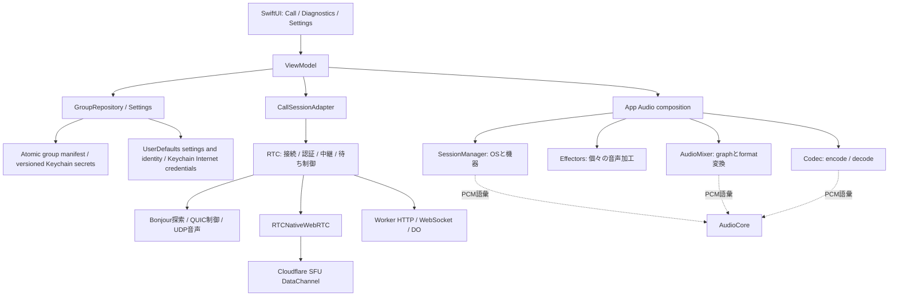
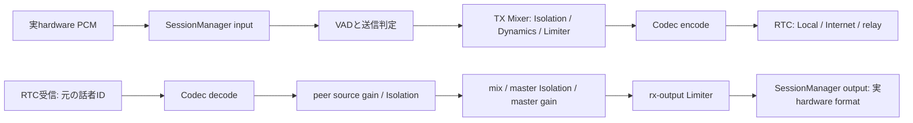

# アーキテクチャと文書の対応

## 文書の責務

| 読者の問い | 基準となる資料 | 変更の契機 |
|---|---|---|
| アプリが何を満たす必要があるか | [製品要求](../requirements/製品要求.md)、[パッケージ要求](../requirements/パッケージ要求.md) | 利用者の要求・受け入れ条件・package責務の変更 |
| どう作り、どう記録するか | [開発方針](../policies/開発方針.md)、[文書作成規約](../policies/文書作成規約.md)、[ログ記録規約](../policies/ログ記録規約.md) | 工程・設計・記録の制約の変更 |
| どこで何を操作し、どう変わるか | [使い方](../manual/使い方.md)、[設定と効果](../manual/設定と音声効果.md)、[状態の見方](../manual/状態の見方.md) | UI操作・既定値・反映・保存の変更 |
| 誰が処理・状態を所有するか | 本書、Appの各仕様、[package統合仕様](packages/Overview.md) | 責務境界・API・lifecycleの変更 |
| packageへ何を渡すか | Appの[Configuration](App/Configuration/設定値一覧.md)とBindings | Appの選択・固定値・導出値の変更 |
| package単体で何が可能か | `spec/packages` | package自身の契約変更。Appの採用設定と区別 |
| サーバーで何を許可・制限するか | [Worker](server/Worker.md)、[Cost](../development/Cloudflare費用試算.md) | API・資格・利用枠・費用仮定の変更 |
| どう開発し再検証するか | [開発環境](../development/開発環境.md)、[自動検証](../development/自動検証.md) | build・editor・検証入口の変更 |
| 何をどの条件で確認したか | [検証状況](../validation/README.md)、`validation/history` | 実行結果の追加。過去の成功を現行保証へ流用しない |

本書とspec配下は現在の実装を記述する。目的と統一方針は要求、これから作るものは[課題](../backlog/README.md)、確認待ちと結果は[検証](../validation/README.md)へ分ける。

## 仕様の分類と所有者

| 変えたい契約 | 編集する文書 | 境界で照合するもの |
|---|---|---|
| 構造・依存・寿命 | 本書の[構成と依存方向](#構成と依存方向)、[音声・通信の所有境界](#音声通信の所有境界) | 生成・停止する側、状態の所有者、呼出方向 |
| プラグインと内部インターフェイス | [package統合](packages/Overview.md)から各packageの能力・入力・結果・失敗へ。Appが選ぶ値は[Bindingsの例](App/Configuration/Bindings/Audio/Effectors/SoundIsolation.md) | 交換可能なbackend・node・codecに共通する契約と方式固有の制約 |
| 保存・復元 | [設定の永続化](App/Configuration/設定値一覧.md#永続化される値)、[グループの永続化](App/通信仕様.md#永続化と入力検証の所有) | 所有範囲、書込・確定時点、旧形式、読込失敗・再開時の結果 |
| 通信・外部サービス | [Appの通信](App/通信仕様.md)、[RTC](packages/RTC.md)、[Worker](server/Worker.md) | 送受信の形式・認可・順序・再試行時の結果 |
| ログ・診断 | [Appの発行イベント](App/ログ仕様.md#発行イベント)、[記録できる情報](../policies/ログ記録規約.md)、[Diagnostics](App/UI/Diagnostics.md) | 発行者、観測可能な事実と欠測、秘匿項目、表示が読む値 |
| 画面・状態遷移 | [画面項目定義](App/UI/画面項目定義.md)、[画面・状態遷移](App/UI/画面・状態遷移.md) | 操作可能条件、ユーザー操作、表示・復帰、呼び出す機能の結果 |

背景と利用者側の結果は[用途別のストーリーマップ](../requirements/README.md#用途別のストーリーマップ)から逆引きできる。

## 構成と依存方向

RTCはAudio packageやDSPに依存しない。Appはpackageの生成・接続・設定・寿命を調整し、package内の音声加工や経路制御を複製しない。動的plugin loaderは設けず、既存のnode / backend / route factoryを差し替え口とする。

## 実ディレクトリと仕様

| 実装 | 所有するもの | 対応文書 |
|---|---|---|
| [App](../../RideIntercom/App) | 起動、deep link、ログbootstrap | [通信](App/通信仕様.md)、[ログ](App/ログ仕様.md) |
| [UI](../../RideIntercom/UI) | SwiftUIの入力と表示 | [画面一覧](App/UI/画面項目定義.md)、[デザイン](../design/デザインシステム.md) |
| [ViewModel](../../RideIntercom/Intercom/ViewModel) | group選択とactive接続、音声lifecycle、非同期世代、package report | [状態遷移](App/UI/画面・状態遷移.md)、[音声](App/音声処理仕様.md) |
| [Groups](../../RideIntercom/Intercom/Groups) | domain/招待、snapshot、file lockとatomic replace、versioned key、旧形式の読込、GroupRepositoryによるcommitと復旧。member枠と保存済みユーザーへ本人・端末を束縛する規則は`GroupIdentityBinding`がgroup・検証済みidentity・接続中memberだけから判定し、GroupRepositoryは結果のcommitだけを行う | [通信](App/通信仕様.md)、[利用手順](../manual/使い方.md) |
| [Invitations](../../RideIntercom/Intercom/Invitations) | 個人招待の受け渡しsession、表示中の招待、候補の名前。招待リンクを受け取れなかった理由は`InviteRejection`が1回分類し、画面の文とログの理由は同じ分類から出す | [通信](App/通信仕様.md)、[招待受理の失敗](App/UI/共通画面遷移.md#招待受理の失敗と再試行) |
| [Settings](../../RideIntercom/Intercom/Settings) | UserDefaults / Keychain、希望値 | [設定値](App/Configuration/設定値一覧.md) |
| [Audio composition](../../RideIntercom/Intercom/Audio) | graph組立、codec/RTC境界、VAD送信判定、callback寿命 | [音声](App/音声処理仕様.md)、[AppからMixerへ渡す値](App/Configuration/Bindings/Audio/AudioMixer.md) |
| [Transport adapter](../../RideIntercom/Intercom/Transport) | App portとevent、bounded command queue、単一worker、RTC factoryへの入力、App固有dataとイベント変換 | [通信](App/通信仕様.md)、[RTCへの設定](App/Configuration/Bindings/RTC.md) |
| [Diagnostics](../../RideIntercom/Intercom/Diagnostics) | package reportを画面用に要約 | [Diagnostics](App/UI/Diagnostics.md)、[状態の見方](../manual/状態の見方.md) |
| [AudioCore](../../RideIntercom/packages/Audio/AudioCore) | PCM型、format、measurement、report語彙 | [AudioCore](packages/Audio/AudioCore.md) |
| [AudioMixer](../../RideIntercom/packages/Audio/AudioMixer) | source/sink/bus、format変換、音量、node実行、予約上限 | [AudioMixer](packages/Audio/AudioMixer.md) |
| [SessionManager](../../RideIntercom/packages/Audio/SessionManager) | OS audio session、機器、入出力、runtime event | [SessionManager](packages/Audio/SessionManager.md) |
| [Codec](../../RideIntercom/packages/Audio/Codec) | codec availability、符号化・復号、fallback | [Codec](packages/Audio/Codec.md) |
| [Effectors](../../RideIntercom/packages/Audio/Effectors) | VAD / Dynamics / Limiter / Isolationの個別処理 | [VADGate](packages/Audio/Effectors/VADGate.md)、[Dynamics](packages/Audio/Effectors/DynamicsProcessor.md)、[Limiter](packages/Audio/Effectors/PeakLimiter.md)、[Isolation](packages/Audio/Effectors/SoundIsolation.md) |
| [CallControl](../../RideIntercom/packages/CallControl) | App・Widget・Watch操作で共有する通話世代の参照と形式。Appが世代と操作可否を所有 | [通話操作の参照](packages/CallControl.md) |
| [RTC](../../RideIntercom/packages/RTC) | Local / WebRTC、認証、暗号化、再接続、中継、順序・鮮度 | [RTC](packages/RTC.md) |
| [server](../../server) | SFUの制御、端末認証、部屋、lease、利用枠 | [Worker](server/Worker.md)、[費用](../development/Cloudflare費用試算.md) |
| [scripts](../../scripts) | build、検証、WebRTC更新、資格発行、費用試算 | [自動検証](../development/自動検証.md)、[WebRTC更新](../development/BuildWebRTC/WebRTCビルドスクリプト.md) |

通話関係の自動保存では、`GroupRepository` が端末内の確定済みデータから候補を選び、`CallRelationshipBackup` が内容の検査を受け持つ。自動保存の進行は `CallRelationshipBackupSync` が管理し、CloudKitの読込・書込に必要なJSON変換は保管先が担当する。`AppCallOwner` は現在の通話モデルを自動保存へつなぎ、`CloudKitCallRelationshipBackupSession` がiCloudアカウントの切替を扱う。[復元候補の作成・保存](App/通信仕様.md#保存データから通話関係の復元候補を作る)

通話関係の復元では、`CloudKitCallRelationshipBackupSession` が現在の保管先と照合先を確かめる。個別通話の宛先の判定は、要求作成と復元前のどちらも `CallRelationshipBackup` に置く。復元の呼出元は通話先ごとの要求・応答・参加情報を一組にして渡す。`GroupRepository` はその組で通話鍵を検査し、参加情報を新端末用に組み立てる。最後に相手一覧・通話先・鍵の参照をまとめて保存する。[復元の保存条件](App/通信仕様.md#新端末に確認済みの通話関係を保存する)

1人ずつ個別通話を復元する経路では、`GroupRepository` が現在の保存と削除済みの個別通話IDを基準に追加を許可する。相手の削除と復元の判定で同じ個別通話IDを使う。Appの通話モデルは確定した通話先だけを一覧に追加し、進行中の通話の状態を保つ。[個別通話の追加条件](App/通信仕様.md#新端末に確認済みの通話関係を保存する)

通常グループの照合先では、`CloudKitCallRelationshipBackupSession` がiCloudの現在の候補を読み、`GroupRepository` が端末内の所属と現在の鍵を同じロックの下で確認する。個別通話と同じ署名・暗号化処理で、確認と新端末宛ての鍵を組み合わせた `CallRelationshipRestoreResponse` を作る。[通常グループの応答条件](App/通信仕様.md#通常グループの照合先が現在の通話鍵を暗号化する)

通常グループの参加情報は、照合先が `GroupRestoreMembership` に入れて鍵と一緒に暗号化する。受け取った端末はこの情報を検証し、当人のiCloud候補から名前と招待経緯を読み直す。`GroupRepository` が削除・退出と同じ保存で復元を拒否するIDを記録し、受信側の保存でも確認する。[新端末での保存](App/通信仕様.md#新端末に確認済みの通話関係を保存する)

個別通話の復元では、Workerの回収応答の解釈を `InternetAccountClient` に置く。回収成功とHTTP 404はどちらも中継メッセージが受信箱からなくなった結果となる。要求の応答後、選択を記録しない試験用の復元後、選択を保存した新端末での再開時は、この同じ回収操作を使う。端末内に残す記録と回収できる時点は、それぞれの復元処理が判断する。[回収の条件](App/通信仕様.md#通話鍵の保存後に応答の回収を続ける)

個別通話の復元で使う[Workerの一時中継](server/Worker.md#個別通話の復元で暗号文を一時中継する)では、HTTPの入口が送信の署名を検査し、宛先の `UserAccount` がセッションを照合する。宛先ごとの保管・重複・再読込の判定は `AccountDirectRestoreRelay` が担当する。通話関係の照合、参加資格の判断、鍵の復号はAppが担当する。中継はローカルの試験で有効にする。

## 音声・通信の所有境界

| 境界 | 不変条件 |
|---|---|
| format | hardware実format、Mixer 48kHz mono、RTC選択48/24/16kHz monoを区別し、Mixerで明示変換 |
| 話者 | 個別音量・effectはorigin peer ID。経路や中継者が変わっても同じ話者として扱う |
| 中継 | 符号化済み音声をRTCで転送。中継者の音声graphへ戻して再加工しない |
| 転送 | 音声は順序待ち・再送なし、制御はreliable。App/RTC/PCM予約に上限・期限。100msは各境界の期限で総遅延の保証ではない |
| VAD | Mixer nodeではなく入力の発話分析と送信判定。runtime reportとMixer effect chainを混同しない |
| 音声停止 | 機器消失では自分の送受話を止め、接続・他者中継を維持。明示Resumeまで戻さない |
| group選択 | selectedGroupとactiveGroupIDを分離。他group閲覧は通話を終了しない |
| 手動設定 | route変更・資格保存成功は明示切断。自然な経路消失時の継続と区別 |

## 拡張時の変更単位

| 変更 | 先に更新・検証するもの | 次に追従するもの |
|---|---|---|
| 新しいroute / backend / Effector / codec | 対応package仕様、実装、単体・契約テストを独立commit | AppのBindings、composition、UI、マニュアル、統合テスト |
| UI / 既定値 / 保存方式 | App仕様・実装・テスト | 課題・検証の状態、設定と効果、操作手順 |
| Worker API / 利用枠 | WorkerとRTCの契約・ペア試験 | 端末設定と運用手順、費用の前提 |
| 文書移動 | 移動対応・全文保持・相対リンク | READMEの導線、コード対応、文書自動検査 |

共通基盤の責務方針は[パッケージ要求](../requirements/パッケージ要求.md)、現行APIは対応するpackage仕様に従う。実装変更の計画は課題、確認待ちは検証へ置く。

## 大きな実装の責務分解

| 領域 | 分解後の所有者 | 保持する境界 |
|---|---|---|
| AudioMixer | MixerModels、AudioMixer graph owner、MixerBus、MixerPCMPorts、MixerPCMNormalizer | 既存public API、graphの所有と排他、format変換、callback寿命。独立packageや新しい抽象層は増やさない |
| SessionManager | `SessionModels`、`SessionManager`、`SystemAudioSessionBackend`とOS別extension、VoiceProcessing、入出力stream owner/backend/PCM helper | OS差分をbackendへ閉じ込める。session/input/outputの排他・公開APIは維持 |
| Diagnostics | DiagnosticsInputの値snapshot → Transmit/ReceivePipelinePresentationの純粋な導出 → Live画面とPipeline/Receive部品 | ViewModelを子へ丸ごと渡さず必要な値だけ渡す。新しいObservable ViewModelや二重状態を作らない |
| Appテスト | 各領域のsuite（`AudioPipeline`、`CallLifecycle`、`GroupLifecycle`、`Diagnostics`、`Settings`、`TransportAdapter`、`Architecture`）。保存・queueは専用suite | 共通backend・Harness・gateはSupport。既存の直列実行とactor隔離、assertionを保持 |

画面表示の入力、永続identity、通話runtime、package処理を別の責務として扱う。ファイルの行数だけを理由にservice/repository層を追加せず、変更理由と資源所有者が分かれる場所で切る。
